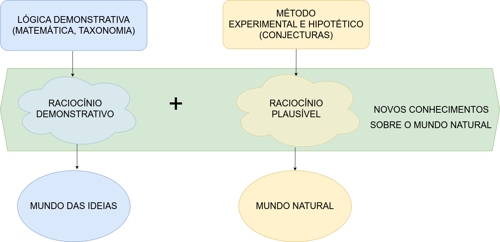
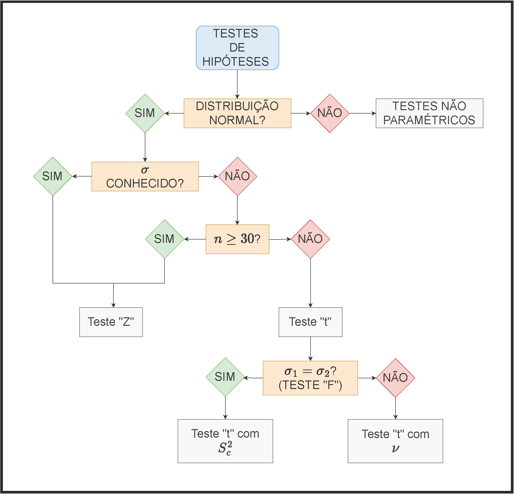
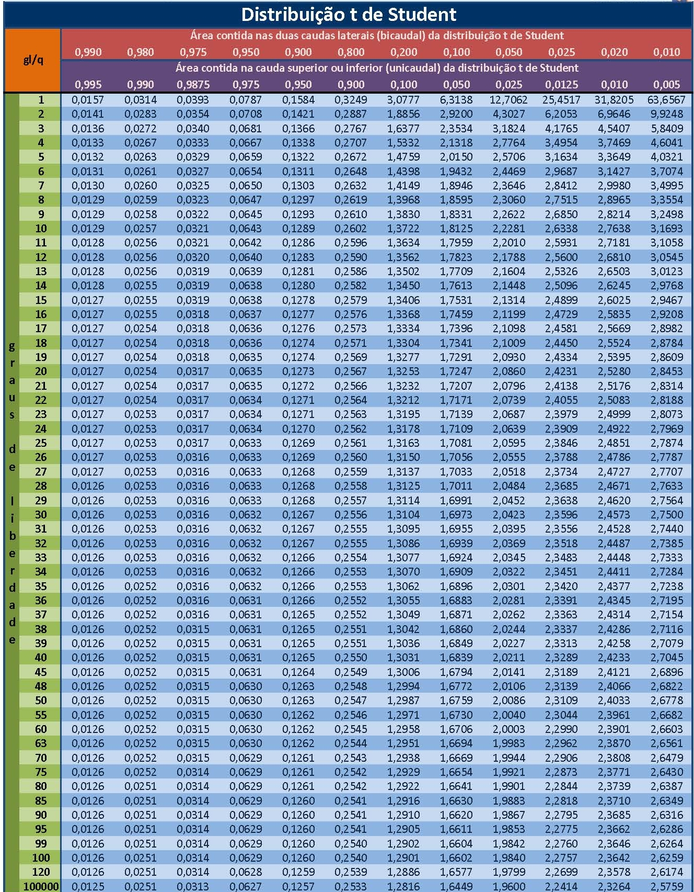
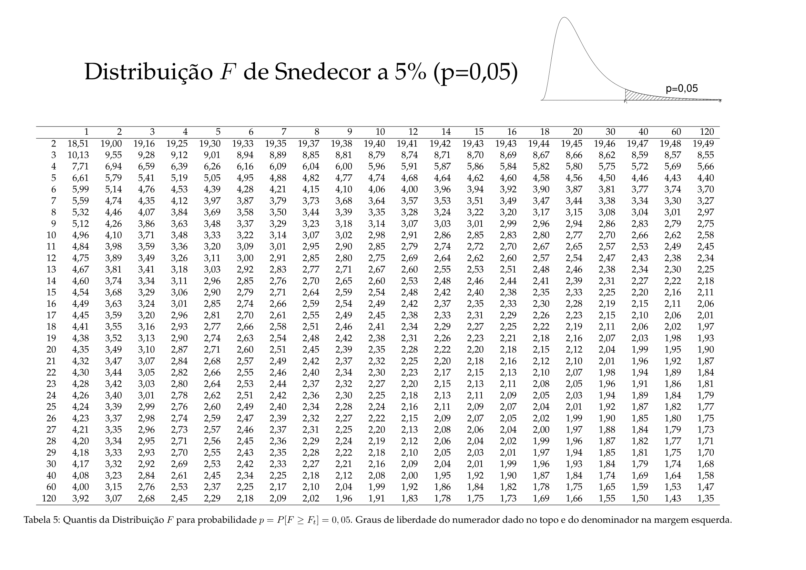
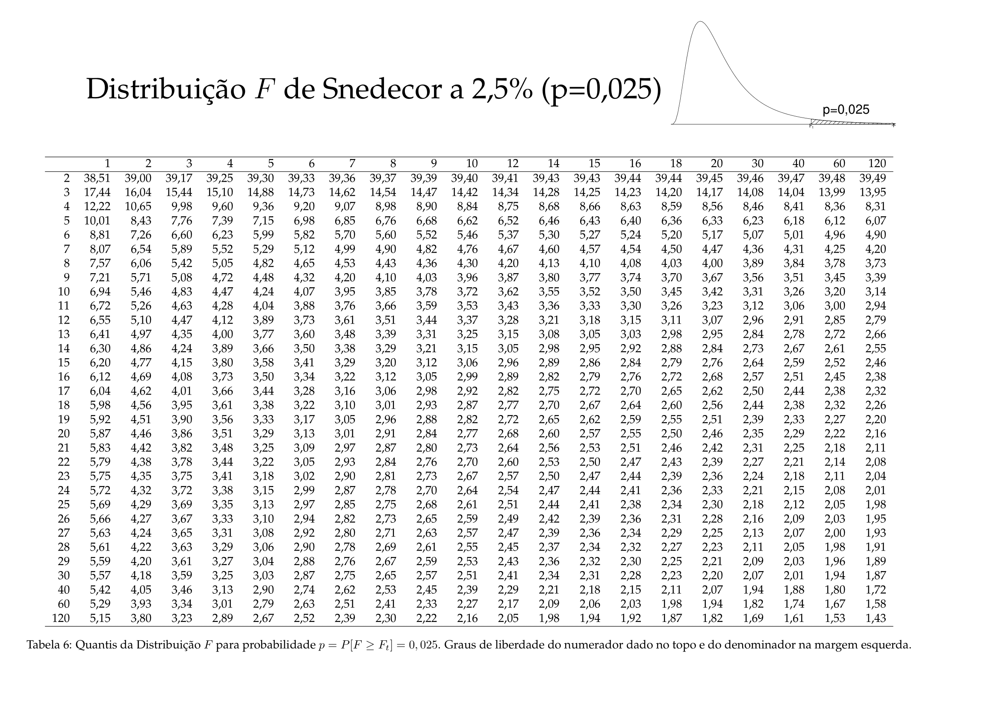
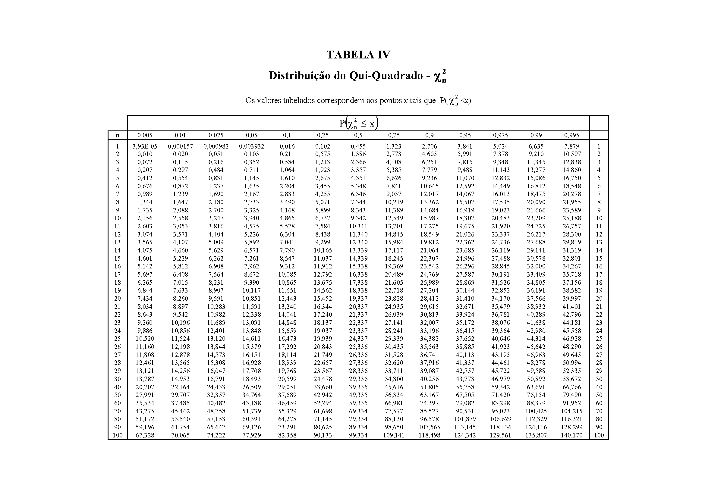
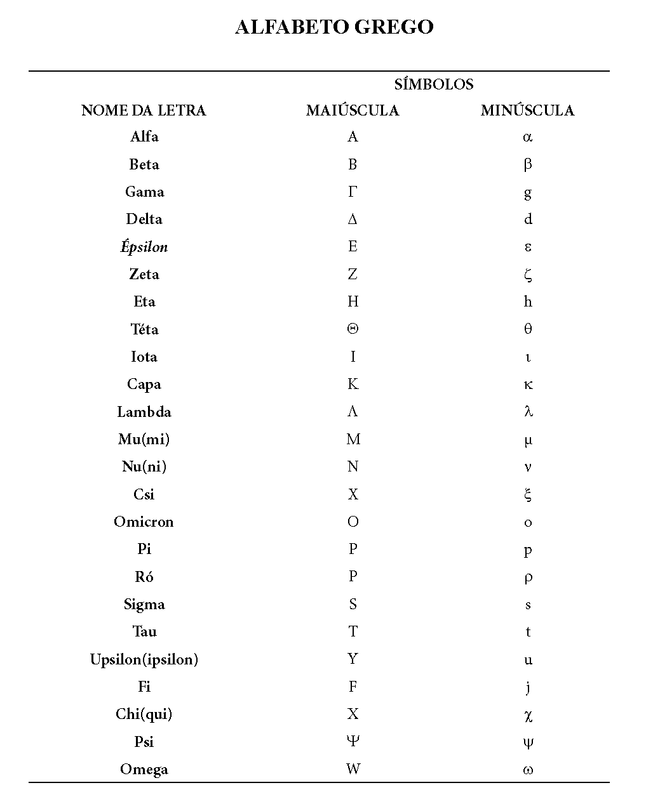

---
output:
  html_document: default
  pdf_document: default
---
```{r, echo=FALSE, include=FALSE}
colFmt <- function(x,color) {
  
  outputFormat <- knitr::opts_knit$get("rmarkdown.pandoc.to")
  
  if(outputFormat == 'latex') {
    ret <- paste("\\textcolor{",color,"}{",x,"}",sep="")
  } else if(outputFormat == 'html') {
    ret <- paste("<font color='",color,"'>",x,"</font>",sep="")
  } else {
    ret <- x
  }

  return(ret)
}

#uso>>>> `r colFmt("REG",'red')`, 


```


```{r , echo = FALSE, include=FALSE}
library(texPreview)
library(kableExtra)
library(knitr)
library(ggplot2)
knitr::opts_chunk$set(echo = TRUE)
library(showtext)
font_add_google('Noto Sans')
showtext_auto()
library(formatR)


```

\

# Introdução a testes de hipóteses{#introducao-a-testes-de-hipoteses}

\

## Filosofia da ciencia (teoria do conhecimento, epistemologia)

\


>Estritamente falando, todo o conhecimento fora da matemática, da lógica demonstrativa (um ramo da mesma) e da taxonomia encontra-se fundamentado em hipóteses (naturalmente há inúmeros tipos de hipóteses, mas as que estamos a nos referir são altamente confiáveis, como as expressas em certas leis gerais da física e da química como, por exemplo, a Lei de Hooke as Leis de Kepler dentre tantas outras).

\

O *raciocínio lógico demonstrativo* permeia as ciências até onde a matemática lhe suporta; todavia, em si (assim como também a matemática), é incapaz de gerar novos conhecimentos sobre o mundo que nos rodeia.

\

> O _método lógico demonstrativo_ é próprio para objetos que existem apenas _idealmente_, que são construídos inteiramente pelo nosso pensamento. 

\

> O _método hipotético experimental_ é próprio das ciências naturais  (física, química, biologia, etc.), que observam seus objetos e realizam experimentos.

\


```{r , echo=FALSE, out.width='80%', fig.align='center', fig.cap='Método demonstrativo e Método experimental hipotético (George Polya, 1954) '}


```

\

_Hipotético_ porque os cientistas partem de hipóteses sobre os objetos que guiam os experimentos e a avaliação dos resultados e _experimental_ porque se baseia em observações e em experimentos, tanto para formular quanto para verificar as teorias. 

\

O método hipotético experimental pode ser indutivo (fatos $\to$ lei geral) ou dedutivo  (lei geral $\to$ fatos): 

\

> Hipotético-indutivo porque o cientista observa inúmeros fatos variando as condições da observação; elabora uma hipótese e realiza novos experimentos (ou induções) para confirmar ou negar a hipótese; se esta não for negada, chega-se à lei do fenômeno estudado.

\

> Hipotético-dedutivo porque tendo chegado à lei, o cientista pode formular novas hipóteses, deduzidas do conhecimento já adquirido, e com elas prever novos fatos, ou formular novas experiências, que o levam a conhecimentos novos.


\


Em muitos processos de investigação científica, o pesquisador formula perguntas que deverão ser apropriadamente respondidas a partir de dados coletados. Em geral, essas perguntas envolvem medidas (valores centrais, variabilidade, proporções) calculadas em uma ou mais amostras e consistem em:

\

- comparar uma medida obtida em uma amostra a um valor de referência (por exemplo, um padrão técnico, uma especificação ou um valor histórico); ou,  
- comparar medidas obtidas em diferentes amostras, submetidas, por exemplo, a diferentes métodos, tratamentos ou produtos.
\


```{r , echo=FALSE, out.width='40%', fig.align='center', fig.cap='Método experimental hipotético'}


```

\

Uma hipótese é uma conjectura racional feita após um grande número de observações e experimentos; é uma tese que precisa ser confirmada ou verificada por meio de novas observações e experimentos. 


\


Uma hipótese estatística é uma suposição feita sobre uma determinada característica de interesse de uma população sob estudo (um parâmetro) que subsiste (perdura, sobrevive, permanece incontestável) até que alguma informação sobre essa população seja estatisticamente significativa para contradizê-la.


\

> ``A ciência não consegue provar coisa alguma. Ela pode apenas refutar as coisas'' (Karl Popper)

\

> Uma teoria científica é, portanto, transitória. Uma conjectura temporariamente sustentada que um dia poderá ser refutada e substituída por outra. Conclusões baseadas em raciocínios plausíveis são provisórias, ao contrário daquelas produzidas por raciocínios lógico demonstrativos. 

\


>Um teste de hipóteses refere-se, portanto, a um método quantitativo subsidiário em processos de decisão, baseado na inferência estatística e de ampla aplicabilidade na experimentação e pesquisa; virtualmente, em qualquer área do conhecimento.  


\

## História


\

```{r fig67, echo=FALSE, out.width='40%', fig.align='center', fig.cap='Oriatrike or, physick refined. The common errors therein refuted, and the whole art reformed and rectified: being a new rise and progress of phylosophy and medicine, for the destruction of diseases and prolongation of life (p. 526)'}


```

\

Antigas referências relativas a testes de valores remontam a séculos atrás. Historicamente podemos retroceder a 1662, quando o médico flamengo Jean Baptista Van Helmont escreveu um desafio (*aposta de 300 florins*) em seu livro (Figura \@ref(fig:fig67)), sobre um _procedimento teste_ que consistiria em se dividir 200 ou 500 pacientes com febre e pleurite em dois grupos iguais e aplicar a eles diferentes tratamentos: os habitualmente adotados pelos médicos da época e os seus próprios métodos. Ao final de um período de tempo (não foi especificado) verificar quantos _funerais_ ocorreriam num e no outro (o livro foi publicado após sua morte, ocorrida em 1644, e não se tem registro sobre sua realização efetiva). 

\

```{r fig68, echo=FALSE, out.width='40%', fig.align='center', fig.cap='Tratamento mais utilizado à época (sangria)'}


```


\

```{r arbuthnot, echo=FALSE, out.width='40%', fig.align='center', fig.cap='John Arbuthnot, FRS (1667-1735)'}


```


\


Outro registro histórico é o artigo publicado em 1710 na _Royal Society's Philosophical Transactions_ pelo médico escocês John Arbuthnot (1667-1735, Figura \@ref(fig:arbuthnot)): _An argument for Divine Providence_ [(link)](https://royalsocietypublishing.org/doi/pdf/10.1098/rstl.1710.0011). 

\

Este artigo foi um marco na história da estatística; em termos modernos, ele realizou testes de hipóteses estatísticas, calculando o p-valor através de um teste de sinais e interpretou-o como estatisticamente significante e assim rejeitou a hipótese nula. Isso é creditado como "[...] o primeiro uso de testes de significância [...]" ( _in_ "Estatísticos do século", David Bellhouse, 2001).


\


O pensamento estatístico da primeira metade do século XX tem seu interesse voltado à solução dos problemas de testes de hipóteses e sua formulação e filosofia, tal como hoje são conhecidos, foi em grande parte estruturado por [K. Pearson (On the criterion...,1900)](https://www.tandfonline.com/doi/abs/10.1080/14786440009463897), [W. Gosset (The Probable Error of a Mean, 1908)](https://www.jstor.org/stable/2331554?origin=crossref), [R. Fisher (Statistical Methods for Research Workers, (1925)](https://psychclassics.yorku.ca/Fisher/Methods/), [E. Pearson e J. Neyman (On the use and interpretation of certain test criteria for purposes of statistical inference, 1928)](https://www.jstor.org/stable/2331945) e [E. Lehmann (Testing Statistical Hypotheses, 1959)](https://gwern.net/doc/statistics/decision/1959-lehmann-testingstatisticalhypotheses.pdf) (Figura \@ref(fig:fig69)).  


\


```{r fig69, echo=FALSE, out.width='50%', fig.align='center', fig.cap='Personagens históricos'}


```


\	

Uma pequena digressão.Em 1933 Karl Pearson  se aposentou com professor da *University College London* e diretor do Laboratório Galton de eugenia. Apesar das objeções de Fisher, o laboratório de estatística foi dividido em dois departamentos. O Departamento de estatística (criado em 1911, o primeiro do gênero em uma universidade), assumido pelo filho único de Karl, Egon; e o Laboratório de eugenia, assumido por seu sucessor na cadeira de Eugenia, Ronald Fisher. O artigo de Henry F. Inman (*Karl Pearson and R. A. Fisher on Statistical Tests: A 1935 Exchange From Nature*, 1994) registra uma intensa troca de correspondências entre Fisher e Pearson tendo por assunto suas diferenças conceituais matemáticas e estatísticas, pela contrariedade de Pearson ante a continuidade de Fisher em lecionar teoria estatística e até mesmo por espaço físico para os experimentos científicos de Fisher, ao remover material do Museu de eugenia deixado por Pearson. 

\	

## Conceitos Essenciais 

\

Testes de hipóteses nos fornece elementos auxiliares no processo da tomada de decisão sob um *prisma probabilístico*, na *rejeição* ou *não rejeição* de uma *conjectura (hipótese)* postulada sobre um *parâmetro* (desconhecido) da população estudada. Esta decisão é baseada na informação disponível, obtida a partir de uma amostra, que se recolhe da população. 


\

Muitos estatísticos têm cautela e não adotam a expressão *aceitar* uma hipótese preferindo, no lugar, empregar a expressão *não rejeitar* a hipótese. Por que a distinção entre *aceitar* e *não rejeitar*?

\

>Empregar a expressão *aceitar* pode levar a uma uma pré-concepção de que a hipótese propugnada é *universalmente (sempre) verdadeira*. Adotando-se a expressão *não rejeitar* salienta-se que a informação trazida pela amostra não foi *suficientemente robusta (conclusiva)* para que pudéssemos abandonar essa hipótese em favor de uma outra.


\

>A eterna analogia. Um *teste de hipóteses* guarda uma certa semelhança a um julgamento. Caso não haja indício forte o suficiente que comprove a culpa do acusado ele é declarado *não culpado* e não *inocente*.

\

No contexto estatístico, os *indícios* que nos levam a rejeitar ou não uma hipótese provêm basicamente da informação trazida por uma amostra. 

\


### Hipóteses

\

Recomendações gerais:

\

- o pesquisador deve *delimitar* o objeto de sua pesquisa;  
- uma *boa hipótese* deve ser baseada em uma *boa pergunta* sobre o objeto do estudo;
- deve ser *simples e específica*; 
- deve ser formulada na *fase propositiva* da pesquisa e *não após a coleta de dados* (*post hoc*);
- enunciar as hipóteses: as hipóteses são apresentadas de tal maneira que sejam *mutuamente exclusivas* (o que afirmado por uma deve ser contradito pela outra);   
- as hipóteses são comumente denominadas por hipótese nula ($H_{0}$) e hipótese alternativa ($H_{1}$);
- a hipótese nula ($H_{0}$) que será testada sob um nível de significância ($\alpha$) é, em geral, de concordância com o parâmetro que se estuda da população (conservadora) e baseada em conhecimento prévio; 
- a hipótese alternativa ($H_{1}$) é contrária, oposta, antagônica à hipótese nula (novadora).


\

$$
\begin{cases}
	H_{0}: \text{[parâmetro testado]} = \text{[valor inferido]}\\
	H_{1}: \text{[parâmetro testado]} \ne \text{[valor inferido]}\\
\end{cases}
\\
\text{ou}
\\
\begin{cases}
	H_{0}: \text{[parâmetro testado]} \ge \text{[valor inferido]}\\
	H_{1}: \text{[parâmetro testado]} < \text{[valor inferido]}\\
\end{cases}
\\
\text{ou}
\\
\begin{cases}
	H_{0}: \text{[parâmetro testado]} \le \text{[valor inferido]}\\
	H_{1}: \text{[parâmetro testado]} > \text{[valor inferido]}\\
\end{cases}
$$


\

> ``Em relação a qualquer experimento, podemos referir-nos a esta hipótese como a *hipótese nula*, e deve-se notar que a *hipótese nula* nunca é provada ou estabelecida, mas é *possivelmente refutada* no decorrer da experimentação. Todo experimento pode ser considerado como existindo apenas para dar aos fatos uma chance de *refutar a hipótese nula*.'' (*The Design of Experiments*, Ronald Aylmer Fisher,  1935, p. 19)

\

*Inicialmente* a hipótese nula ela é *assumida* como verdadeira para, a seguir, ser confrontada com *evidências amostrais* e se testar sua sustentabilidade. Caso a *informação amostral* não seja robusta o suficiente, tudo o que pode ser feito é se decidir por sua manutenção: *falha-se* na tentativa de se derrubar a hipótese nula. 


\

### Natureza dos erros 

\

Teste de hipóteses nos permitem associar um *nível de significância* ($\alpha$) como medida da probabilidade do erro que se pode incorrer ao se concluir pela *rejeição* de uma *hipótese verdadeira*, na tomada de decisão. 

\

Outra pequena digressão: Dizem que os estatísticos não se perguntam qual a probabilidade de estarem *certos*, mas sim qual a probabilidade de estarem *errados*.

\


> Nível de significância ($\alpha$) é estabelecido pelo pesquisador *antes* do experimento ser realizado e corresponde à medida da probabilidade do risco que se deseja incorrer de se "rejeitar" uma hipótese nula verdadeira.

\

Pelo complementar: 
	
\	

> Nível de confiança ($1-\alpha$) é a medida da probabilidade associada a "não rejeitar" uma hipótese nula verdadeira.

\


Para introduzir os conceitos relacionados aos erros em testes de hipóteses considere uma situação onde uma empresa produz lâmpadas e a vida útil, em horas, dessas lâmpadas segue uma distribuição Normal com média 1.600 h e desvio padrão 120 h, isto é, $VU \sim N (\mu = 1600; \sigma = 120)$.

\

Se *não* temos conhecimento algum sobre a real vida útil média dessas lâmpadas e *alguém nos afirma que a vida útil é de 1.600 h*, o procedimento científico para confirmar se essa afirmação é confiável é realizar-se um teste de hipóteses:

\

$$
\begin{cases}
	H_{0}: \mu = 1600 \text{ h}\\
	H_{1}: \mu \ne 1600 \text{ h}\\
\end{cases}
$$

\

Inicialmente extraímos uma amostra. Usando conceitos explicados em uma unidade anterior podemos determinar o tamanho amostral em função de:

\

- um erro máximo tolerado: $\varepsilon$=20 horas;
- um nível de significância estabelecido: $\alpha$=0,05; e,
- alguma informação sobre a medida da variabilidade da variável em estudo: $\sigma$=120 horas (no caso, o desvio padrão populacional).

\

$$
n = \left( \frac{z_{\alpha/2} \cdot \sigma}{\varepsilon} \right)^{2} = \left( \frac{1{,}96 \times 120}{20} \right)^{2} = (11{,}76)^{2} \approx 138{,}3
$$

\

Como o tamanho amostral deve ser um número inteiro, arredonda-se sempre para cima, de modo a garantir que o erro não ultrapasse $\varepsilon$. Adotou-se $n$ = 140. 


\


>Os cenários a seguir foram criados apenas para tentar estabelecer um paralelo entre a probabilidade de se obter *médias amostrais muito extremas*, destoantes da *média populacional* e uma *inclinação* ou *não* em se rejeitar uma afirmação. No scatterplot a seguir vemos a flutuação das médias amostrais quando simulamos 100 amostras.

\


```{r, warning=FALSE, echo=FALSE}

IC.Na = function (N, n, mu0, mu, sigma, conf, er) {
  dados=data.frame()
  plot(0, 0, 
       type="n", 
       xlim=c(mu0-0.05*mu0,mu0+0.05*mu0), 
       ylim=c(0,N), 
       bty="l",
       xlab="Vida útil em horas", 
       ylab="Amostras extraídas", 
       main=paste0("Scatterplot das médias obtidas de ", N,"amostras") , 
       sub=paste0("Os valores da vida útil seguem uma distribuição ~ N  (\u03bc:",mu," ; \u03c3:", sigma,")")
       )
  abline(v=mu0, col='blue', lwd=2, lty=2)
  abline(v=mu0-er, col='red', lwd=2, lty=2)
  abline(v=mu0+er, col='red', lwd=2, lty=2)
  if (mu != mu0) abline(v=mu, col='darkgreen', lwd=2)

  #axis(1, at = c(mu-1*mu, mu, mu+1*mu))
zc = qnorm(1-((1-conf)/2))
#sigma.xbarra = sigma/sqrt(n)
for (i in 1:N) {
  x = rnorm(n, mu, sigma)
  media = mean(x)
  erro= media-mu
  sd = sd(x)
  li = media - zc * sd/(sqrt(n))
  ls = media + zc * sd/(sqrt(n))
  rejeita = media > mu0+er || media < mu0-er
  decisao.errada = if (mu == mu0) rejeita else !rejeita
  temp=cbind(mu, media, erro, li, ls, rejeita, decisao.errada)
  dados=rbind(dados, temp)
  plotx = c(li,ls)
  ploty = c(i,i)
  #if (li > mu | ls < mu) lines(plotx,ploty, col="red", lwd=2, lend=0)
  #else lines(plotx,ploty, lend=0) 
   if (decisao.errada) {
     points(media, i, col="red", cex=1)
     text(y=i+3,x=media, labels=round(media,1), cex=1, col='red')
   }
  else 
    points(media, i, col="black", cex=1) 
} 
colnames(dados)=c("mu", "media", "erro", "li", "ls", "rejeita", "decisao.errada")
rotulos = c(paste0("H0: \u03bc = ", mu0), "decisão correta", paste0("decisão errada (", sum(dados$decisao.errada), " de ", N, ")"))
cores = c("blue", "black", "red")
if (mu != mu0) {
  rotulos = c(rotulos, paste0("\u03bc verdadeiro = ", mu))
  cores = c(cores, "darkgreen")
}
legend("topleft", bty="n", cex=0.8, legend=rotulos, col=cores,
       lty=c(2, NA, NA, 1)[seq_along(rotulos)], pch=c(NA, 1, 1, NA)[seq_along(rotulos)])
return(dados)
}
```

\


```{r, echo=FALSE, results='hide', warning=FALSE, out.width='90%', fig.align='center', fig.cap="Flutuação dos valores médios de diversas amostras extraídas de uma mesma população distribuição $\\sim N(\\mu; \\sigma)$, sendo $H_{0}$ verdadeira"}

N=100
n=140
mu0=1600
mu=1600
sigma=120
conf=0.95
er=20
set.seed(13)
IC.Na(N, n, mu0, mu, sigma, conf, er)

```

```{r, echo=FALSE}
fmt = function(x) format(round(x, 3), decimal.mark = ",")
ep = sigma/sqrt(n)
alfa.teorico = 2*(1 - pnorm(er/ep))
mu.real = 1630
beta.teorico = pnorm(mu0+er, mu.real, ep) - pnorm(mu0-er, mu.real, ep)
beta.1620 = pnorm(mu0+er, 1620, ep) - pnorm(mu0-er, 1620, ep)
```

\

Observa-se que algumas das amostras, numa *proporção* aproximadamente igual ao nível de significância estabelecido quando do dimensionamento (5\%), apresentam médias com valores que se afastam do valor médio populacional mais que o erro estabelecido (20 h). 

\


De fato, com $n$ = `r n`, a probabilidade de uma média amostral cair fora do intervalo de confiança pretendido [1.580; 1.620] h é `r fmt(alfa.teorico)`; a proporção observada varia de uma simulação para outra em torno desse valor.

\ 


> Considere que a sua *amostra em particular* é uma das que resultou numa média que *não se afastou* tanto do valor que lhe afirmaram (a vida útil das lâmpadas é de 1.600 h). Nessa situação, talvez você *não se convencesse* de que a vida útil média fosse *diferente daquilo que lhe informaram* e, assim, *não iria recusar a afirmação*.

\

> Agora considere que a sua *amostra em particular* é uma das que resultou em uma média que *se afasta muito* do valor que lhe afirmaram. Nessa nova situação, *certamente você iria suspeitar* que a vida útil média é *diferente daquilo que lhe informaram* e assim, *recusar a afirmação*.

\

Na primeira decisão, você **não recusou uma afirmação que era, de fato, verdadeira**; ao passo que na segunda, você **rejeitou uma afirmação que era verdadeira** (sempre lembrando que você **não** sabia que a vida útil média é, de fato, 1.600 h).

\


Percebe-se nitidamente assim que existem **dois tipos de erros** envolvidos em um teste de hipóteses.

\

> Um *erro do tipo I* ocorre quando o pesquisador *rejeita uma hipótese nula verdadeira*. A probabilidade (fixada *a priori*) de cometimento do *erro do tipo I* é chamada de *nível de significância* e, frequentemente, denotada pela letra grega $\alpha$.

\

> Um *erro do tipo II*  ocorre quando o pesquisador *não rejeita uma hipótese nula falsa*. A probabilidade de cometimento do *erro do tipo II* é frequentemente denotada pela letra grega $\beta$; seu complementar, $1-\beta$ (*poder do teste*).

\


```{=latex }
\begin{table}[h]
\centering
\caption{{\small Erros envolvidos em um teste de hipóteses}}
\begin{tabular}{p{5cm}p{5cm}p{5cm}}
\hline
\rowcolor{lightgray} Valor real do parâmetro & Não rejeitar & Rejeitar \\				
\rowcolor{lightgray} (desconhecido) & $H_{0}$ & $H_{0}$ \\
			\\[0.1cm]
\hline
		$H_{0}$ verdadeira & Decisão correta            & Erro do tipo I \\
			                         & probabilidade associada=$(1-\alpha$) & probabilidade associada= $\alpha$\\
\hline	                         
		$H_{0}$ falsa      & Erro do tipo II            & Decisão correta \\
			                         & probabilidade associada=$\beta$    & probabilidade associada =($1-\beta$)  \\
\hline
\end{tabular}
\end{table} 
```


```{r eval=knitr::is_html_output(), results = "asis", echo = FALSE, message = FALSE}

tex2markdown <- function(texstring) {
  writeLines(text = texstring,
             con = myfile <- tempfile(fileext = ".tex"))
  texfile <- pandoc(input = myfile, format = "html")
  cat(readLines(texfile), sep = "\n")
  unlink(c(myfile, texfile))
}

textable <- "
\\begin{table}[h]
\\caption*{{\\small Erros envolvidos em um teste de hipóteses}}
\\begin{tabular}{p{5cm}p{5cm}p{5cm}}
\\hline
\\rowcolor{lightgray} Valor real do parâmetro & Não rejeitar & Rejeitar \\\\				
\\rowcolor{lightgray} (desconhecido) & $H_{0}$ & $H_{0}$ \\\\
			\\\\[0.1cm]
\\hline
		$H_{0}$ verdadeira & Decisão correta            & Erro do tipo I \\\\
			                         & probabilidade associada = $(1-\\alpha$) & probabilidade associada =  $\\alpha$\\\\
\\hline	                         
		$H_{0}$ falsa      & Erro do tipo II            & Decisão correta \\\\
			                         & probabilidade associada = $\\beta$    & probabilidade associada  = ($1-\\beta$)  \\\\
\\hline
\\end{tabular}
\\end{table} 
"

tex2markdown(textable)
```


\

No quadro acima identificam-se:

\

- $\alpha$: é a probabilidade associada ao cometimento de um *erro do tipo I*: *rejeitar a hipótese nula sendo ela verdadeira*, conhecida como *nível de significância do teste*. 
- $\beta$: é a probabilidade associada ao cometimento de um *erro do tipo II*: *não rejeitar a hipótese nula sendo esta falsa*;
- (1-$\alpha$): é conhecido como *nível de confiança*, a probabilidade associada ao *não se rejeitar a hipótese nula quando ela é verdadeira*.
- (1-$\beta$): é conhecido como *poder do teste*, a probabilidade associada em se *rejeitar a hipótese nula quando ela é falsa*.

\

Na simulação anterior a hipótese nula era verdadeira ($\mu$ = 1.600 h); por isso, a única decisão errada possível era rejeitá-la (*erro do tipo I*). Para visualizar o *erro do tipo II* é preciso que $H_{0}$ seja falsa. Suponha agora que, sem que saibamos, a vida útil média real seja de `r mu.real` h, mantendo-se $\sigma$ = 120 h, $n$ = 140 e a mesma regra de decisão: rejeitar $H_{0}: \mu = 1600$ h sempre que a média amostral estiver fora do intervalo [1.580; 1.620] h.

\

```{r ,  out.width='90%', fig.align='center', fig.cap="Flutuação dos valores médios para diversas amostras, sendo $H_{0}$ falsa ($\\mu$ real = 1.630 h)", warning = FALSE, echo=FALSE, results='hide'}

mu.real=1630
set.seed(13)
IC.Na(N, n, mu0, mu.real, sigma, conf, er)

```

\

Agora as decisões erradas são as amostras cujas médias caem **dentro** do intervalo [1.580; 1.620] h: nelas não se rejeita uma hipótese nula falsa. A probabilidade desse erro é $\beta = P(1580 \le \bar{X} \le 1620 \mid \mu = 1630) \approx$ `r fmt(beta.teorico)` e, portanto, o poder do teste é $1-\beta \approx$ `r fmt(1-beta.teorico)`.

\

Note que, diferentemente de $\alpha$, o valor de $\beta$ não é fixado pelo pesquisador: ele depende do valor real (desconhecido) do parâmetro. Se a vida útil média real fosse de 1.620 h, teríamos $\beta \approx$ `r fmt(beta.1620)`: quanto mais próximo o valor real estiver do valor afirmado em $H_{0}$, mais difícil é detectar a diferença.


\

As duas simulações podem ser resumidas em um único gráfico, que sobrepõe a distribuição amostral da média sob $H_{0}$ ($\mu$ = 1.600 h) e sob o valor real ($\mu$ = 1.630 h). As linhas tracejadas delimitam a regra de decisão: médias fora do intervalo [1.580; 1.620] h levam à rejeição de $H_{0}$.

\

```{r, echo=FALSE, out.width='90%', fig.align='center', fig.cap="Distribuições amostrais da média sob $H_{0}$ e sob o valor real do parâmetro: áreas associadas a $\\alpha$, $\\beta$ e ao poder do teste ($1-\\beta$)"}

lc.inf = mu0 - er
lc.sup = mu0 + er
x = seq(mu0 - 4*ep, mu.real + 4*ep, length.out = 1000)
f0 = dnorm(x, mu0, ep)
f1 = dnorm(x, mu.real, ep)

area = function(de, ate, mu, ...) {
  xs = seq(de, ate, length.out = 200)
  polygon(c(de, xs, ate), c(0, dnorm(xs, mu, ep), 0), ...)
}

plot(x, f0, type = "n", bty = "l", ylim = c(0, max(f0, f1)*1.1),
     xlab = "Média amostral da vida útil (h)", ylab = "Densidade",
     main = paste0("Distribuições amostrais da média (n = ", n, ")"))
area(lc.inf, lc.sup, mu.real, col = "grey85", border = NA)
area(min(x), lc.inf, mu0, density = 20, angle = 45, col = "red", border = NA)
area(lc.sup, max(x), mu0, density = 20, angle = 45, col = "red", border = NA)
area(min(x), lc.inf, mu.real, density = 20, angle = -45, col = "darkgreen", border = NA)
area(lc.sup, max(x), mu.real, density = 20, angle = -45, col = "darkgreen", border = NA)
lines(x, f0, col = "blue", lwd = 2)
lines(x, f1, col = "darkgreen", lwd = 2)
abline(v = c(lc.inf, lc.sup), col = "red", lty = 2, lwd = 2)
text(mu0, max(f0)*1.05, bquote(H[0]: mu == .(mu0)), col = "blue")
text(mu.real, max(f1)*1.05, bquote(mu[real] == .(mu.real)), col = "darkgreen")
legend("topright", bty = "n", cex = 0.9,
       legend = c(bquote(alpha %~~% .(fmt(alfa.teorico))),
                  bquote(beta %~~% .(fmt(beta.teorico))),
                  bquote(1 - beta %~~% .(fmt(1 - beta.teorico)))),
       fill = c("red", "grey85", "darkgreen"), density = c(20, NA, 20), angle = c(45, 0, -45),
       border = c("red", "grey60", "darkgreen"))
```

\

Observe que $\alpha$ é uma área sob a curva de $H_{0}$, enquanto $\beta$ e $1-\beta$ são áreas sob a curva do valor real. Ao deslocar a curva verde para mais perto de 1.600 h, a área cinza ($\beta$) aumenta e o poder diminui; ao aumentar $n$, as duas curvas ficam mais estreitas, e $\beta$ diminui.

\


\

> Qual erro é o pior?

\

Não há resposta universal: a gravidade de cada erro depende do problema e, sobretudo, de *como a hipótese nula foi formulada*. Para comparar os erros, é preciso primeiro explicitar $H_{0}$.

\

**Exemplo 1: julgamento.** Considere $H_{0}$: o réu é inocente.

\

- *Erro do tipo I* (rejeitar $H_{0}$ verdadeira): condenar um inocente.
- *Erro do tipo II* (não rejeitar $H_{0}$ falsa): absolver um culpado.

\

Os sistemas jurídicos, em geral, consideram o erro do tipo I mais grave (*in dubio pro reo*) e, por isso, exigem evidência forte para condenar; em termos estatísticos, adota-se um $\alpha$ pequeno.

\

**Exemplo 2: diagnóstico de uma doença grave.** Considere $H_{0}$: o paciente não tem a doença.

\

- *Erro do tipo I* (falso positivo): tratar um paciente saudável, expondo-o a efeitos colaterais e a custos desnecessários.
- *Erro do tipo II* (falso negativo): deixar de tratar um paciente doente, o que pode levá-lo à morte.

\

Aqui o erro do tipo II é o mais grave. Por isso, testes de triagem costumam aceitar um $\alpha$ maior (mais falsos positivos, que serão depois descartados por exames confirmatórios) para reduzir $\beta$.

\

Os dois exemplos mostram por que o pesquisador fixa $\alpha$, a única probabilidade de erro que ele controla diretamente: sempre que possível, $H_{0}$ é formulada de modo que o erro do tipo I seja o de consequências mais graves. Quando isso não ocorre, como no diagnóstico, o próprio valor de $\alpha$ deve ser escolhido considerando o custo do erro do tipo II.

\

Recomenda-se, portanto, ao se usar dados para testar uma hipótese, avaliar com cuidado as consequências de cada tipo de erro. Vários autores sugerem detalhá-las em uma tabela como a abaixo.

\


```{=latex }
\begin{table}[h]
\centering
\caption{{\small Consequências da tomada de decisão face aos erros envolvidos}}
\begin{tabular}{p{5cm}p{5cm}p{5cm}}
\hline
\rowcolor{lightgray} $H_{0}$ explicada & Erro tipo I: rejeitar $H_{0}$ quando verdadeira & Erro tipo II: não rejeitar $H_{0}$ quando falsa \\	
\hline
O medicamento ``A`` não alivia a Condição ``B`` & O medicamento ``A`` não alivia a Condição ``B``, mas não é eliminado como opção de tratamento & O medicamento ``A`` alivia a condição ``B``, mas é eliminado como opção de tratamento\\
\hline	                         
Consequências  &  Pacientes com Condição ``B`` que recebem o Medicamento ``A`` não obtêm alívio. Eles podem experimentar piora da condição e/ou efeitos colaterais, até e incluindo a morte. A empresa produtora do medicamento pode enfrentar processos judiciais & Um tratamento viável permanece indisponível para pacientes com Condição ``B``. Os custos de desenvolvimento são perdidos. O potencial lucro pela produção do medicamento ``A`` pela empresa é eliminado. \\
\hline
\end{tabular}
\end{table} 
```


```{r eval=knitr::is_html_output(), results = "asis", echo = FALSE, message = FALSE}

tex2markdown <- function(texstring) {
  writeLines(text = texstring,
             con = myfile <- tempfile(fileext = ".tex"))
  texfile <- pandoc(input = myfile, format = "html")
  cat(readLines(texfile), sep = "\n")
  unlink(c(myfile, texfile))
}

textable <- "
\\begin{table}[h]
\\caption*{{\\small Consequências da tomada de decisão face aos erros envolvidos}}
\\begin{tabular}{p{5cm}p{5cm}p{5cm}}
\\hline
\\rowcolor{lightgray} $H_{0}$ explicada & Erro tipo I: rejeitar $H_{0}$ quando verdadeira & Erro tipo II: não rejeitar $H_{0}$ quando falsa \\\\
\\hline
O medicamento ``A`` não alivia a Condição ``B`` & O medicamento ``A`` não alivia a Condição ``B``, mas não é eliminado como opção de tratamento & O medicamento ``A`` alivia a condição ``B``, mas é eliminado como opção de tratamento\\\\
\\hline	                         
Consequências  &  Pacientes com Condição ``B`` que recebem o Medicamento ``A`` não obtêm alívio. Eles podem experimentar piora da condição e/ou efeitos colaterais, até e incluindo a morte. A empresa produtora do medicamento pode enfrentar processos judiciais & Um tratamento viável permanece indisponível para pacientes com Condição ``B``. Os custos de desenvolvimento são perdidos. O potencial lucro pela produção do medicamento ``A`` pela empresa é eliminado. \\\\
\\hline
\\end{tabular}
\\end{table} 

"

tex2markdown(textable)
```


\

É desejável conduzir o teste de um modo a manter a probabilidade de ambos os tipos de erro em um mínimo.

\

- aumentar o tamanho amostral reduz a probabilidade associada ao cometimento de erro do tipo II ($\beta$) e, consequentemente, aumenta o poder do teste ($1- \beta$);
- aumentar o nível de significância ($\alpha$) tem implicação direta na probabilidade associada ao cometimento de erro do tipo I todavia reduz a probabilidade associada ao cometimento de erro do tipo II ($\beta$). 

\


## Estruturas das hipóteses 

\


###  Interpretação gráfica dos níveis de significância/confiança 

\

O delineamento de um teste de hipóteses inclui regras de decisão para se rejeitar ou não a hipótese nula. 

\

Essas regras são construídas a partir de uma *estatística do teste*: uma função dos dados da amostra cuja distribuição de probabilidade é conhecida quando a hipótese nula é verdadeira. As estatísticas mais usuais ($Z$, $t$, $\chi^{2}$, $F$) serão apresentadas adiante; por ora, interessa apenas a lógica da decisão.

\

Essas regras de decisão passam pela comparação dos valores calculados de uma estatística apropriada para o teste em curso com seus valores extremos, frequentemente obtidos em tabelas, os quais estão associados ao complemento de uma probabilidade (o nível de confiança) de ocorrência condizente ao nível de significância estabelecido na pesquisa.

\

Essa comparação é por demais facilitada se visualizada no gráfico da densidade de probabilidade da distribuição da estatística do teste (nos gráficos a seguir, a forma da distribuição Normal é usada apenas como ilustração), onde regiões de rejeição da hipótese nula (baseadas no nível de significância estabelecido) podem ser estabelecidas, sendo $v_{c}$ o valor crítico da estatística do teste:

\

- testes bilaterais ( _hipótese alternativa do tipo: diferente de_ ): a região de rejeição é dividida em duas partes, uma em cada cauda da distribuição: $]-\infty; -v_{c}] \cup [v_{c}; +\infty[$;
- testes unilaterais à direita ( _hipótese alternativa do tipo: maior que_ ): a região de rejeição é fechada à esquerda, delimitada pelo valor crítico, e aberta à direita: $[v_{c}; +\infty[$; e,
- testes unilaterais à esquerda ( _hipótese alternativa do tipo: menor que_ ): a região de rejeição é aberta à esquerda e fechada à direita, delimitada pelo valor crítico: $]-\infty; -v_{c}]$.

\


No gráfico de densidade de probabilidade da estatística do teste temos também a _região de não rejeição_: um intervalo de valores dentro do qual, se o valor calculado para a estatística de teste estiver contido, a hipótese nula não será rejeitada. 


\

O intervalo de valores que delimitam a _região de não rejeição_ é tal que, sendo a hipótese nula verdadeira, a probabilidade dessa região é igual ao nível de confiança $(1-\alpha)$. 

\

Se a estatística calculada para o teste estiver fora da faixa de valores delimitada na _região de não rejeição_ a hipótese nula poderá ser rejeitada sob o nível de significância $\alpha$ estabelecido; ou seja, a probabilidade de se incorrer em um erro _Tipo I: rejeitar a hipótese nula quando ela é verdadeira_  é igual a $\alpha$. 


\

Com a popularização dos programas estatísticos computacionais, a _probabilidade exata_ associada ao valor calculado da estatística do teste passou a ser neles apresentada de modo *default*, nominada pela expressão _valor p_ ( _p-value_ ). 


\


Para melhor entender o _valor p_ ( _p-value_) suponha que o valor calculado da estatística do teste seja igual a $\zeta$. O _valor p_ é a probabilidade, supondo a hipótese nula verdadeira, de se obter um valor da estatística do teste tão ou mais extremo que $\zeta$, na direção indicada pela hipótese alternativa:

\

- teste unilateral à direita: $p = P(\text{estatística} \ge \zeta)$;
- teste unilateral à esquerda: $p = P(\text{estatística} \le \zeta)$; e,
- teste bilateral (distribuição simétrica): $p = 2 \cdot P(\text{estatística} \ge |\zeta|)$.

\

Se o _valor p_ for menor que o nível de significância ($\alpha$) estipulado pelo pesquisador, rejeita-se a hipótese nula sob esse nível de significância de cometimento de um erro do tipo I.

\

### Teste de hipóteses Bilateral

\


Nesse tipo de teste a _hipótese alternativa_ é proposta como a dizer que o valor em teste é diferente daquele afirmado pela _hipótese nula_ (conservadora):

\

$$
\begin{cases}
	H_{0}: \text{[parâmetro testado]} = \text{[valor inferido]}\\
	H_{1}: \text{[parâmetro testado]} \ne \text{[valor inferido]}\\
\end{cases}
$$

\

em que [valor inferido] é o valor atribuído ao [parâmetro testado] pela hipótese nula.

\


```{r fig70,   out.width='80%', fig.align='center', fig.cap="Regiões críticas, cada uma com probabilidade igual a $\\frac{\\alpha}{2}$ sob a hipótese nula, delimitando um intervalo com nível de confiança igual a $(1-\\alpha)$", echo=FALSE, warning = FALSE}


alfa=0.05

prob_desejada1=alfa/2
z_desejado1=round(qnorm(prob_desejada1),4)
d_desejada1=dnorm(z_desejado1, 0, 1)

prob_desejada2=1-alfa/2
z_desejado2=round(qnorm(prob_desejada2),4)
d_desejada2=dnorm(z_desejado2, 0, 1)


ggplot(NULL, aes(c(-4,4))) +
  geom_area(stat = "function", 
            fun = dnorm, 
            fill = "red", 
            xlim = c(-4, z_desejado1),
            colour="black") +
  geom_area(stat = "function", 
            fun = dnorm, 
            fill = "lightgrey", 
            xlim = c(z_desejado1,0),
            colour="black") +
  geom_area(stat = "function", 
            fun = dnorm, 
            fill = "lightgrey", 
            xlim = c(0, z_desejado2),
            colour="black") +
  geom_area(stat = "function", 
            fun = dnorm, 
            fill = "red", 
            xlim = c(z_desejado2,4),
            colour="black") +
  scale_y_continuous(name="Densidade") +
  scale_x_continuous(name="Valores da estatística calculada para o teste")  +
  labs(title= 
         "Regiões críticas sob a curva da função densidade da \ndistribuição apropriada ao teste", 
       subtitle = "P((-val. crítc), (val. crít.))=(1-\u03b1) em cinza (nível de confiança) \nP(-\U221e; (-val. crític.))= P((val.crítc.); \U221e)= \u03b1/2 em vermelho ")+
  geom_segment(aes(x = z_desejado1, y = 0, xend = z_desejado1, yend = d_desejada1), color="blue", lty=2, lwd=0.3)+
  geom_segment(aes(x = z_desejado2, y = 0, xend = z_desejado2, yend = d_desejada2), color="blue", lty=2, lwd=0.3)+
  annotate(geom="text", x=z_desejado1-0.04, y=d_desejada1+0.01, label="-(valor crítico)", angle=90, vjust=0, hjust=0, color="blue",size=3)+
  annotate(geom="text", x=z_desejado2+0.1, y=d_desejada2+0.01, label="(valor crítico)", angle=90, vjust=0, hjust=0, color="blue",size=3)+
  annotate(geom="text", x=z_desejado1-2, y=0.1, label="Região de rejeição\nda hipótese nula \nprobabilidade=\u03b1/2", angle=0, vjust=0, hjust=0, color="blue",size=3)+
  annotate(geom="text", x=z_desejado2+0.5, y=0.1, label="Região de rejeição\nda hipótese nula \nprobabilidade=\u03b1/2", angle=0, vjust=0, hjust=0, color="blue",size=3)+
  annotate(geom="text", x=z_desejado1+1.1, y=0.2, label="Região de não rejeição\nda hipótese nula \nprobabilidade= (1-\u03b1)", angle=0, vjust=0, hjust=0, color="blue",size=3)+
  theme_bw()


```

\

Na Figura \@ref(fig:fig70) observa-se: 

\	

- as regiões de rejeição da hipótese nula (subdivididas nos dois lados) sob a curva da função densidade de probabilidade da distribuição adequada ao teste, cada uma com probabilidade igual a $\alpha/2$, totalizando o nível de significância $\alpha$;   
- a região de não rejeição da hipótese nula (delimitada à esquerda e à direita) com probabilidade igual ao nível de confiança $(1-\alpha)$; e,   
- os valores críticos da estatística do teste.


### Teste de hipóteses Unilateral à esquerda


Nesse tipo de teste a _hipótese alternativa_ é proposta como a dizer que o valor em teste não apenas é diferente, mas é menor do que aquele afirmado pela _hipótese nula_ (conservadora):

\

$$
\begin{cases}
	H_{0}: \text{[parâmetro testado]} \ge \text{[valor inferido]}\\
	H_{1}: \text{[parâmetro testado]} < \text{[valor inferido]}\\
\end{cases}
$$

\

em que [valor inferido] é o valor atribuído ao [parâmetro testado] pela hipótese nula.

\

Note que a hipótese nula engloba vários valores ([parâmetro testado] $\ge$ [valor inferido]). O teste é construído na fronteira, [parâmetro testado] = [valor inferido], que é o caso mais desfavorável: para qualquer outro valor admitido por $H_{0}$, a probabilidade de se cometer um erro do tipo I é menor que $\alpha$.

\

Note que a hipótese nula engloba vários valores ($\mu \ge \mu_{0}$). O teste é construído na fronteira, $\mu = \mu_{0}$, que é o caso mais desfavorável: para qualquer outro valor admitido por $H_{0}$, a probabilidade de se cometer um erro do tipo I é menor que $\alpha$.

\


```{r fig71,   out.width='80%', fig.align='center', fig.cap="Região crítica aquém da qual a probabilidade associada aos valores amostrais observados é inferior a $\\alpha$, estabelecendo assim um intervalo com nível de confiança igual a $(1-\\alpha)$",echo=FALSE,  warning = FALSE}


alfa=0.05
prob_desejada=alfa
z_desejado=round(qnorm(prob_desejada),4)
d_desejada=dnorm(z_desejado, 0, 1)


ggplot(NULL, aes(c(-4,4))) +
  geom_area(stat = "function", 
            fun = dnorm, 
            fill = "red", 
            xlim = c(-4, z_desejado),
            colour="black") +
  geom_area(stat = "function", 
            fun = dnorm, 
            fill = "lightgrey", 
            xlim = c(z_desejado,4),
            colour="black") +
  scale_y_continuous(name="Densidade") +
  scale_x_continuous(name="Valores da estatística calculada para o teste")  +
  labs(title= 
         "Região crítica sob a curva da função densidade da \ndistribuição apropriada ao teste", 
       subtitle = "P((-val. crít.); \U221e)=(1-\u03b1) em cinza (nível de confiança) \nP(-\U221e; (-val. crític.))=\u03b1 em vermelho ")+
geom_segment(aes(x = z_desejado, y = 0, xend = z_desejado, yend = d_desejada), color="blue", lty=2, lwd=0.3)+
annotate(geom="text", x=z_desejado-0.04, y=d_desejada+0.01, label="-(valor crítico)", angle=90, vjust=0, hjust=0, color="blue",size=3)+
annotate(geom="text", x=z_desejado-2, y=0.1, label="Região de rejeição\nda hipótese nula \nprobabilidade=\u03b1", angle=0, vjust=0, hjust=0, color="blue",size=3)+
annotate(geom="text", x=z_desejado+1.05, y=0.2, label="Região de não rejeição\nda hipótese nula  \nprobabilidade= (1-\u03b1)", angle=0, vjust=0, hjust=0, color="blue",size=3)+
theme_bw()


```
\

Na Figura \@ref(fig:fig71) observa-se: 

\	

- a região de rejeição da hipótese nula delimitada sob a curva da função densidade de probabilidade da distribuição adequada ao teste com probabilidade igual ao nível de significância $\alpha$ ;   
- a região de não rejeição da hipótese nula (delimitada à esquerda) com probabilidade igual ao nível de confiança $(1-\alpha)$; e,   
- os valores críticos da estatística do teste.


### Teste de hipóteses Unilateral à direita


Nesse tipo de teste a _hipótese alternativa_ é proposta como a dizer que o valor em teste não apenas é diferente, mas é maior do que aquele afirmado pela _hipótese nula_ (conservadora):

\


$$
\begin{cases}
	H_{0}: \text{[parâmetro testado]} \le \text{[valor inferido]}\\
	H_{1}: \text{[parâmetro testado]} > \text{[valor inferido]}\\
\end{cases}
$$

\

em que [valor inferido] é o valor atribuído ao [parâmetro testado] pela hipótese nula.

\

Assim como no teste unilateral à esquerda, o teste é construído na fronteira da hipótese nula, [parâmetro testado] = [valor inferido].

\

Assim como no teste unilateral à esquerda, o teste é construído na fronteira da hipótese nula, $\mu = \mu_{0}$.

\


```{r fig72,   out.width='80%', fig.align='center', fig.cap="Região crítica além da qual a probabilidade associada aos valores amostrais observados é inferior a $\\alpha$, estabelecendo assim um intervalo com nível de confiança igual a $(1-\\alpha)$", echo=FALSE, warning = FALSE}


alfa=0.05
prob_desejada=1-alfa
z_desejado=round(qnorm(prob_desejada),4)
d_desejada=dnorm(z_desejado, 0, 1)


ggplot(NULL, aes(c(-4,4))) +
  geom_area(stat = "function", 
            fun = dnorm, 
            fill = "lightgrey", 
            xlim = c(-4, z_desejado),
            colour="black") +
  geom_area(stat = "function", 
            fun = dnorm, 
            fill = "red", 
            xlim = c(z_desejado,4),
            colour="black") +
  scale_y_continuous(name="Densidade") +
  scale_x_continuous(name="Valores da estatística calculada para o teste")  +
  labs(title= 
         "Região crítica sob a curva da função densidade da \ndistribuição apropriada ao teste", 
       subtitle = "P(-\U221e, (val. crít.))=(1-\u03b1) em cinza (nível de confiança) \nP((val.crítc.); \U221e)= \u03b1 em vermelho ")+
geom_segment(aes(x = z_desejado, y = 0, xend = z_desejado, yend = d_desejada), color="blue", lty=2, lwd=0.3)+
annotate(geom="text", x=z_desejado, y=d_desejada+0.01, label="(valor crítico)", angle=90, vjust=0, hjust=0, color="blue",size=3)+
annotate(geom="text", x=z_desejado+0.5, y=0.1, label="Região de rejeição\nda hipótese nula \nprobabilidade=\u03b1", angle=0, vjust=0, hjust=0, color="blue",size=3)+
  annotate(geom="text", x=z_desejado-2.5, y=0.2, label="Região de não rejeição\nda hipótese nula \nprobabilidade= (1-\u03b1)", angle=0, vjust=0, hjust=0, color="blue",size=3)+
  theme_bw()
```


\

Na Figura \@ref(fig:fig72) observa-se: 

\	

- a região de rejeição da hipótese nula delimitada sob a curva da função densidade de probabilidade da distribuição adequada ao teste com probabilidade igual ao nível de significância $\alpha$ ;   
- a região de não rejeição da hipótese nula (delimitada à direita) com probabilidade igual ao nível de confiança $(1-\alpha)$; e,   
- os valores críticos da estatística do teste.

\


>Para construir as regiões de rejeição, é preciso conhecer a *distribuição da estatística do teste* quando a hipótese nula é verdadeira. Para testes sobre médias, essa distribuição decorre de dois resultados fundamentais da teoria de probabilidades: a Lei dos grandes números e o Teorema do limite central.

\

Esses resultados foram apresentados no Capítulo \@ref(introducao-a-distribuicao-das-medias-e-diferencas-entre-medias-e-seus-intervalos-de-confianca), na construção dos intervalos de confiança para a média. Recordando o essencial:

- $E(\stackrel{-}{X}) = \mu$ e $Var(\stackrel{-}{X}) = \frac{\sigma^{2}}{n}$, qualquer que seja a distribuição da população;
- se a população é Normal, $\stackrel{-}{X}$ tem distribuição exatamente Normal; caso contrário, pelo Teorema do limite central, aproximadamente Normal para $n$ grande;
- padronizando $\stackrel{-}{X}$, obtêm-se as estatísticas $Z$ (com $\sigma$ conhecido, ou estimado por $S$ em amostras grandes) e $T$ (com $\sigma$ estimado por $S$, população Normal), com distribuições $N(0,1)$ e $t_{(n-1)}$, respectivamente.

\

As estatísticas de teste a seguir são *as mesmas* usadas na construção dos intervalos de confiança para $\mu$, com uma única diferença: no lugar do parâmetro desconhecido $\mu$, utiliza-se o valor $\mu_{0}$ afirmado pela hipótese nula. É justamente por supor $H_{0}$ verdadeira que se conhece a distribuição da estatística e, com ela, se delimitam as regiões de rejeição.

\

## Teste de hipóteses para a média $\mu$ de uma população Normal

\

### Cenários possíveis

\

- variância populacional ($\sigma^2$) conhecida;  
- variância populacional ($\sigma^2$) desconhecida, mas o tamanho da amostra ($n$) é grande: $n\ge 30$; e,  
- variância populacional ($\sigma^2$) desconhecida e população Normal, com amostra de qualquer tamanho (suposição indispensável quando $n < 30$).

\


## Teste de hipóteses para a média $\mu$ de uma população Normal

\

### Cenários possíveis

\


- variância populacional ($\sigma^2$) conhecida;  
- variância populacional ($\sigma^2$) desconhecida, mas o tamanho da amostra ($n$) é grande: $n\ge 30$; e,  
- variância populacional ($\sigma^2$) desconhecida e as amostras de tamanho ($n$) reduzido: $n < 30$.

\

Em todos os casos, a distribuição indicada para a estatística do teste é válida *supondo a hipótese nula verdadeira* ($\mu = \mu_{0}$), o que se denota por $\overset{H_{0}}{\sim}$. É essa distribuição que permite construir as regiões de rejeição apresentadas na seção anterior.

\

> Estatística do teste para a primeira situação: variância populacional conhecida


$$
Z = \frac{\bar{X} - \mu_{0}}{\frac{\sigma}{\sqrt{n}}} \overset{H_{0}}{\sim}  \mathcal{N}(0,1)
$$
\

em que: 

\

- $\bar{X}$ é uma média amostral;  
- $\mu_{0}$ o valor inferido ao parâmetro, a ser testado frente à média amostral observada;  
- $\sigma$ é o desvio padrão populacional; e,  
- $n$ é o tamanho da amostra.

\

Sendo a população Normal, essa distribuição é exata para qualquer $n$; caso contrário, é aproximada, para $n$ grande, pelo Teorema do limite central.

\

Retomando o exemplo das lâmpadas ($\mu_{0}$ = 1.600 h, $\sigma$ = 120 h, $n$ = 140), o erro padrão da média é $120/\sqrt{140} \approx 10{,}14$ h. Os limites da faixa de decisão usada nas simulações, $\bar{X}$ = 1.580 h e $\bar{X}$ = 1.620 h, correspondem a $Z = \pm 20/10{,}14 \approx \pm 1{,}97$: praticamente a região de não rejeição $[-1{,}96; 1{,}96]$ de um teste bilateral com $\alpha$ = 0,05 (Figura \@ref(fig:fig70)).

\


> Estatística do teste para a segunda situação: variância populacional desconhecida mas amostras grandes: $n\ge30$: $S$ pode ser tomado como estimativa de $\sigma$:

\

$$
Z = \frac{\bar{X} - \mu_{0}}{\frac{S}{\sqrt{n}}}   \overset{H_{0}}{\approx} \mathcal{N}(0,1)
$$

\


em que:  

\

- $\bar{X}$ é uma média amostral;  
- $\mu_{0}$ o valor inferido ao parâmetro, a ser testado frente à média amostral observada;    
- $S$ é o desvio padrão amostral; e,  
- $n$ é o tamanho da amostra. 

\

A distribuição é aproximada: com amostras grandes, $S$ é uma boa estimativa de $\sigma$ e, pelo Teorema do limite central, $\bar{X}$ tem distribuição aproximadamente Normal mesmo que a população não o seja.

\

> Estatística do teste para a terceira situação: variância populacional desconhecida e amostras pequenas: $n<30$:

\


$$
T = \frac{(\bar{X} - \mu_{0})}{    \frac{S}{\sqrt{n}} } \overset{H_{0}}{\sim} t_{(n-1)}
$$

\

em que:
\

- $\bar{X}$ é uma média amostral;  
- $\mu_{0}$ o valor inferido ao parâmetro, a ser testado frente à média amostral observada;     
- $S$ é o desvio padrão amostral; e,   
- $n$ é o tamanho da amostra.

\

Com amostras pequenas o Teorema do limite central não pode ser invocado: a normalidade da população é, aqui, uma suposição essencial. Satisfeita essa suposição, a distribuição $t_{(n-1)}$ é *exata para qualquer* $n$; o uso de $Z$ no segundo cenário é apenas uma aproximação de conveniência, válida porque, para $n$ grande, $t_{(n-1)} \approx \mathcal{N}(0,1)$. Por essa razão, os programas estatísticos empregam a distribuição $t$ sempre que $\sigma$ é desconhecido.

\

A distribuição $t$ tem caudas mais pesadas que a Normal padronizada, o que produz valores críticos maiores para amostras pequenas; à medida que os graus de liberdade aumentam, ela se aproxima da Normal padronizada.

\

```{r,   out.width='80%', fig.align='center', fig.cap="Distribuição t sob diferentes graus de liberdade e sua aproximação à Normal padronizada", echo=FALSE, warning = FALSE}


# Definição do eixo x
x <- seq(-4, 4, length.out = 100)

# Densidade da distribuição normal padrão
y_norm <- dnorm(x, mean = 0, sd = 1)

# Lista com diferentes graus de liberdade
df_list=c(1, 2, 4, 8, 20)

# Lista com cores para as curvas da distribuição t
colors=c("#097aeb", "#a37602", "#e66101", "#9635a1", "#16b533")

# Criação do data frame com todas as curvas
data=data.frame()
for (i in seq_along(df_list)) {
  df = df_list[i]
  y_t = dt(x, df)
  df_data = data.frame(x, y_t, df)
  data = rbind(data, df_data)
}

# Plotagem do gráfico
p = ggplot(data, aes(x = x)) +
  geom_line(aes(y = y_t, color = factor(df)), linewidth = 0.5) +
  scale_color_manual(values = colors, name = "Graus de liberdade")+
  ggtitle("Normal padronizada: linha vermelha tracejada") +
  xlab("Valores t") +
  ylab("Densidade") +
  theme_classic() +
  stat_function(fun = dnorm, args = list(mean = 0, sd = 1), color = "red", linewidth=1, linetype='dashed')
print(p)


```

\

### Probabilidade da região de não rejeição para os testes de hipóteses com o uso da estatística Z ($Z \overset{H_{0}}{\sim} \mathcal{N}(0,1)$):

\

Nas expressões a seguir, $Z_{tab(\alpha)}$ denota o valor *positivo* da distribuição Normal padronizada tal que $P(Z > Z_{tab(\alpha)}) = \alpha$ (analogamente para $Z_{tab(\alpha/2)}$ e para $t_{tab(\alpha; n-1)}$ na distribuição $t$ com $n-1$ graus de liberdade). As probabilidades são calculadas supondo a hipótese nula verdadeira, na sua fronteira ($\mu = \mu_{0}$); na segunda linha de cada bloco essa condição é omitida apenas para simplificar a notação.

\

- Teste de hipóteses bilateral (tipo: diferente de): 

\

\begin{align*}
P[\left|Z_{calc}\right| \le {Z}_{tab\left(\frac{\alpha }{2}\right)}|\mu=\mu_{0}] & =(1-\alpha)\\
P(-{Z}_{tab\left(\frac{\alpha }{2}\right)} \le  Z_{calc} \le {Z}_{tab\left(\frac{\alpha }{2}\right)}) & = (1-\alpha)\\
\end{align*}

\

- Teste de hipóteses unilateral à esquerda (tipo: menor que): 
	
\

\begin{align*}
P[Z_{calc} \ge -{Z}_{tab\left(\alpha \right)}|\mu = \mu_{0}] & =(1-\alpha) \\
P(Z_{calc} \ge -{Z}_{tab\left(\alpha \right)}) & =(1-\alpha)\\
\end{align*}

\

- Teste de hipóteses unilateral à direita (tipo maior que):

\

\begin{align*}
P[Z_{calc} \le {Z}_{tab\left(\alpha \right)}|\mu = \mu_{0}] & =(1-\alpha)\\
P(Z_{calc} \le {Z}_{tab\left(\alpha \right)}) & =(1-\alpha)\\
\end{align*}

\

Nos testes unilaterais, para os demais valores admitidos pela hipótese nula ($\mu > \mu_{0}$ no teste à esquerda; $\mu < \mu_{0}$ no teste à direita), a probabilidade da região de não rejeição é *maior* que $(1-\alpha)$, ou seja, a probabilidade de erro do tipo I é menor que $\alpha$.

\

### Probabilidade da região de não rejeição para os testes de hipóteses com o uso da estatística T ($T \overset{H_{0}}{\sim} t_{(n-1)}$):


\

- Teste de hipóteses bilateral: 

\

\begin{align*}
P[\left|t_{calc}\right| \le {t}_{tab\left(\frac{\alpha }{2};n-1\right)}|\mu=\mu_{0}] & =(1-\alpha)\\
P(-{t}_{tab\left(\frac{\alpha }{2};n-1\right)} \le  t_{calc}  \le  {t}_{tab\left(\frac{\alpha }{2};n-1\right)}) & =(1-\alpha)
\end{align*}


\

- Teste de hipóteses unilateral à esquerda:

\

\begin{align*}
P[t_{calc} \ge -{t}_{tab\left(\alpha;n-1\right)}|\mu = \mu_{0}] & =(1-\alpha)\\  
P( t_{calc}  \ge -{t}_{tab\left(\alpha;n-1\right)}) & = (1-\alpha) 
\end{align*}


	
\
	
- Teste de hipóteses unilateral à direita:

\

\begin{align*}
P[t_{calc} \le {t}_{tab\left(\alpha;n-1\right)}|\mu = \mu_{0}] & =(1-\alpha) \\  
P( t_{calc}  \le {t}_{tab\left(\alpha;n-1\right)} ) & = (1-\alpha) 
\end{align*}

\

### Roteiro geral

\

- formular as hipóteses nula ($H_{0}$) e alternativa ($H_{1}$) e fixar o nível de significância $\alpha$, *antes* da coleta e da análise dos dados;
- identificar o parâmetro da população sob estudo (média, proporção, variância, ...) e o modelo de probabilidade do seu estimador;
- identificar a estatística apropriada para o teste ($Z$, $t$, $\chi^{2}$, $F$, ...) em razão do parâmetro e das informações disponíveis acerca da população, do tamanho da amostra e da independência das observações;
- determinar na curva de densidade de probabilidade do modelo da estatística de teste a(s) região(ões) crítica(s): faixa(s) de valores da estatística que nos levam à rejeição da hipótese $H_{0}$, em função do nível de significância $\alpha$ previamente arbitrado pelo pesquisador;
- calcular a estatística do teste apropriada para o parâmetro que se pretende inferir com base na amostra extraída;
- concluir com base nos resultados analisados: se o valor da estatística do teste pertence à(s) região(ões) crítica(s) de sua distribuição teórica (ou, equivalentemente, se o valor p for menor que $\alpha$), rejeitar $H_{0}$; caso contrário, não há evidências estatisticamente significativas para rejeitá-la.

\


### Exemplos


\

> Exemplo: O tempo de vida útil de uma amostra de 100 lâmpadas fluorescentes produzidas por uma fábrica foi calculado resultando em uma vida útil média de 1570 h sob um desvio padrão de 120 h. Seja $\mu$ o tempo médio de vida útil das lâmpadas produzidas pela empresa. Teste a hipótese de $\mu=1600 h$ contra a hipótese alternativa de $\mu \neq 1600 h$ sob um nível de significância $\alpha=0,05$.

\


> O problema nos pede um teste bilateral (tipo: diferente de):

\


$$
\begin{cases}
	H_{0}: \mu = 1.600\\
	H_{1}: \mu \ne 1.600\\
\end{cases}
$$

Iremos verificar se a informação amostral obtida nos permite rejeitar a hipótese nula que afirma ser a vida útil média das lâmpadas a 1.600 h., fazendo então valer a hipótese alternativa que afirma ser a vida útil das lâmpadas **diferente de** 1.600 h.


\

Pelo enunciado do problema a variância populacional $\sigma^{2}$ é desconhecida mas, como a amostra é de grande tamanho (n=100) podemos tomar $S$ como uma estimativa de $\sigma$ e a estatística do teste fica definida como sendo:

\

$$
Z = \frac{\bar{X} - \mu_{0}}{\frac{S}{\sqrt{n}}}   \overset{H_{0}}{\approx} \mathcal{N}(0,1)
$$


\

Extraindo os dados do problema:


- $\bar{x}=1570h$ é a média amostral;  
- $\mu_{0}=1600$ o valor inferido à média populacional a ser testado frente à média amostral;  
- $S=120h$ é o desvio padrão amostral; e,    
- $n=100$ é o tamanho da amostra.

\

Calculando-se o valor da estatística do teste:

$$
z_{calc} = \frac{1570 - 1600}{\frac{120}{\sqrt{100}}   } =-2,50
$$


Da tabela da distribuição Normal reduzida obtemos o valor crítico bicaudal: $|{z}_{crit}|=1,96$. Pelo cálculo, a estatística do teste é $z_{calc}=-2,50$.


```{r fig73, echo=FALSE,   out.width='80%', fig.align='center', fig.cap="Regiões de rejeição da hipótese nula para o teste bilateral (tipo: diferente de) realizado: a região de não rejeição da hipótese nula (região de não significância do teste) está delimitada pelos valores críticos da estatística do teste: $z_{crit} =\\pm 1,96$. O valor calculado da estatística ($z_{calc}=-2,50$) situa-se na faixa de significância do teste, possibilitando a rejeição da hipótese nula sob aquele nível de confiança", warning = FALSE }


alfa=0.05

prob_desejada1=alfa/2
z_desejado1=round(qnorm(prob_desejada1),4)
d_desejada1=dnorm(z_desejado1, 0, 1)

prob_desejada2=1-alfa/2
z_desejado2=round(qnorm(prob_desejada2),4)
d_desejada2=dnorm(z_desejado2, 0, 1)

z_calculado=-2.5
d_calculado=dnorm(z_calculado, 0, 1)


ggplot(NULL, aes(c(-4,4))) +
  geom_area(stat = "function", 
            fun = dnorm, 
            fill = "red", 
            xlim = c(-4, z_desejado1),
            colour="black") +
  geom_area(stat = "function", 
            fun = dnorm, 
            fill = "lightgrey", 
            xlim = c(z_desejado1,0),
            colour="black") +
  geom_area(stat = "function", 
            fun = dnorm, 
            fill = "lightgrey", 
            xlim = c(0, z_desejado2),
            colour="black") +
  geom_area(stat = "function", 
            fun = dnorm, 
            fill = "red", 
            xlim = c(z_desejado2,4),
            colour="black") +
  scale_y_continuous(name="Densidade") +
  scale_x_continuous(name="Valores de z", breaks = c(z_desejado1,z_desejado2))  +
  labs(title= 
         "Regiões críticas sob a curva da função densidade da \ndistribuição apropriada ao teste", 
       subtitle = "P(-1,96, 1,96)=(1-\u03b1) em cinza (nível de confiança=0,95) \nP(-\U221e; -1,96)= P(1,96; \U221e)= \u03b1/2 em vermelho (nível de significância/2=0,025) ")+
  geom_segment(aes(x = z_desejado1, y = 0, xend = z_desejado1, yend = d_desejada1), color="blue", lty=2, lwd=0.3)+
  geom_segment(aes(x = z_desejado2, y = 0, xend = z_desejado2, yend = d_desejada2), color="blue", lty=2, lwd=0.3)+
  annotate(geom="text", x=z_desejado1-0.1, y=d_desejada1, label="valor crítico=-1,96", angle=90, vjust=0, hjust=0, color="blue",size=3)+
  annotate(geom="text", x=z_desejado2+0.3, y=d_desejada2, label="valor crítico=1,96", angle=90, vjust=0, hjust=0, color="blue",size=3)+
  annotate(geom="text", x=z_desejado1-2, y=0.1, label="Região de rejeição da hipótese nula \nprobabilidade=\u03b1/2", angle=0, vjust=0, hjust=0, color="blue",size=3)+
  annotate(geom="text", x=z_desejado2+0.5, y=0.1, label="Região de rejeição da hipótese nula \nprobabilidade=\u03b1/2", angle=0, vjust=0, hjust=0, color="blue",size=3)+
  annotate(geom="text", x=z_desejado1+1.3, y=0.2, label="Região de não rejeição da hipótese nula \nprobabilidade= (1-\u03b1)", angle=0, vjust=0, hjust=0, color="blue",size=3)+
  geom_segment(aes(x = z_calculado, y = 0, xend = z_calculado, yend = d_calculado), color="blue", lty=2, lwd=0.3)+
  annotate(geom="text", x=z_calculado-0.1, y=d_calculado, label="valor da estatística do teste=-2,5", angle=90, vjust=0, hjust=0, color="blue",size=3)+
  theme_bw()


```

\

Conclusão: Os resultados obtidos na análise estatística realizada nos permitem rejeitar a hipótese de que a duração média populacional das lâmpadas seja igual a 1600h sob um nível de confiança de 95\% (valor p = $2 \cdot P(Z \le -2,50) \approx 0,0124 < 0,05$). Há evidências de que a vida útil média das lâmpadas seja **diferente** de 1600h (Figura \@ref(fig:fig73)).    


\


\

Podemos ainda realizar testes de hipóteses unilaterais ($\mu<\mu_{0}$ ou $\mu>\mu_{0}$). 

\

> **Atenção:** na prática, apenas um tipo de teste (bilateral, unilateral à esquerda ou unilateral à direita) é escolhido, e isso deve ser feito *antes* da coleta e da análise dos dados. Escolher o tipo de teste após observar a amostra é um procedimento *post hoc* que invalida o nível de significância declarado. Os três testes são aqui aplicados aos mesmos dados apenas para fins de comparação.

\

> Teste unilateral à esquerda

\

$$
\begin{cases}
	H_{0}: \mu \ge 1.600 \\
	H_{1}: \mu < 1.600  \\
\end{cases}  
$$


\


Iremos verificar se a informação amostral obtida nos permite rejeitar a hipótese nula que afirma ser a vida útil média das lâmpadas igual ou superior a 1.600 h., fazendo então valer a hipótese alternativa que afirma ser a vida útil das lâmpadas **menor que** 1.600 h.

\


Da tabela da distribuição Normal reduzida obtemos o valor crítico monocaudal: ${z}_{crit}=-1,64$. Pelo cálculo, a estatística do teste é $z_{calc}=-2,50$.

\


```{r fig74,echo=FALSE,    out.width='80%', fig.align='center', fig.cap="Região de rejeição da hipótese nula para o teste unilateral realizado: a região de não rejeição da hipótese nula (região de não significância do teste) está delimitada pelo valor crítico da estatística do teste: $z_{crit} = -1,64$. O valor calculado da estatística ($z_{calc}=-2,50$) situa-se na faixa de significância do teste, possibilitando a rejeição da hipótese nula sob aquele nível de confiança", warning = FALSE}


alfa=0.05
prob_desejada=alfa
z_desejado=round(qnorm(prob_desejada),4)
d_desejada=dnorm(z_desejado, 0, 1)

z_calculado=-2.5
d_calculado=dnorm(z_calculado, 0, 1)


ggplot(NULL, aes(c(-4,4))) +
  geom_area(stat = "function", 
            fun = dnorm, 
            fill = "red", 
            xlim = c(-4, z_desejado),
            colour="black") +
  geom_area(stat = "function", 
            fun = dnorm, 
            fill = "lightgrey", 
            xlim = c(z_desejado,4),
            colour="black") +
  scale_y_continuous(name="Densidade") +
  scale_x_continuous(name="Valores da estatística calculada para o teste")  +
  labs(title= 
         "Região crítica sob a curva da função densidade da \ndistribuição apropriada ao teste", 
       subtitle = "P(-1,64; \U221e)=(1-\u03b1) em cinza (nível de confiança=0,95) \nP(-\U221e; -1,64)=\u03b1 em vermelho (nível de significância=0,05) ")+
geom_segment(aes(x = z_desejado, y = 0, xend = z_desejado, yend = d_desejada), color="blue", lty=2, lwd=0.3)+
annotate(geom="text", x=z_desejado-0.1, y=d_desejada, label="valor crítico=-1,64", angle=90, vjust=0, hjust=0, color="blue",size=3)+
annotate(geom="text", x=z_desejado-2.5, y=0.1, label="Região de rejeição da hipótese nula \nprobabilidade=\u03b1", angle=0, vjust=0, hjust=0, color="blue",size=3)+
annotate(geom="text", x=z_desejado+1, y=0.2, label="Região de não rejeição da hipótese nula  \nprobabilidade= (1-\u03b1)", angle=0, vjust=0, hjust=0, color="blue",size=3)+
  geom_segment(aes(x = z_calculado, y = 0, xend = z_calculado, yend = d_calculado), color="blue", lty=2, lwd=0.3)+
  annotate(geom="text", x=z_calculado-0.1, y=d_calculado, label="valor da estatística do teste=-2,5", angle=90, vjust=0, hjust=0, color="blue",size=3)+
  theme_bw()

```


\

Conclusão: Os resultados obtidos na análise estatística realizada nos permitem rejeitar a hipótese de que a duração média populacional das lâmpadas seja igual ou superior a 1600h sob um nível de confiança de 95\% (valor p = $P(Z \le -2,50) \approx 0,0062 < 0,05$). Há evidências de que a vida útil média seja **menor que** 1600h  (Figura \@ref(fig:fig74)).  


\


> Teste unilateral à direita 

\

$$
\begin{cases}
H_{0}: \mu \le 1.600 \\
H_{1}: \mu > 1.600 \\
\end{cases} 
$$ 

\


Iremos verificar se a informação amostral obtida nos permite rejeitar a hipótese nula que afirma ser a vida útil média das lâmpadas igual ou inferior a 1.600 h., fazendo então valer a hipótese alternativa que afirma ser a vida útil das lâmpadas **maior que** 1.600 h.

\

Da tabela da distribuição Normal reduzida obtemos o valor crítico monocaudal: ${z}_{crit}=1,64$. Pelo cálculo, a estatística do teste é $z_{calc}=-2,50$.

\


```{r fig75,echo=FALSE,    out.width='80%', fig.align='center', fig.cap="Região de rejeição da hipótese nula para o teste unilateral realizado: a região de não rejeição da hipótese nula (região de não significância do teste) está delimitada pelo valor crítico da estatística do teste: $z_{crit} = 1,64$. O valor calculado da estatística ($z_{calc}=-2,50$) situa-se na faixa de não significância do teste, não possibilitando a rejeição da hipótese nula sob aquele nível de confiança", warning = FALSE}


alfa=0.05
prob_desejada=1-alfa
z_desejado=round(qnorm(prob_desejada),4)
d_desejada=dnorm(z_desejado, 0, 1)

z_calculado=-2.5
d_calculado=dnorm(z_calculado, 0, 1)


ggplot(NULL, aes(c(-4,4))) +
  geom_area(stat = "function", 
            fun = dnorm, 
            fill = "lightgrey", 
            xlim = c(-4, z_desejado),
            colour="black") +
  geom_area(stat = "function", 
            fun = dnorm, 
            fill = "red", 
            xlim = c(z_desejado,4),
            colour="black") +
  scale_y_continuous(name="Densidade") +
  scale_x_continuous(name="Valores da estatística calculada para o teste")  +
  labs(title= 
         "Região crítica sob a curva da função densidade da \ndistribuição apropriada ao teste", 
       subtitle = "P(-\U221e; 1,64)=(1-\u03b1) em cinza (nível de confiança=0,95) \nP(1,64; \U221e)=\u03b1 em vermelho (nível de significância=0,05) ")+
geom_segment(aes(x = z_desejado, y = 0, xend = z_desejado, yend = d_desejada), color="blue", lty=2, lwd=0.3)+
annotate(geom="text", x=z_desejado+0.3, y=d_desejada, label="valor crítico=1,64", angle=90, vjust=0, hjust=0, color="blue",size=3)+
annotate(geom="text", x=z_desejado+0.5, y=0.1, label="Região de rejeição da hipótese nula \nprobabilidade=\u03b1", angle=0, vjust=0, hjust=0, color="blue",size=3)+
annotate(geom="text", x=z_desejado-2.5, y=0.2, label="Região de não rejeição da hipótese nula  \nprobabilidade= (1-\u03b1)", angle=0, vjust=0, hjust=0, color="blue",size=3)+
  geom_segment(aes(x = z_calculado, y = 0, xend = z_calculado, yend = d_calculado), color="blue", lty=2, lwd=0.3)+
  annotate(geom="text", x=z_calculado-0.1, y=d_calculado, label="valor da estatística do teste=-2,5", angle=90, vjust=0, hjust=0, color="blue",size=3)+
  theme_bw()
```


\

Conclusão: Os resultados obtidos na análise estatística realizada não nos permitem rejeitar a hipótese de que a duração média populacional das lâmpadas seja igual ou inferior a 1600h sob um nível de confiança de 95\% (valor p = $P(Z \ge -2,50) \approx 0,9938$). Não há evidência de que a vida útil média seja maior que 1600h; ao contrário, a média amostral está abaixo desse valor (Figura \@ref(fig:fig75)).  


\


> Exemplo: De um universo Normal com parâmetros média e variância ($\mu$ e $\sigma^{2}$) desconhecidos, retirou-se uma amostra aleatória composta por 9 observações que apresentou as seguintes sínteses numéricas: $\bar{X} = 4$ e $S^{2} = 2,2$. Proceda ao seguinte teste de hipóteses, a um nível de significância: $\alpha=0,05$, de que a média populacional é igual a 5.

\

> O problema nos pede um teste bilateral:

\


$$
\begin{cases}
H_{0}: \mu = 5\\
H_{1}: \mu \ne 5\\
\end{cases}
$$


\


Iremos verificar se a informação amostral obtida nos permite rejeitar a hipótese nula que afirma ser a média igual a 5, fazendo então valer a hipótese alternativa que afirma ser a média **diferente de** 5.

\


Pelo enunciado do problema a variância populacional $\sigma^{2}$ é desconhecida e a amostra é pequena (n=9). Nessa situação, a estatística do teste fica definida como sendo:

\

$$
T = \frac{(\bar{X} - \mu_{0})}{    \frac{S}{\sqrt{n}} } \overset{H_{0}}{\sim} t_{(n-1)}    
$$

\

Extraindo os dados do problema:

\

- $\bar{x}=4$ é a média amostral;  
- $\mu_{0}=5$ o valor inferido à média populacional (desconhecida), a ser testado frente à média amostral;  
- $s = \sqrt{2,2}=1,48$ é o desvio padrão da amostra extraída;  
- $n = 9$ é o tamanho da amostra extraída;  

\

Calculando-se o valor da estatística do teste:

\


$$
t_{calc} = \frac{(\bar{X} - \mu_{0})}{    \frac{S}{\sqrt{n}} } = \frac{4 - 5}{\frac{1,48}{\sqrt{9}}} = -2,02
$$    

\

Da tabela "t" de Student obtemos o valor crítico bicaudal: $t_{tab\left(\frac{\alpha }{2};\, n-1\right)}=2,306$. Pelo cálculo a estatística do teste é $t_{calc}=-2,02$.

\

```{r fig76,echo=FALSE,   out.width='80%', fig.align='center', fig.cap="Regiões de rejeição da hipótese nula para o teste bilateral realizado: a região de não rejeição da hipótese nula (região de não significância do teste) está delimitada pelos valores críticos da estatística do teste: $t_{crit} =\\pm 2,306$. O valor calculado da estatística ($t_{calc}=-2,02$) situa-se na faixa de não significância do teste, não possibilitando a rejeição da hipótese nula sob aquele nível de confiança", warning = FALSE}


alfa=0.05

prob_desejada1=alfa/2
df=8
t_desejado1=round(qt(prob_desejada1,df ),4)
d_desejada1=dt(t_desejado1,df)

prob_desejada2=1-alfa/2
df=8
t_desejado2=round(qt(prob_desejada2, df),4)
d_desejada2=dt(t_desejado2,df)

t_calculado=(4-5)/sqrt(2.2/9)
d_calculado=dt(t_calculado,df)


ggplot(NULL, aes(c(-4,4))) +
  geom_area(stat = "function", 
            fun = dt,
            args=list(df), 
            fill = "red", 
            xlim = c(-4, t_desejado1),
            colour="black") +
  geom_area(stat = "function", 
            fun = dt, 
            args=list(df), 
            fill = "lightgrey", 
            xlim = c(t_desejado1,0),
            colour="black") +
  geom_area(stat = "function", 
            fun = dt, 
            args=list(df), 
            fill = "lightgrey", 
            xlim = c(0, t_desejado2),
            colour="black") +
  geom_area(stat = "function", 
            fun = dt, 
            args=list(df), 
            fill = "red", 
            xlim = c(t_desejado2,4),
            colour="black") +
  scale_y_continuous(name="Densidade") +
  scale_x_continuous(name="Valores de t", breaks = c(t_desejado1, t_desejado2))  +
  labs(title= 
         "Regiões críticas sob a curva da função densidade da \ndistribuição apropriada ao teste", 
       subtitle = "P(-2,306, 2,306)=(1-\u03b1) em cinza (nível de confiança=0,95) \nP(-\U221e; -2,306)= P(2,306; \U221e)= \u03b1/2 em vermelho (nível de significância/2=0,025) ")+ geom_segment(aes(x = t_desejado1, y = 0, xend = t_desejado1, yend = d_desejada1), color="blue", lty=2, lwd=0.3)+
 geom_segment(aes(x = t_desejado2, y = 0, xend = t_desejado2, yend = d_desejada2), color="blue", lty=2, lwd=0.3)+
  annotate(geom="text", x=t_desejado1-0.1, y=d_desejada1, label="valor crítico=-2,306", angle=90, vjust=0, hjust=0, color="blue",size=3)+
  annotate(geom="text", x=t_desejado2+0.3, y=d_desejada2, label="valor crítico=2,306", angle=90, vjust=0, hjust=0, color="blue",size=3)+
 annotate(geom="text", x=t_desejado1-2, y=0.1, label="Região de rejeição da hipótese nula \nprobabilidade=\u03b1/2", angle=0, vjust=0, hjust=0, color="blue",size=3)+
 annotate(geom="text", x=t_desejado2+0.5, y=0.1, label="Região de rejeição da hipótese nula \nprobabilidade=\u03b1/2", angle=0, vjust=0, hjust=0, color="blue",size=3)+
 annotate(geom="text", x=t_desejado1+2, y=0.2, label="Região de não rejeição da hipótese nula \nprobabilidade= (1-\u03b1)", angle=0, vjust=0, hjust=0, color="blue",size=3)+
 geom_segment(aes(x = t_calculado, y = 0, xend = t_calculado, yend = d_calculado), color="blue", lty=2, lwd=0.3)+
 annotate(geom="text", x=t_calculado-0.1, y=d_calculado, label="valor da estatística do teste=-2,02", angle=90, vjust=0, hjust=0, color="blue",size=3)+
  theme_bw()

```

\

Conclusão: Os resultados obtidos na análise estatística realizada não nos permitem rejeitar a hipótese de que a média populacional seja igual a 5 sob um nível de confiança de 95\% (Figura \@ref(fig:fig76)).  

\


```{r, echo=FALSE}
# Dados do problema
n=9
media_amostral=4
var_amostral=2.2
media_populacao=5
alfa=0.05

# Estatística de teste
t=(media_amostral - media_populacao) / sqrt(var_amostral / n)

# Graus de liberdade
df=n - 1

# Valor-p à esquerda
p_valor_1=pt(-abs(t), df, lower.tail = TRUE)

# Valor-p à direita
p_valor_2=pt(abs(t), df, lower.tail = FALSE)

# p-valor
p_valor=p_valor_1+p_valor_2

# Ou
p_valor <- 2 * pt(-abs(t), df)

# Decisão e conclusão
if (p_valor < alfa) {
  cat("Os dados amostrais trazidos à análise nos permitem rejeitar, sob o nível de significância estabelecido de", format(alfa, decimal.mark=","), "de se cometer um erro do tipo I, a hipótese nula (H0) que afirma ser a média populacional igual a", media_populacao, ". Há evidências de que a média populacional seja diferente.")
} else {
  cat("Os dados amostrais trazidos à análise não nos permitem rejeitar, sob o nível de confiança de", format(1-alfa, decimal.mark=","), ", a hipótese nula (H0). Não há evidência suficiente para afirmar que a média populacional seja diferente de", media_populacao, ".")
}
```
\
> Teste unilateral à esquerda 

\

Como no exemplo anterior, os testes unilaterais a seguir são aplicados aos mesmos dados apenas para fins de comparação.

\

$$
\begin{cases}
H_{0}: \mu \ge 5\\
H_{1}: \mu < 5\\
\end{cases}
$$

\

Iremos verificar se a informação amostral obtida nos permite rejeitar a hipótese nula que afirma ser a média igual ou maior a 5, fazendo então valer a hipótese alternativa que afirma ser a média **menor que** 5.

\


Da tabela "t" de Student obtemos o valor crítico monocaudal: $t_{tab(\alpha;\, n-1)}=1,86$ e, portanto, o valor crítico do teste à esquerda é $-1,86$. Pelo cálculo a estatística do teste é $t_{calc}=-2,02$.

\


```{r fig77,echo=FALSE,   out.width='80%', fig.align='center', fig.cap="Região de rejeição da hipótese nula para o teste unilateral realizado: a região de não rejeição da hipótese nula (região de não significância do teste) está delimitada pelo valor crítico da estatística do teste: $t_{crit} = -1,86$. O valor calculado da estatística ($t_{calc}=-2,02$) situa-se na faixa de significância do teste possibilitando a rejeição da hipótese nula sob aquele nível de confiança", warning = FALSE}


alfa=0.05
prob_desejada=alfa
df=8
t_desejado=round(qt(prob_desejada,df ),4)
d_desejada=dt(t_desejado,df)

t_calculado=(4-5)/sqrt(2.2/9)
d_calculado=dt(t_calculado,df)


ggplot(NULL, aes(c(-4,4))) +
  geom_area(stat = "function", 
            fun = dt,
            args=list(df), 
            fill = "red", 
            xlim = c(-4, t_desejado),
            colour="black") +
  geom_area(stat = "function", 
            fun = dt, 
            args=list(df), 
            fill = "lightgrey", 
            xlim = c(t_desejado,4),
            colour="black") +
  scale_y_continuous(name="Densidade") +
  scale_x_continuous(name="Valores de t", breaks = c(t_desejado))  +
  labs(title= 
         "Regiões críticas sob a curva da função densidade da \ndistribuição apropriada ao teste", 
       subtitle = "P(-1,86, \U221e)=(1-\u03b1) em cinza (nível de confiança=0,95) \nP(-\U221e; -1,86)= \u03b1 em vermelho (nível de significância=0,05) ")+ 
  geom_segment(aes(x = t_desejado, y = 0, xend = t_desejado, yend = d_desejada), color="blue", lty=2, lwd=0.3)+
 annotate(geom="text", x=t_desejado-0.1, y=d_desejada, label="valor crítico=-1,86", angle=90, vjust=0, hjust=0, color="blue",size=3)+
  annotate(geom="text", x=t_desejado-2, y=0.1, label="Região de rejeição da hipótese nula \nprobabilidade=\u03b1", angle=0, vjust=0, hjust=0, color="blue",size=3)+
 annotate(geom="text", x=t_desejado+1.5, y=0.2, label="Região de não rejeição da hipótese nula \nprobabilidade= (1-\u03b1)", angle=0, vjust=0, hjust=0, color="blue",size=3)+
 geom_segment(aes(x = t_calculado, y = 0, xend = t_calculado, yend = d_calculado), color="blue", lty=2, lwd=0.3)+
 annotate(geom="text", x=t_calculado-0.1, y=d_calculado, label="valor da estatística do teste=-2,02", angle=90, vjust=0, hjust=0, color="blue",size=3)+
  theme_bw()

```


\


Conclusão: sob um nível de confiança de 95\%, face aos dados trazidos à análise podemos rejeitar a hipótese de que a média seja de no mínimo 5 (Figura \@ref(fig:fig77)).

\

O valor p deste teste é $P(T \le -2,02) \approx 0,0389$. Caso estabelecêssemos um nível de confiança $(1-\alpha) \ge 0,9611$ (isto é, $\alpha \le 0,0389$), ou tivéssemos uma informação amostral $\bar{x} \ge 4,0806$, a hipótese nula **não** seria rejeitada: não haveria evidência suficiente para afirmar que a média populacional é menor que 5.

\


```{r, echo=FALSE  }
# Dados do problema
n=9
media_amostral=4
var_amostral=2.2
media_populacao=5
alfa=0.05

# Estatística de teste
t=(media_amostral - media_populacao) / sqrt(var_amostral / n)

# Graus de liberdade
df=n - 1

# Valor-p à esquerda
p_valor=pt(t, df)


# Decisão e conclusão
if (p_valor < alfa) {
  cat("Os dados amostrais trazidos à análise nos permitem rejeitar, sob o nível de significância estabelecido de", format(alfa, decimal.mark=","), "de se cometer um erro do tipo I, a hipótese nula (H0) que afirma ser a média populacional maior ou igual a", media_populacao, ". Há evidências de que a média populacional seja menor que", media_populacao, ".")
} else {
  cat("Os dados amostrais trazidos à análise não nos permitem rejeitar, sob o nível de confiança de", format(1-alfa, decimal.mark=","), ", a hipótese nula (H0). Não há evidência suficiente para afirmar que a média populacional seja menor que", media_populacao, ".")
}
```

\


> Teste unilateral à direita 

\

$$
\begin{cases}
H_{0}: \mu \le 5\\
H_{1}: \mu > 5\\
\end{cases}
$$


\

Iremos verificar se a informação amostral obtida nos permite rejeitar a hipótese nula que afirma ser a média igual ou menor a 5, fazendo então valer a hipótese alternativa que afirma ser a média **maior que** 5.


\

Da tabela "t" de Student obtemos o valor crítico monocaudal: $t_{tab(\alpha;\, n-1)}=1,86$. Pelo cálculo a estatística do teste é $t_{calc}=-2,02$.

\


```{r fig78, echo=FALSE,  out.width='80%', fig.align='center', fig.cap="Região de rejeição da hipótese nula para o teste unilateral  realizado: a região de não rejeição da hipótese nula (região de não significância do teste) está delimitada pelo valor crítico da estatística do teste: $t_{crit} = 1,86$. O valor calculado da estatística ($t_{calc}=-2,02$) situa-se na faixa de não significância do teste, não possibilitando a rejeição da hipótese nula sob aquele nível de confiança", warning = FALSE}


alfa=0.05
prob_desejada=1-alfa
df=8
t_desejado=round(qt(prob_desejada,df ),4)
d_desejada=dt(t_desejado,df)

t_calculado=(4-5)/sqrt(2.2/9)
d_calculado=dt(t_calculado,df)


ggplot(NULL, aes(c(-4,4))) +
  geom_area(stat = "function", 
            fun = dt,
            args=list(df), 
            fill = "lightgrey", 
            xlim = c(-4, t_desejado),
            colour="black") +
  geom_area(stat = "function", 
            fun = dt, 
            args=list(df), 
            fill = "red", 
            xlim = c(t_desejado,4),
            colour="black") +
  scale_y_continuous(name="Densidade") +
  scale_x_continuous(name="Valores de t", breaks = c(t_desejado))  +
  labs(title= 
         "Regiões críticas sob a curva da função densidade da \ndistribuição apropriada ao teste", 
       subtitle = "P(-\U221e; 1,86)=(1-\u03b1) em cinza (nível de confiança=0,95) \nP(1,86; \U221e)= \u03b1 em vermelho (nível de significância=0,05) ")+ 
  geom_segment(aes(x = t_desejado, y = 0, xend = t_desejado, yend = d_desejada), color="blue", lty=2, lwd=0.3)+
  annotate(geom="text", x=t_desejado+0.3, y=d_desejada, label="valor crítico=1,86", angle=90, vjust=0, hjust=0, color="blue",size=3)+
  annotate(geom="text", x=t_desejado-3, y=0.2, label="Região de não rejeição da hipótese nula \nprobabilidade= (1-\u03b1)", angle=0, vjust=0, hjust=0, color="blue",size=3)+
 annotate(geom="text", x=t_desejado+0.3, y=0.1, label="Região de rejeição da hipótese nula \nprobabilidade=\u03b1", angle=0, vjust=0, hjust=0, color="blue",size=3)+
 geom_segment(aes(x = t_calculado, y = 0, xend = t_calculado, yend = d_calculado), color="blue", lty=2, lwd=0.3)+
 annotate(geom="text", x=t_calculado-0.1, y=d_calculado, label="valor da estatística do teste=-2,02", angle=90, vjust=0, hjust=0, color="blue",size=3)+
  theme_bw()

```

\


Conclusão: sob um nível de confiança de 95\%, face aos dados trazidos à análise não podemos rejeitar a hipótese de que a média seja igual ou inferior a 5 (Figura \@ref(fig:fig78)).

\

O valor p deste teste é $P(T \ge -2,02) \approx 0,9611$: os dados não oferecem nenhum apoio à hipótese alternativa, pois a média amostral está *abaixo* de 5. A hipótese nula só seria rejeitada com $\alpha \ge 0,9611$, o que não faz sentido na prática, ou com uma informação amostral $\bar{x} \ge 5,9194$.

\


```{r ,echo=FALSE }
# Dados do problema
n=9
media_amostral=4
var_amostral=2.2
media_populacao=5
alfa=0.05

# Estatística de teste
t=(media_amostral - media_populacao) / sqrt(var_amostral / n)

# Graus de liberdade
df=n - 1

# Valor-p à direita
p_valor=pt(-t, df)


# Decisão e conclusão
if (p_valor < alfa) {
  cat("Os dados amostrais trazidos à análise nos permitem rejeitar, sob o nível de significância estabelecido de", format(alfa, decimal.mark=","), "de se cometer um erro do tipo I, a hipótese nula (H0) que afirma ser a média populacional menor ou igual a", media_populacao, ". Há evidências de que a média populacional seja maior que", media_populacao, ".")
} else {
  cat("Os dados amostrais trazidos à análise não nos permitem rejeitar, sob o nível de confiança de", format(1-alfa, decimal.mark=","), ", a hipótese nula (H0). Não há evidência suficiente para afirmar que a média populacional seja maior que", media_populacao, ".")
}
```

\


## Teste de hipóteses para a razão de duas variâncias ($\frac{\sigma_{1}^{2}}{\sigma_{2}^{2}}$)

\

Para se verificar se a consideração de igualdade das variâncias é estatisticamente sustentável pode-se recorrer ao teste "F" de sua razão. Estrutura do teste: 
 
\


$$
\begin{cases}
    H_{0}: \frac{\sigma_{1}^{2}}{\sigma_{2}^{2}}=1 \\
    H_{1}: \frac{\sigma_{1}^{2}}{\sigma_{2}^{2}} \ne 1
\end{cases}
$$
\

em que a razão igual a 1 corresponde à igualdade das variâncias ($\sigma_{1}^{2}=\sigma_{2}^{2}$), a fim de se testar se as variâncias podem ou não ser admitidas iguais. A estatística do teste, $F$, será dada por:

\

$$
F =  \left(\frac{{S}_{1}^{2}}{{S}_{2}^{2}}\right)\cdot \left(\frac{{\sigma }_{2}^{2}}{{\sigma }_{1}^2}\right ) \overset{H_{0}}{=}\left(\frac{{S}_{1}^{2}}{{S}_{2}^{2}}\right)  \overset{H_{0}}{\sim} F_{[(n_{1} -1), (n_{2} -1)]},
$$

\

sendo $f_{calc}$ o valor de $F$ calculado com as amostras e lembrando que a pressuposição da igualdade estabelecida na hipótese nula ($H_{0}$) leva a $\left(\frac{{\sigma }_{1}^{2}}{{\sigma}_{2}^2}\right)=1$.

\


A Hipótese nula será rejeitada se:

\
$$
f_{calc} \ge f_{[(n_{1} -1), (n_{2} -1), (1-\frac{\alpha}{2})]} 
$$

\

ou

\

$$
f_{calc} \le f_{[(n_{1} -1), (n_{2} -1), (\frac{\alpha}{2})]}
$$

\

em que $f_{[(n_{1} -1), (n_{2} -1), (\frac{\alpha}{2})]}$ e $f_{[(n_{1} -1), (n_{2} -1), (1-\frac{\alpha}{2})]}$ são os quantis de ordem $\frac{\alpha}{2}$ e $(1-\frac{\alpha}{2})$, respectivamente os valores limite pelo lado esquerdo e pelo lado direito da curva da função densidade da Distribuição "F" (Ronald Fisher e George Waddel Snedecor) com graus de liberdade: $(n_{1}-1)$ são os graus de liberdade (GL) no numerador e $(n_{2}-1)$ são os graus de liberdade (GL) no denominador (em concordância com a razão adotada: $\frac{S_{1}^{2}}{S_{2}^{2}}$).


\


Como as tabelas costumam mostrar apenas $f_{[(n_{1} -1), (n_{2} -1), ( 1-\frac{\alpha}{2})]}$ (o valor limite superior do intervalo), para a determinação do valor limite inferior ($f_{[(n_{1} -1), (n_{2} -1), (\frac{\alpha}{2})]}$) torna-se interessante relembrar a propriedade:

\

$$
{f}_{[({n}_{1}-1),({n}_{2}-1), (\frac{\alpha}{2})]} = \frac{1}{ {f}_{[({n}_{2}-1),({n}_{1}-1), (1-\frac{\alpha}{2})]}  }.
$$
\

Considere o exemplo:

\

-vamos fazer o teste de hipóteses bilateral (pois estamos testando se são iguais ou não) a um nível de significância $\alpha=0,05$ (assim, teremos $\frac{\alpha}{2}=0,025$ à esquerda e $\frac{\alpha}{2}=0,025$ à direita);  
-admitamos que a razão das variâncias amostrais seja feita na ordem $\frac{S_{1}^{2}}{S_{2}^{2}}$ e que as mesmas tenham sido calculadas a partir das amostras $n_{1}=10$ e $n_{2}=9$;  
-assim, os graus de liberdade do numerador são: $GL_{numerador}=9$ e $GL_{denominador}=8$;  
-na tabela para $\alpha=0,025$, temos o valor de 4,357;  
-esse é o valor $f_{[9; 8; 0,975]}$ (o limite superior da região de não rejeição);
-para achar o valor ${f}_{[9; 8; 0,025]}$ (o limite inferior da região de não rejeição) tomemos o valor de $f_{[8; 9; 0,975]}=4,102$ e o seu inverso será ${f}_{[9; 8; 0,025]}=\frac{1}{4,102}=0,243$.

\

Regiões de rejeição da hipótese nula (Figura \@ref(fig:fig86)):
 
\
 
 
```{r fig86,  echo=FALSE,  out.width='80%', fig.align='center', fig.cap='Regiões de rejeição da hipótese nula para o teste bilateral realizado: a região de não rejeição da hipótese nula (região de não significância do teste) está delimitada pelos valores críticos da estatística do teste: $f_{crit1}$ e $f_{crit2}$ para o nível de significância pretendido ($\\alpha$ dividido em ambas as caudas) e ($df_{1}; df_{2}$) graus de liberdade. A curva não é simétrica e assim, os valores críticos são diferentes', warning = FALSE}


# Parâmetros
prob_desejada1 = 0.025
prob_desejada2 = 0.975

df1 = 9
df2 = 8  

# Cálculo dos valores críticos
f_desejado1 = round(qf(prob_desejada1, df1, df2), 4)
f_desejado2 = round(qf(prob_desejada2, df1, df2), 4)

# Densidades nos valores críticos
d_desejada1 = df(f_desejado1, df1, df2)
d_desejada2 = df(f_desejado2, df1, df2)

# Gráfico
plot = ggplot(data.frame(x = c(0, 6)), aes(x)) +
  
  # Curva da distribuição F
  stat_function(fun = function(x) df(x, df1, df2),
                geom = "line",
                color = "black") +
  
  # Região de rejeição à esquerda (Vermelha)
  stat_function(fun = function(x) df(x, df1, df2),
                geom = "area",
                fill = "red",
                alpha = 0.5,
                xlim = c(0, f_desejado1)) +
  
  # Região de não rejeição (Cinza)
  stat_function(fun = function(x) df(x, df1, df2),
                geom = "area",
                fill = "lightgrey",
                alpha = 0.5,
                xlim = c(f_desejado1, f_desejado2)) +
  
  # Região de rejeição à direita (Vermelha)
  stat_function(fun = function(x) df(x, df1, df2),
                geom = "area",
                fill = "red",
                alpha = 0.5,
                xlim = c(f_desejado2, 6)) +
  
  # Linhas verticais nos valores críticos
  annotate("segment", x = f_desejado1, y = 0, xend = f_desejado1, yend = d_desejada1, 
           color = "blue", linetype = "dashed", linewidth = 0.5) +
  
  annotate("segment", x = f_desejado2, y = 0, xend = f_desejado2, yend = d_desejada2, 
           color = "blue", linetype = "dashed", linewidth = 0.5) +
  
  # Rótulos nos valores críticos
  annotate("text", x = f_desejado1 + 0.2, y = 0.2, label = "f crítico 1", 
           angle = 90, vjust = 0, hjust = 0, color = "blue", size = 4) +
  
  annotate("text", x = f_desejado2 - 0.2, y = 0.2, label = "f crítico 2", 
           angle = 90, vjust = 0, hjust = 0, color = "blue", size = 4) +
  
  # Rótulos das zonas de rejeição e não rejeição
  annotate("text", x = f_desejado1 + 1, y = 0.4, label = "Zona de não rejeição\n(para f calculado)", 
           vjust = 0, hjust = 0, color = "blue", size = 3) +
  
  annotate("text", x = f_desejado2 + 1, y = 0.2, label = "Zona de rejeição\n(para f calculado)", 
           vjust = 0, hjust = 0, color = "blue", size = 3) +
  
  annotate("text", x = f_desejado1 + 0.4, y = 0.05, label = "Zona de rejeição\n(para f calculado)",
           vjust = 0, hjust = 0, color = "blue", size = 3) +

  annotate("segment", x = f_desejado1 + 0.38, y = 0.07, xend = f_desejado1 - 0.06, yend = 0.04,
           color = "blue", linewidth = 0.4, arrow = arrow(length = unit(0.15, "cm"))) +
  
  # Ajuste dos eixos
  scale_y_continuous(name = "Densidade") +
  scale_x_continuous(name = "Valores score (f)", limits = c(0, 6)) +  
  
  # Títulos e tema
  labs(title = "Curva da função densidade \nDistribuição F", 
       subtitle = "P(f crítico 1, f crítico 2)=(1-\u03b1) em cinza (nível de confiança) \nP(0; f crítico 1)= P(f crítico 2; ∞)= \u03b1/2 em vermelho (nível de significância/2)") +
  theme_bw()

# Exibir gráfico
print(plot)


```
\


Uma regra prática permite reverter o teste bilateral em um teste unilateral à direita se tomarmos o maior valor ($f_{calc}$ maior que 1, portanto) de $f_{calc}$ dentre as possíveis razões: 

\

$$
F =  \left(\frac{{S}_{1}^{2}}{{S}_{2}^{2}}\right)\cdot \left(\frac{{\sigma }_{2}^{2}}{{\sigma }_{1}^2}\right ) \overset{H_{0}}{=}\left(\frac{{S}_{1}^{2}}{{S}_{2}^{2}}\right)  \overset{H_{0}}{\sim} F_{[(n_{1} -1), (n_{2} -1)]}
$$

ou

$$
F =  \left(\frac{{S}_{2}^{2}}{{S}_{1}^{2}}\right)\cdot \left(\frac{{\sigma }_{1}^{2}}{{\sigma }_{2}^2}\right ) \overset{H_{0}}{=}\left(\frac{{S}_{2}^{2}}{{S}_{1}^{2}}\right)  \overset{H_{0}}{\sim} F_{[(n_{2} -1), (n_{1} -1)]}
$$

\

A hipótese nula será rejeitada se:

\

$$
f_{calc} \ge f_{[(n_{1} -1), (n_{2} -1), (1-\frac{\alpha}{2})]} \quad \text{ou} \quad f_{calc} \ge f_{[(n_{2} -1), (n_{1} -1), (1-\frac{\alpha}{2})]},
$$

\

em que:

\

- $f_{[(n_{1} -1), (n_{2} -1), (1-\frac{\alpha}{2})]}$ é o quantil de ordem $(1-\frac{\alpha}{2})$ da Distribuição "F" (Ronald Fisher e George Waddel Snedecor) com graus de liberdade $(n_{1}-1)$ no numerador e $(n_{2}-1)$ no denominador (em concordância com a razão utilizada: $\frac{S_{1}^{2}}{S_{2}^{2}}$); ou,
- $f_{[(n_{2} -1), (n_{1} -1), (1-\frac{\alpha}{2})]}$ é o quantil de ordem $(1-\frac{\alpha}{2})$ da Distribuição "F" com graus de liberdade $(n_{2}-1)$ no numerador e $(n_{1}-1)$ no denominador (em concordância com a razão utilizada: $\frac{S_{2}^{2}}{S_{1}^{2}}$).

\

O nível de significância continua dividido ($\frac{\alpha}{2}$ na cauda direita) porque a escolha da maior razão é feita após a observação dos dados: o teste continua sendo bilateral. Usar o quantil de ordem $(1-\alpha)$ dobraria, aproximadamente, o nível de significância real do teste.


\


Região de rejeição da hipótese nula (Figura \@ref(fig:fig87)):
 
 
\
 
```{r fig87,echo=FALSE,    out.width='80%', fig.align='center', fig.cap="Região de rejeição da hipótese nula pela regra prática (maior razão no numerador): a região de não rejeição da hipótese nula (região de não significância do teste) está delimitada pelo valor crítico da estatística do teste: $f_{crit}$ para o nível de significância pretendido ($\\frac{\\alpha}{2}$ na cauda direita, pois o teste continua sendo bilateral) e ($df_{1}; df_{2}$) graus de liberdade.", warning = FALSE}

# Parâmetros
prob_desejada1 = 0.975

df1 = 9
df2 = 8

# Cálculo do valor crítico
f_desejado1 = round(qf(prob_desejada1, df1, df2), 4)

# Densidade no valor crítico
d_desejada1 = df(f_desejado1, df1, df2)

# Gráfico
plot = ggplot(data.frame(x = c(0, 6)), aes(x)) +

# Curva da distribuição F
stat_function(fun = function(x) df(x, df1, df2),
            geom = "line",
            color = "black") +

# Região de não rejeição à esquerda (Cinza)
stat_function(fun = function(x) df(x, df1, df2),
            geom = "area",
            fill = "lightgray",
            alpha = 0.5,
            xlim = c(0, f_desejado1)) +
# Região de rejeição à direita (Vermelha)
stat_function(fun = function(x) df(x, df1, df2),
            geom = "area",
            fill = "red",
            alpha = 0.5,
            xlim = c(f_desejado1, 6)) +

# Linhas verticais nos valores críticos
annotate("segment", x = f_desejado1, y = 0, xend = f_desejado1, yend = d_desejada1, 
       color = "blue", linetype = "dashed", linewidth = 0.5) +

# Rótulos nos valores críticos
annotate("text", x = f_desejado1 + 0.2, y = 0.2, label = "f crítico",
       angle = 90, vjust = 0, hjust = 0, color = "blue", size = 4)+

# Rótulos das zonas de rejeição e não rejeição
annotate("text", x = f_desejado1 + 1, y = 0.4, label = "Zona de rejeição\n(para f calculado)", 
       vjust = 0, hjust = 0, color = "blue", size = 3) +
annotate("text", x = f_desejado1 - 1, y = 0.2, label = "Zona de não rejeição\n(para f calculado)", 
       vjust = 0, hjust = 0, color = "blue", size = 3) +

# Ajuste dos eixos
scale_y_continuous(name = "Densidade") +
scale_x_continuous(name = "Valores score (f)", limits = c(0, 6)) +  

# Títulos e tema
labs(title = "Curva da função densidade \nDistribuição F", 
   subtitle = "P(0; f crítico)=(1-\u03b1/2) em cinza \nP(f crítico; ∞)= \u03b1/2 em vermelho (nível de significância/2)") +
theme_bw()

# Exibir gráfico
print(plot)


```

\


## Teste de hipóteses para as médias ($\mu_{1};\mu_{2}$) de duas  populações Normais independentes 


\


```{r fig82, echo=FALSE, echo=FALSE,  out.width='100%', fig.align='center', fig.cap='Visão esquemática das amostras de duas populações'}

knitr::include_graphics("images11/ilustração_01.png")


```


\


Pelo Teorema Limite Central, para tamanhos amostrais $n$ suficientemente grandes a média amostral $\stackrel{-}{X}$ tem distribuição aproximadamente Normal, com média $\mu$ e variância $\frac{\sigma^{2}}{n}$, independente da distribuição da população, onde $\mu$ e $\sigma^{2}$  são a média e a variância populacionais.    

\


- grandes: $n \geq 30$; e  
- pequenas: $n < 30$.

\

> Situações possíveis:

\


- Variâncias populacionais conhecidas ou não conhecidas mas com amostras de grande tamanho;  
- Variâncias populacionais desconhecidas: 
  - Variâncias populacionais admitidas iguais; ou,  
  - Variâncias populacionais quaisquer.


\


Os valores assumidos pelas características de nosso interesse nas populações são tais que: 

\


$$
X_{1} \sim \mathcal{N}(\mu_{1}; \sigma^{2}_{1})
$$

\

e 


\

$$
X_{2} \sim \mathcal{N}(\mu_{2}; \sigma^{2}_{2})
$$ 

Ao se extrair duas amostras, os valores amostrais assumidos por essas características serão duas variáveis aleatórias tais que:

\

$$
\stackrel{-}{X}_{1} \sim \mathcal{N} (\mu_{1};\frac{\sigma^{2}_{1}}{n_{1}})
$$

\

e

\

$$
\stackrel{-}{X}_{2} \sim \mathcal{N} (\mu_{2};\frac{\sigma^{2}_{2}}{n_{2}}).
$$

\


É de nosso particular interesse definir uma variável aleatória expressa como a diferença das variáveis $\stackrel{-}{X}_{1}$ e $\stackrel{-}{X}_{2}$. 

\
Segue-se assim (por serem independentes) que

\

$$
\stackrel{-}{X}_{1}-\stackrel{-}{X}_{2}  \sim \mathcal{N} (\mu_{1}-\mu_{2}; \frac{\sigma^{2}_{1}}{n_{1}} +  \frac{\sigma^{2}_{2}}{n_{2}}) .
$$

\

### Recomendação: não utilizar um teste de variâncias para escolher entre os testes \(t\)


\

O teste \(F\) da razão de variâncias é apropriado, sob a hipótese de
normalidade, quando o interesse científico recai sobre as próprias
variâncias — por exemplo, na comparação da precisão de dois processos ou
instrumentos de medida. Entretanto, não se recomenda utilizá-lo como teste
preliminar para decidir, com base nos mesmos dados, entre o teste \(t\)
homocedástico de Student e o teste \(t\) heterocedástico de Welch.

\

Essa recomendação decorre dos seguintes fatos:

\

- Em amostras pequenas, o teste \(F\) pode apresentar baixo poder. Portanto,
  não rejeitar
  \[
  H_0:\sigma_1^2=\sigma_2^2
  \]
  não demonstra que as variâncias sejam iguais ou suficientemente próximas
  para justificar o modelo homocedástico. A ausência de evidência contra
  \(H_0\) não constitui evidência de equivalência entre as variâncias.

- A distribuição nula exata do teste \(F\) depende da normalidade das
  populações. O teste é sensível a assimetria, caudas pesadas e observações
  extremas, de modo que uma rejeição pode refletir afastamentos da
  normalidade, e não apenas uma diferença entre as variâncias. Quando a
  igualdade de dispersões é a própria hipótese de interesse, os testes de
  Levene e, especialmente, de Brown--Forsythe constituem alternativas mais
  robustas à não normalidade.

- O procedimento em duas etapas — testar inicialmente a igualdade das
  variâncias e, em seguida, escolher entre Student e Welch conforme o
  resultado — não garante a manutenção do nível de significância nominal
  do teste das médias. Isso ocorre porque tanto o teste preliminar quanto o
  teste final dependem das mesmas variâncias amostrais. Consequentemente, as
  propriedades dos testes de Student e de Welch, estabelecidas para sua
  aplicação incondicional, não são necessariamente preservadas depois
  dessa seleção.

\

Para comparar as médias de duas amostras independentes, recomenda-se, em
geral, empregar diretamente o teste \(t\) de Welch:

\

\[
T_W=
\frac{\bar X_1-\bar X_2}
{\sqrt{\dfrac{S_1^2}{n_1}+\dfrac{S_2^2}{n_2}}},
\]

\

com os graus de liberdade aproximados pela fórmula de
Welch--Satterthwaite:

\

\[
\nu=
\frac{
\left(\dfrac{S_1^2}{n_1}+\dfrac{S_2^2}{n_2}\right)^2
}{
\dfrac{S_1^4}{n_1^2(n_1-1)}
+
\dfrac{S_2^4}{n_2^2(n_2-1)}
}.
\]

\

O teste de Welch não exige a igualdade das variâncias e permanece
adequadamente calibrado quando elas são iguais, sob normalidade ou, para
amostras suficientemente grandes, sob as condições usuais do teorema
central do limite. Quando a homocedasticidade é verdadeira, sua eventual
perda de poder em relação ao teste de Student costuma ser pequena. Em
contrapartida, quando as variâncias e os tamanhos amostrais são diferentes,
o teste de Student pode apresentar distorções importantes no erro do tipo I.

\

O teste \(t\) homocedástico pode ser empregado quando a igualdade das
variâncias estiver fundamentada por razões externas aos dados analisados,
como o delineamento experimental, o processo de mensuração ou conhecimento
substantivo prévio, e essa hipótese tiver sido estabelecida antes da
análise. Delineamentos balanceados também tornam o teste de Student
relativamente resistente a diferenças moderadas entre as variâncias, mas
não transformam a igualdade de variâncias em uma conclusão obtida pela não
rejeição de um teste preliminar.

\

Quando \(n_1=n_2=n\), as estatísticas de Student e de Welch são
numericamente idênticas. De fato,

\

\[
S_p^2
=
\frac{(n-1)S_1^2+(n-1)S_2^2}{2n-2}
=
\frac{S_1^2+S_2^2}{2},
\]

\

e, portanto,

\

\[
S_p^2\left(\frac1n+\frac1n\right)
=
\frac{S_1^2}{n}+\frac{S_2^2}{n}.
\]

\

Os testes podem, contudo, produzir valores-\(p\) diferentes, pois Student
utiliza \(2n-2\) graus de liberdade, enquanto Welch utiliza

\

\[
\nu=
(n-1)\frac{(S_1^2+S_2^2)^2}{S_1^4+S_2^4},
\qquad
n-1\leq \nu\leq 2n-2.
\]

\

Os graus de liberdade — e, consequentemente, os valores-\(p\) — coincidem
somente quando \(S_1^2=S_2^2\).

\

#### Referências

\

BROWN, Morton B.; FORSYTHE, Alan B. Robust tests for the equality of
variances. *Journal of the American Statistical Association*, v. 69,
n. 346, p. 364--367, 1974.
doi: [10.1080/01621459.1974.10482955](https://doi.org/10.1080/01621459.1974.10482955).

DELACRE, Marie; LAKENS, Daniël; LEYS, Christophe. Why psychologists
should by default use Welch's \(t\)-test instead of Student's \(t\)-test.
*International Review of Social Psychology*, v. 30, n. 1, p. 92--101,
2017.
doi: [10.5334/irsp.82](https://doi.org/10.5334/irsp.82).

LEVENE, Howard. Robust tests for equality of variances. In: OLKIN,
Ingram et al. (ed.). *Contributions to probability and statistics:
essays in honor of Harold Hotelling*. Stanford: Stanford University
Press, 1960. p. 278--292.

WELCH, Bernard L. The generalization of ``Student's'' problem when
several different population variances are involved. *Biometrika*,
v. 34, n. 1--2, p. 28--35, 1947.
doi: [10.1093/biomet/34.1-2.28](https://doi.org/10.1093/biomet/34.1-2.28).

ZIMMERMAN, Donald W. A note on preliminary tests of equality of
variances. *British Journal of Mathematical and Statistical Psychology*,
v. 57, n. 1, p. 173--181, 2004.
doi: [10.1348/000711004849222](https://doi.org/10.1348/000711004849222).

\


### As estruturas possíveis dos testes de hipóteses relacionados às suas médias serão:

\

> Teste bilateral

\


$$
\begin{cases}
	H_{0}:(\mu_{1} - \mu_{2}) = \Delta_{0} \\
	H_{1}:(\mu_{1} - \mu_{2}) \ne \Delta_{0} \\
\end{cases}
$$ 
\

> Teste unilateral à esquerda
 
\
 

$$
\begin{cases}
	H_{0}: (\mu_{1} - \mu_{2}) \ge \Delta_{0}\\
	H_{1}: (\mu_{1} - \mu_{2}) < \Delta_{0}\\
\end{cases}
$$

\

> Teste unilateral à direita 

\

$$
\begin{cases}
	H_{0}: (\mu_{1} - \mu_{2}) \le \Delta_{0}\\
	H_{1}: (\mu_{1} - \mu_{2}) > \Delta_{0}\\
\end{cases}
$$

\

Os valores assumidos pelas diferenças amostrais são tais que:

\


$$
\frac{(\stackrel{-}{X}_{1}-\stackrel{-}{X}_{2}) - \Delta_{0}}{\sqrt{\frac{\sigma^{2}_{1}}{n_{1}} +  \frac{\sigma^{2}_{2}}{n_{2}}}} \sim \mathcal{N} (0,1)
$$

\

para

\

- amostras Normais: $n_{1}$ e $n_{2}$ quaisquer;
- amostras sob outras distribuições, desde que: $n_{1}$ e $n_{2} \ge 30$:  
- ${Z}_{tab\left(\frac{\alpha }{2}\right)}$ ou ${Z}_{tab\left(\alpha \right)}$: valores da distribuição Normal padronizada para o nível de significância pretendido no teste (bilateral ou unilateral); e,  
- $Z =   \frac{(\stackrel{-}{X}_{1} - \stackrel{-}{X}_{2})-\Delta_{0}}{\sqrt{\frac{\sigma^{2}_{1}}{n_{1}}+\frac{\sigma^{2}_{2}}{n_{2}}}} \overset{H_{0}}{\sim} \mathcal{N}(0,1)$, cujo valor calculado com as amostras é $Z_{calc}$

\

em que: 

\

- $\Delta_{0}$ é o valor postulado na hipótese nula para a diferença das médias populacionais $\mu_{1}$ e $\mu_{2}$, usualmente 0 (igualdade);
- $\sigma_{1}^{2}$ é a variância  da população 1;  
- $\sigma_{2}^{2}$ é a variância da população 2;  
- $\stackrel{-}{X}_{1}, n_{1}$ são a média e o tamanho da amostra 1; e,  
- $\stackrel{-}{X}_{2}, n_{2}$ são a média e o tamanho da amostra 2.

\


### Testes de hipóteses para as médias de duas populações Normais com variâncias conhecidas (ou não conhecidas mas o tamanho das amostras é grande: $n\ge30$: $S^{2}\approx\sigma^{2}$)

\


> Probabilidade dos intervalos de confiança para os testes de hipóteses com o uso da estatística Z ($Z \overset{H_{0}}{\sim} \mathcal{N}(0,1)$):

\

- Teste de hipóteses bilateral: 

\

\begin{align*}
P[\left|Z_{calc}\right| \le {Z}_{tab\left(\frac{\alpha }{2}\right)}|\mu_{1}=\mu_{2}] & =(1-\alpha)\\
P(-{Z}_{tab\left(\frac{\alpha }{2}\right)} \le Z_{calc} \le {Z}_{tab\left(\frac{\alpha }{2}\right)}) & = (1-\alpha)\\
\end{align*}

\


- Teste de hipóteses unilateral à esquerda: 

\

\begin{align*}
P[Z_{calc} \ge -{Z}_{tab\left(\alpha \right)}|\mu_{1} = \mu_{2}] & =(1-\alpha) \\
P( Z_{calc}  \ge -{Z}_{tab\left(\alpha \right)}) & = (1-\alpha) \\
\end{align*}

\

		
- Teste de hipóteses unilateral à direita:

\


\begin{align*}
P[Z_{calc} \le {Z}_{tab\left(\alpha \right)}|\mu_{1} = \mu_{2}] & =(1-\alpha)  \\
P( Z_{calc}  \le {Z}_{tab\left(\alpha \right)}) & = (1-\alpha) \\
\end{align*}


\


Nas figuras \@ref(fig:fig70), \@ref(fig:fig71) e  \@ref(fig:fig72) observam-se: 


\	

- as regiões de rejeição da hipótese nula (subdivididas nos dois ou em apenas um dos lados) sob a curva da função densidade de probabilidade da distribuição adequada ao teste com probabilidades iguais ao nível de significância $\alpha$ ;   
- a região de não rejeição da hipótese nula (delimitada à esquerda e à direita ou apenas em um dos lados) com probabilidade igual ao nível de confiança $(1-\alpha)$; e,   
- os valores críticos da estatística do teste.

\

> Exemplo: Duas máquinas são usadas para encher garrafas plásticas com um volume líquido de 16oz. Os volumes de enchimento podem ser admitidos como normais, tendo desvios padrão iguais a $\sigma_{1}=0,020$oz e $\sigma_{2}=0,025$oz. O departamento de engenharia da fábrica deseja saber a um nível de significância de $\alpha=0,01$ se ambas as máquinas enchem um mesmo volume e para isso coletou uma amostra de 10 garrafas enchidas por cada uma das máquinas cf. tabela abaixo: 

\


```{=latex }
\begin{table}[h]
\centering
\caption{Enchimento de duas máquinas}	
\begin{tabular}{|c|c|c|c|}
\hline 
\multicolumn{2}{|c|}{Máquina 01} & \multicolumn{2}{|c|}{Máquina 02}   \\ 
\hline 
16,03 & 16,01 & 16,02 & 16,03 \\ 
\hline 
16,04 & 15,96 & 15,97 & 16,04 \\ 
\hline 
16,05 & 15,98 & 15,96 & 16,02 \\ 
\hline 
16,05 & 16,02 & 16,01 & 16,01 \\ 
\hline 
16,02 & 15,99 & 15,99 & 16,00 \\ 
\hline 
\end{tabular}  
\end{table}

```


```{r eval=knitr::is_html_output(), results = "asis", echo = FALSE, message = FALSE}

tex2markdown <- function(texstring) {
  writeLines(text = texstring,
             con = myfile <- tempfile(fileext = ".tex"))
  texfile <- pandoc(input = myfile, format = "html")
  cat(readLines(texfile), sep = "\n")
  unlink(c(myfile, texfile))
}

textable <- "
\\begin{table}[h]
\\caption*{Enchimento de duas máquinas}	
\\begin{tabular}{|c|c|c|c|}
\\hline 
\\multicolumn{2}{|c|}{Máquina 01} & \\multicolumn{2}{|c|}{Máquina 02}   \\\\
\\hline 
	16,03 & 16,01 & 16,02 & 16,03 \\\\
\\hline 
	16,04 & 15,96 & 15,97 & 16,04 \\\\
\\hline 
	16,05 & 15,98 & 15,96 & 16,02 \\\\
\\hline 
	16,05 & 16,02 & 16,01 & 16,01 \\\\
\\hline 
	16,02 & 15,99 & 15,99 & 16,00 \\\\
\\hline 
\\end{tabular}  
\\end{table}
"

tex2markdown(textable)
```


\

As variâncias populacionais $\sigma_{1}^{2}$ e $\sigma_{2}^{2}$ são conhecidas e as populações seguem uma distribuição Normal. A estatística do teste é: 

\

$$
Z_{calc} =   \frac{(\stackrel{-}{X}_{1} - \stackrel{-}{X}_{2}) }{\sqrt{\frac{\sigma^{2}_{1}}{n_{1}}+\frac{\sigma^{2}_{2}}{n_{2}}}}
$$
\

tal que $Z \overset{H_{0}}{\sim} \mathcal{N}(0,1)$, em que:

\

- $\mu_{1} , \mu_{2}$ são as médias das populações em teste;  
- $\sigma_{1}^{2}=0,020^{2}, \sigma_{2}^{2}=0,025^{2}$ são as variâncias das populações em teste;  
- $\stackrel{-}{x}_{1}=16,015, n_{1}=10$ são a média e o tamanho da amostra 1;  
- $\stackrel{-}{x}_{2}=16,005, n_{2}=10$ são a média e o tamanho da amostra 2; e,   
- o nível de significância estabelecido para o teste é $\alpha=0,01$.

\


> O problema nos pede um teste bilateral:


$$
\begin{cases}
	H_{0}: (\mu_{1} - \mu_{2}) = 0 \\
	H_{1}: (\mu_{1} - \mu_{2}) \ne 0 \\
\end{cases}
$$
\

Se $z_{calc}$ for tal que: 

\


$$
-{z}_{tab\left(\frac{\alpha }{2}\right)} \le z_{calc} \le {z}_{tab\left(\frac{\alpha }{2}\right)}
$$

\


não se rejeita a hipótese nula sob o nível de significância estabelecido. Da tabela da distribuição Normal padronizada obtemos o valor crítico bicaudal: $|{Z}_{tab\left(\frac{\alpha }{2}\right)}|=2,57$. Pelo cálculo, a estatística do teste é  $z_{calc}=0,98773$.


\


```{r fig83, echo=FALSE,   out.width='80%', fig.align='center', fig.cap="Regiões de rejeição da hipótese nula para o teste bilateral realizado: a região de não rejeição da hipótese nula (região de não significância do teste) está delimitada pelos valores críticos da estatística do teste: $z_{crit} =\\pm 2,57$. O valor calculado da estatística ($z_{calc}=0,987$) não nos possibilita a rejeição da hipótese nula sob aquele nível de confiança", warning = FALSE}


alfa=0.01

prob_desejada1=alfa/2
z_desejado1=round(qnorm(prob_desejada1),4)
d_desejada1=dnorm(z_desejado1, 0, 1)

prob_desejada2=1-alfa/2
z_desejado2=round(qnorm(prob_desejada2),4)
d_desejada2=dnorm(z_desejado2, 0, 1)

z_calculado=0.98773
d_calculado=dnorm(z_calculado, 0, 1)


ggplot(NULL, aes(c(-4,4))) +
  geom_area(stat = "function", 
            fun = dnorm, 
            fill = "red", 
            xlim = c(-4, z_desejado1),
            colour="black") +
  geom_area(stat = "function", 
            fun = dnorm, 
            fill = "lightgrey", 
            xlim = c(z_desejado1,0),
            colour="black") +
  geom_area(stat = "function", 
            fun = dnorm, 
            fill = "lightgrey", 
            xlim = c(0, z_desejado2),
            colour="black") +
  geom_area(stat = "function", 
            fun = dnorm, 
            fill = "red", 
            xlim = c(z_desejado2,4),
            colour="black") +
  scale_y_continuous(name="Densidade") +
  scale_x_continuous(name="Valores de z", breaks = c(z_desejado1,z_desejado2))  +
  labs(title= 
         "Regiões críticas sob a curva da função densidade da \ndistribuição apropriada ao teste", 
       subtitle = "P(-2,57, 2,57)=(1-\u03b1) em cinza (nível de confiança=0,99) \nP(-\U221e; -2,57)= P(2,57; \U221e)= \u03b1/2 em vermelho (nível de significância/2=0,005) ")+
  geom_segment(aes(x = z_desejado1, y = 0, xend = z_desejado1, yend = d_desejada1), color="blue", lty=2, lwd=0.3)+
  geom_segment(aes(x = z_desejado2, y = 0, xend = z_desejado2, yend = d_desejada2), color="blue", lty=2, lwd=0.3)+
  annotate(geom="text", x=z_desejado1-0.1, y=d_desejada1, label="valor crítico=-2,57", angle=90, vjust=0, hjust=0, color="blue",size=3)+
  annotate(geom="text", x=z_desejado2+0.3, y=d_desejada2, label="valor crítico=2,57", angle=90, vjust=0, hjust=0, color="blue",size=3)+
  annotate(geom="text", x=z_desejado1-1.5, y=0.1, label="Região de rejeição da hipótese nula \nprobabilidade=\u03b1/2", angle=0, vjust=0, hjust=0, color="blue",size=3)+
  annotate(geom="text", x=z_desejado2+0.5, y=0.1, label="Região de rejeição da hipótese nula \nprobabilidade=\u03b1/2", angle=0, vjust=0, hjust=0, color="blue",size=3)+
  annotate(geom="text", x=z_desejado1+2, y=0.2, label="Região de não rejeição da hipótese nula \nprobabilidade= (1-\u03b1)", angle=0, vjust=0, hjust=0, color="blue",size=3)+
  geom_segment(aes(x = z_calculado, y = 0, xend = z_calculado, yend = d_calculado), color="blue", lty=2, lwd=0.3)+
  annotate(geom="text", x=z_calculado-0.1, y=d_calculado, label="valor da estatística do teste=0,9877", angle=90, vjust=0, hjust=0, color="blue",size=3)+
  theme_bw()


```

\

Conclusão: Os resultados obtidos pela análise estatística de comparação de médias das duas amostras colhidas de garrafas de plástico enchidas por duas máquinas diferentes $1$ e $2$ não nos permitem rejeitar a hipótese de que suas médias sejam iguais sob um nível de confiança de 99\% (Figura \@ref(fig:fig83)).    

\


Podemos ainda realizar testes de hipóteses unilaterais para a diferença entre as médias ($\mu_{1}<\mu_{2}$ ou $\mu_{1}>\mu_{2}$). Na prática, apenas um tipo de teste é escolhido, *antes* da análise dos dados. Os testes a seguir são aplicados aos mesmos dados apenas para fins de comparação.


\

> Teste unilateral à esquerda

\

Nessa situação postula-se que a diferença da média 1 **para** a média 2 é **no mínimo** 0 (o que equivale dizer que a média 1 **é no mínimo igual** à média 2):

\

$$
\begin{cases}
	H_{0}: (\mu_{1} - \mu_{2}) \ge 0 \\
	H_{1}: (\mu_{1} - \mu_{2}) < 0 
\end{cases}
$$
\

Da tabela da distribuição Normal padronizada obtemos o valor crítico monocaudal: $-{Z}_{tab\left(\alpha \right)}=-2,33$. Pelo cálculo, a estatística do teste é $Z_{calc}=0,98773$.

\


```{r fig84, echo=FALSE,   out.width='80%', fig.align='center', fig.cap="Regiões de rejeição da hipótese nula para o teste unilateral realizado: a região de não rejeição da hipótese nula (região de não significância do teste) está delimitada pelo valor crítico da estatística do teste: $z_{crit}=-2,33$. O valor calculado da estatística ($z_{calc}=0,98773$) não nos possibilita a rejeição da hipótese nula sob aquele nível de confiança", warning = FALSE}


alfa=0.01
prob_desejada=alfa
z_desejado=round(qnorm(prob_desejada),4)
d_desejada=dnorm(z_desejado, 0, 1)

z_calculado=0.98773
d_calculado=dnorm(z_calculado, 0, 1)


ggplot(NULL, aes(c(-4,4))) +
  geom_area(stat = "function", 
            fun = dnorm, 
            fill = "red", 
            xlim = c(-4, z_desejado),
            colour="black") +
  geom_area(stat = "function",
            fun = dnorm,
            fill = "lightgrey",
            xlim = c(z_desejado,4),
            colour="black") +
  scale_y_continuous(name="Densidade") +
  scale_x_continuous(name="Valores de z", breaks = c(z_desejado))  +
  labs(title= 
         "Região crítica sob a curva da função densidade da \ndistribuição apropriada ao teste", 
       subtitle = "P(-2,33; \U221e)=(1-\u03b1) em cinza (nível de confiança=0,99) \nP(-\U221e; -2,33)=\u03b1 em vermelho (nível de significância=0,01) ")+
geom_segment(aes(x = z_desejado, y = 0, xend = z_desejado, yend = d_desejada), color="blue", lty=2, lwd=0.3)+
annotate(geom="text", x=z_desejado-0.1, y=d_desejada, label="valor crítico=-2,33", angle=90, vjust=0, hjust=0, color="blue",size=3)+
annotate(geom="text", x=z_desejado-2, y=0.1, label="Região de rejeição da hipótese nula \nprobabilidade=\u03b1", angle=0, vjust=0, hjust=0, color="blue",size=3)+
annotate(geom="text", x=z_desejado+1, y=0.2, label="Região de não rejeição da hipótese nula  \nprobabilidade= (1-\u03b1)", angle=0, vjust=0, hjust=0, color="blue",size=3)+
  geom_segment(aes(x = z_calculado, y = 0, xend = z_calculado, yend = d_calculado), color="blue", lty=2, lwd=0.3)+
  annotate(geom="text", x=z_calculado-0.1, y=d_calculado, label="valor da estatística do teste=0,98773", angle=90, vjust=0, hjust=0, color="blue",size=3)+
  theme_bw()

```

\


Conclusão: Os resultados obtidos pela análise estatística de comparação de médias das duas amostras colhidas de garrafas de plástico enchidas por duas máquinas diferentes $1$ e $2$ não nos permitem rejeitar a hipótese de que a média de enchimento da máquina 1 seja no mínimo igual à da máquina 2 sob um nível de confiança de 99\% (Figura \@ref(fig:fig84)).   


\


> Teste unilateral à direita 

\


Nessa situação postula-se  que a diferença da média 1 **para** a média 2 é **no máximo** 0 (o que equivale dizer que a média 1 **é no máximo igual** à média 2):

\

$$
\begin{cases}
	H_{0}: (\mu_{1} - \mu_{2}) \le 0 \\
	H_{1}: (\mu_{1} - \mu_{2}) >  0 \\
\end{cases}
$$
\

Da tabela da distribuição Normal padronizada obtemos o valor crítico monocaudal: ${Z}_{tab\left(\alpha \right)}=2,33$. Pelo cálculo, a estatística do teste é $Z_{calc}=0,98773$.

\


```{r fig85,echo=FALSE,    out.width='80%', fig.align='center', fig.cap="Região de rejeição da hipótese nula para o teste unilateral realizado: a região de não rejeição da hipótese nula (região de não significância do teste) está delimitada pelo valor crítico da estatística do teste: $z_{crit} = 2,33$. O valor calculado da estatística ($z_{calc}=0,98773$) não nos possibilita a rejeição da hipótese nula sob aquele nível de confiança", warning = FALSE}


alfa=0.01
prob_desejada=1-alfa
z_desejado=round(qnorm(prob_desejada),4)
d_desejada=dnorm(z_desejado, 0, 1)

z_calculado=0.98773
d_calculado=dnorm(z_calculado, 0, 1)


ggplot(NULL, aes(c(-4,4))) +
  geom_area(stat = "function", 
            fun = dnorm, 
            fill = "lightgrey", 
            xlim = c(-4, z_desejado),
            colour="black") +
  geom_area(stat = "function", 
            fun = dnorm, 
            fill = "red", 
            xlim = c(z_desejado,4),
            colour="black") +
  scale_y_continuous(name="Densidade") +
  scale_x_continuous(name="Valores de z", breaks = c(z_desejado))  +
  labs(title= 
         "Região crítica sob a curva da função densidade da \ndistribuição apropriada ao teste", 
       subtitle = "P(- \U221e; 2,33)=(1-\u03b1) em cinza (nível de confiança=0,99) \nP(2,33 ; \U221e)=\u03b1 em vermelho (nível de significância=0,01) ")+
geom_segment(aes(x = z_desejado, y = 0, xend = z_desejado, yend = d_desejada), color="blue", lty=2, lwd=0.3)+
annotate(geom="text", x=z_desejado-0.1, y=d_desejada, label="valor crítico=2,33", angle=90, vjust=0, hjust=0, color="blue",size=3)+
annotate(geom="text", x=z_desejado, y=0.1, label="Região de rejeição da hipótese nula \nprobabilidade=\u03b1", angle=0, vjust=0, hjust=0, color="blue",size=3)+
annotate(geom="text", x=z_desejado-3, y=0.2, label="Região de não rejeição da hipótese nula  \nprobabilidade= (1-\u03b1)", angle=0, vjust=0, hjust=0, color="blue",size=3)+
  geom_segment(aes(x = z_calculado, y = 0, xend = z_calculado, yend = d_calculado), color="blue", lty=2, lwd=0.3)+
  annotate(geom="text", x=z_calculado-0.1, y=d_calculado, label="valor da estatística do teste=0,98773", angle=90, vjust=0, hjust=0, color="blue",size=3)+
  theme_bw()
```


\

Conclusão: Os resultados obtidos pela análise estatística de comparação de médias das duas amostras colhidas de garrafas de plástico enchidas por duas máquinas diferentes $1$ e $2$ não nos permitem rejeitar a hipótese de que a média de enchimento da máquina 1 seja no máximo igual à da máquina 2 sob um nível de confiança de 99\% (Figura \@ref(fig:fig85)).   

\

Nenhum dos testes realizados (bilateral ou unilaterais) permitiu rejeitar a hipótese nula ao nível de significância estabelecido: os dados não fornecem evidência suficiente de que as médias de enchimento das duas máquinas sejam diferentes. Isso **não** equivale a afirmar que $\mu_{1} = \mu_{2}$, mas apenas que a diferença observada entre as médias amostrais ($16,015 - 16,005 = 0,010$ oz) é compatível com a variabilidade amostral esperada sob a hipótese nula.


\


### Testes de hipóteses para as médias de duas populações Normais com variâncias desconhecidas mas iguais: teste "t" homocedástico ($\sigma_{1}^{2}=\sigma_{2}^{2}=?$)

\


> Probabilidade dos intervalos de confiança para os testes de hipóteses com o uso da estatística t ($T \overset{H_{0}}{\sim} t_{(n_{1} + n_{2} - 2)}$). Os valores assumidos pelas diferenças amostrais são tais que

\


$$
T =  \frac{(\stackrel{-}{X}_{1} - \stackrel{-}{X}_{2})-\Delta_{0}}  {S_{c} \cdot \sqrt{\frac{1}{n_{1}}+\frac{1}{n_{2}}}}  \overset{H_{0}}{\sim} t_{(n_{1} + n_{2} - 2)}
$$
\

em que:

\


- $\Delta_{0}$ usualmente é 0 (igualdade);  
- $\sigma_{1}^{2} = \sigma_{2}^{2} = \sigma^{2}$ são as variâncias populacionais desconhecidas, mas admitidas iguais (homogêneas);  
- $\stackrel{-}{X}_{1}, S_{1}^{2}, n_{1}$ são a média, a variância e o tamanho referentes à  amostra 1;  
- $\stackrel{-}{X}_{2}, S_{2}^{2}, n_{2}$ são a média, a variância e o tamanho referentes à amostra 2; e,  
- $S_{c}^{2}$ é a variância conjunta ou ponderada.

\

Condições: 


\

- amostras Normais ($n_{1}$ e $n_{2}$ quaisquer);
- amostras sob outras distribuições (desde que $n_{1}$ e $n_{2}$ $\ge 30$);
- a utilização da estatística "t" para $n_{1}$ e $n_{2} \ge 30$ apenas pressupõe que $S_{c}$ seja um estimador suficientemente bom para $\sigma_{i}$; e,
- ${t}_{tab\left(\frac{\alpha }{2};{n}_{1}+{n}_{2}-2\right)}$ ou ${t}_{tab\left(\alpha ;{n}_{1}+{n}_{2}-2\right)}$: o quantil associado na distribuição "t" de *Student* ao nível de significância pretendido no teste, com $({n}_{1}+{n}_{2}-2)$ graus de liberdade.

\


A variância conjunta (ou variância ponderada) $S_{c}^{2}$ a ser utilizada no cálculo da estatística do teste é definida como:

\

$$
S_{c}^{2} =  \frac{\left({n}_{1}-1\right)\cdot {S}_{1}^{2}+\left({n}_{2}-1\right)\cdot {S}_{2}^{2}}{{n}_{1}+{n}_{2}-2}
$$ 

\

> Probabilidade dos intervalos de confiança para os testes de hipóteses com o uso da estatística t ($T \overset{H_{0}}{\sim} t_{(n_{1} + n_{2} - 2)}$)

\


- Teste de hipóteses bilateral: 


\begin{align*}
P[\left|t_{calc}\right| \le  {t}_{tab\left(\frac{\alpha }{2};{n}_{1}+{n}_{2}-2\right)}|\mu_{1}=\mu_{2}] & =(1-\alpha) \\
P(-  {t}_{tab\left(\frac{\alpha }{2};{n}_{1}+{n}_{2}-2\right)} \le t_{calc}  \le  {t}_{tab\left(\frac{\alpha }{2};{n}_{1}+{n}_{2}-2\right)}) & =(1-\alpha)\\
\end{align*}


\

- Teste de hipóteses unilateral à esquerda: 

\

\begin{align*}
P[t_{calc} \ge -{t}_{tab\left(\alpha \right)}|\mu_{1} = \mu_{2}] & = (1-\alpha) \\
P( t_{calc}  \ge -{t}_{tab\left(\alpha;{n}_{1}+{n}_{2}-2\right)} ) & = (1-\alpha) \\ 
\end{align*}

\

- Teste de hipóteses unilateral à direita:
	
\

\begin{align*}
P[t_{calc} \le {t}_{tab\left(\alpha \right)}|\mu_{1} = \mu_{2}] &  =(1-\alpha) \\
P( t_{calc}  \le {t}_{tab\left(\alpha;{n}_{1}+{n}_{2}-2\right)})  & = (1-\alpha) 
\end{align*}

\

Nas figuras \@ref(fig:fig70), \@ref(fig:fig71) e  \@ref(fig:fig72) observam-se: 

\	

- as regiões de rejeição da hipótese nula (subdivididas nos dois ou em apenas um dos lados) sob a curva da função densidade de probabilidade da distribuição adequada ao teste com probabilidades iguais ao nível de significância $\alpha$ ;   
- a região de não rejeição da hipótese nula (delimitada à esquerda e à direita ou apenas em um dos lados) com probabilidade igual ao nível de confiança $(1-\alpha)$; e,   
- os valores críticos da estatística do teste.

\


> Exemplo: A Secretaria de Educação de um município deseja saber se o desempenho dos alunos de duas diferentes escolas municipais na disciplina de matemática pode ser considerado igual a um nível de significância de $\alpha=0,05$ (verifique antes se as variâncias podem ser admitidas como iguais). Para tanto ministrou um mesmo teste a 10 alunos de cada uma delas e obteve as seguintes notas:  
\


```{=latex }
\begin{table}[h]
\centering
\caption{Notas em matemática de duas escolas}
\begin{tabular}{|c|c|c|c|}
\hline 
\multicolumn{2}{|c|}{Escola 01} & \multicolumn{2}{|c|}{Escola 02} \\ 
\hline 
78 & 83 & 85 & 79 \\ 
\hline 
84 & 79 & 75 & 88 \\ 
\hline 
81 & 75 & 83 & 94 \\ 
\hline 
78 & 85 & 87 & 87 \\ 
\hline 
76 & 81 & 80 & 82 \\ 
\hline 
\end{tabular} 
\end{table}

```


```{r eval=knitr::is_html_output(), results = "asis", echo = FALSE, message = FALSE}

tex2markdown <- function(texstring) {
  writeLines(text = texstring,
             con = myfile <- tempfile(fileext = ".tex"))
  texfile <- pandoc(input = myfile, format = "html")
  cat(readLines(texfile), sep = "\n")
  unlink(c(myfile, texfile))
}

textable <- "
\\begin{table}[h]
\\caption*{Notas em matemática de duas escolas}
\\begin{tabular}{|c|c|c|c|}
\\hline 
\\multicolumn{2}{|c|}{Escola 01} & \\multicolumn{2}{|c|}{Escola 02} \\\\ 
\\hline 
78 & 83 & 85 & 79 \\\\ 
\\hline 
84 & 79 & 75 & 88 \\\\ 
\\hline 
81 & 75 & 83 & 94 \\\\ 
\\hline 
78 & 85 & 87 & 87 \\\\ 
\\hline 
76 & 81 & 80 & 82 \\\\ 
\\hline 
\\end{tabular} 
\\end{table}
"

tex2markdown(textable)
```

\

- Teste de hipóteses para a igualdade das variâncias:

$$
\begin{cases}
H_{0}: \frac{\sigma_{1}^{2}}{\sigma_{2}^{2}}=1 \\
H_{1}: \frac{\sigma_{1}^{2}}{\sigma_{2}^{2}} \ne 1
\end{cases}
$$
\

em que a razão igual a 1 corresponde à igualdade das variâncias ($\sigma_{1}^{2}=\sigma_{2}^{2}$). Pela regra prática, a maior variância amostral ($S_{2}^{2}$) é colocada no numerador:

\

$$
F=\frac{{S}_{2}^{2}}{{S}_{1}^{2}}\cdot \frac{{\sigma }_{1}^{2}}{{\sigma }_{2}^2} \overset{H_{0}}{=} \frac{{S}_{2}^{2}}{{S}_{1}^{2}} \overset{H_{0}}{\sim} F_{[(n_{2}-1), (n_{1}-1)]}, \qquad f_{calc}=2,56
$$

\

e o valor crítico (o teste continua bilateral: $\frac{\alpha}{2}$ na cauda direita) é

\

$$
f_{[(n_{2}-1), (n_{1}-1), (1-\frac{\alpha}{2})]} = f_{[9; 9; 0,975]} = 4,03
$$

\


```{r fig88, echo=FALSE,   out.width='80%', fig.align='center', fig.cap="O valor calculado da estatística de teste ($f_{calc}=2,56$) situa-se na região não significante do teste, não permitindo a rejeição da hipótese nula de que as variâncias são iguais sob o nível de confiança estabelecido.", warning = FALSE}


prob_desejada1=0.975

df1=9
df2=9

f_desejado1=round(qf(prob_desejada1,df1, df2), 4)
d_desejada1=df(f_desejado1,df1, df2)

f_calculado=2.56
d_calculado=df(f_calculado,df1, df2)

f_test_3=ggplot(data.frame(x = c(0, 6)), aes(x)) +
  stat_function(fun = stats::df,
                geom = "area",
                fill = "lightgrey",
                xlim = c(0,f_desejado1),
                colour="black",
                args = list(
                  df1 = df1,
                  df2 = df2
                ))+
  stat_function(fun = stats::df,
                geom = "area",
                fill = "red",
                xlim = c(f_desejado1,6),
                colour="black",
                args = list(
                  df1 = df1,
                  df2 = df2
                ))+
  scale_y_continuous(name="Densidade") +
  #scale_x_continuous(name="Valores score (f)", breaks = c(f_desejado1, f_desejado2))+
  scale_x_continuous(name="Valores score (f)")+
  labs(title="Curva da função densidade \nDistribuição F",
  subtitle = "P(0; 4,03)=(1-\u03b1/2) em cinza \nP(4,03; \U221e)= \u03b1/2 em vermelho (nível de significância/2=0,025)")+
  geom_segment(aes(x = f_desejado1, y = 0, xend = f_desejado1, yend = d_desejada1), color="blue", lty=2, lwd=0.3)+
  annotate(geom="text", x=f_desejado1+0.1, y=d_desejada1, label="f crítico=4,03", angle=90, vjust=0, hjust=0, color="blue",size=4)+
 annotate(geom="text", x=f_desejado1+0.6, y=0.1, label="Zona de rejeição\n(para f calculado)", angle=0, vjust=0, hjust=0, color="blue",size=3)+
  annotate(geom="text", x=0.6, y=0.1, label="Zona de não rejeição\n(para f calculado)", angle=0, vjust=0, hjust=0, color="blue",size=3)+
    geom_segment(aes(x = f_calculado, y = 0, xend = f_calculado, yend = d_calculado), color="blue", lty=2, lwd=0.3)+
  annotate(geom="text", x=f_calculado+0.1, y=d_calculado, label="f calculado=2,56", angle=90, vjust=0, hjust=0, color="blue",size=4)+
  theme_bw()

print(f_test_3)

```

\

O valor calculado da estatística de teste ($f_{calc}=2,56$) situa-se na região não significante do teste, não permitindo a rejeição da hipótese nula de que as variâncias sejam iguais sob o nível de confiança estabelecido. Não se pode rejeitar a hipótese de que as variâncias sejam iguais a um nível de significância de 5\% (Figura \@ref(fig:fig88)).

\


 
Estrutura do teste:

\

$$
\begin{cases}
  H_{0}: (\mu_{1} - \mu_{2}) = 0 \\
  H_{1}: (\mu_{1} - \mu_{2}) \ne 0 \\
\end{cases}
$$

\

Variâncias populacionais desconhecidas, mas que podem ser admitidas como iguais (conforme o teste F acima). As amostras são de reduzido tamanho; por isso, admite-se que as notas nas duas escolas sigam distribuições Normais, suposição necessária para o uso da estatística $T$.

\

$$
S_{c}^{2} =  \frac{\left({n}_{1}-1\right)\cdot {S}_{1}^{2}+\left({n}_{2}-1\right)\cdot {S}_{2}^{2}}{{n}_{1}+{n}_{2}-2}
$$
\


é a variância conjunta ponderada, em que:

\


- $\mu_{1} , \mu_{2}$ são as médias das populações em teste;  
- $\sigma_{1}^{2}=\sigma_{2}^{2}=\sigma^{2}$ são as variâncias das populações em teste, desconhecidas e estatisticamente iguais;  
- $\stackrel{-}{x}_{1}=80, S_{1}^{2}= 3,366^{2}  , n_{1}=10$ são a média, a variância e o tamanho referentes à amostra 1;  
- $\stackrel{-}{x}_{2}=84, S_{2}^{2}= 5,395^{2}  , n_{2}=10$ são a média, a variância e o tamanho referentes à amostra 2;  
- ${t}_{tab\left(\frac{\alpha }{2};{n}_{1}+{n}_{2}-2\right)}$: o quantil associado na distribuição "t" de **Student** ao nível de significância pretendido no teste, com $({n}_{1}+{n}_{2}-2)=18$ graus de liberdade.

\

\begin{align*}
S_{c}^{2} & = 20,2180\\
S_{c} & = 4,4964
\end{align*}


\


Estatística do teste:  

\

$$
T_{calc}  =  \frac{(\stackrel{-}{X}_{1} - \stackrel{-}{X}_{2})}  {S_{c} \cdot \sqrt{\frac{1}{n_{1}}+\frac{1}{n_{2}}}}
$$
\


$$
t_{calc}=  -1,9892
$$

\


Teste bilateral: 

\

$$
-{t}_{tab\left(\frac{\alpha }{2};{n}_{1}+{n}_{2}-2\right)} < t_{calc}  <  {t}_{tab\left(\frac{\alpha }{2};{n}_{1}+{n}_{2}-2\right)}
$$

\

$$
|{t}_{tab\left(\frac{\alpha }{2};{n}_{1}+{n}_{2}-2\right)}|=|{t}_{tab\left(2.5\%;18\right)}|=2,101
$$

\


```{r fig89,echo=FALSE,   out.width='80%', fig.align='center', fig.cap="Regiões de rejeição da hipótese nula para o teste bilateral realizado: a região de não rejeição da hipótese nula (região de não significância do teste) está delimitada pelos valores críticos da estatística do teste: $t_{crit} =\\pm 2,101$. O valor calculado da estatística ($t_{calc}=-1,9892$) situa-se na faixa de não significância do teste, impossibilitando a rejeição da hipótese nula sob aquele nível de confiança", warning = FALSE}


alfa=0.05

prob_desejada1=alfa/2
df=18
t_desejado1=round(qt(prob_desejada1, df), 4)
d_desejada1=dt(t_desejado1,df)

prob_desejada2=1-alfa/2
df=18
t_desejado2=round(qt(prob_desejada2, df), 4)
d_desejada2=dt(t_desejado2,df)

t_calculado=-1.9892
d_calculado=dt(t_calculado,df)


ggplot(NULL, aes(c(-4,4))) +
  geom_area(stat = "function", 
            fun = dt,
            args=list(df), 
            fill = "red", 
            xlim = c(-4, t_desejado1),
            colour="black") +
  geom_area(stat = "function", 
            fun = dt, 
            args=list(df), 
            fill = "lightgrey", 
            xlim = c(t_desejado1,0),
            colour="black") +
  geom_area(stat = "function", 
            fun = dt, 
            args=list(df), 
            fill = "lightgrey", 
            xlim = c(0, t_desejado2),
            colour="black") +
  geom_area(stat = "function", 
            fun = dt, 
            args=list(df), 
            fill = "red", 
            xlim = c(t_desejado2,4),
            colour="black") +
  scale_y_continuous(name="Densidade") +
  scale_x_continuous(name="Valores de t", breaks = c(t_desejado1, t_desejado2))  +
  labs(title= 
         "Regiões críticas sob a curva da função densidade da \ndistribuição apropriada ao teste", 
       subtitle = "P(-2,101, 2,101)=(1-\u03b1) em cinza (nível de confiança=0,95) \nP(-\U221e; -2,101)= P(2,101; \U221e)= \u03b1/2 em vermelho (nível de significância/2=0,025) ")+ geom_segment(aes(x = t_desejado1, y = 0, xend = t_desejado1, yend = d_desejada1), color="blue", lty=2, lwd=0.3)+
 geom_segment(aes(x = t_desejado2, y = 0, xend = t_desejado2, yend = d_desejada2), color="blue", lty=2, lwd=0.3)+
  annotate(geom="text", x=t_desejado1-0.1, y=d_desejada1, label="valor crítico=-2,101", angle=90, vjust=0, hjust=0, color="blue",size=3)+
  annotate(geom="text", x=t_desejado2+0.3, y=d_desejada2, label="valor crítico=2,101", angle=90, vjust=0, hjust=0, color="blue",size=3)+
 annotate(geom="text", x=t_desejado1-2, y=0.1, label="Região de rejeição da hipótese nula \nprobabilidade=\u03b1/2", angle=0, vjust=0, hjust=0, color="blue",size=3)+
 annotate(geom="text", x=t_desejado2+0.5, y=0.1, label="Região de rejeição da hipótese nula \nprobabilidade=\u03b1/2", angle=0, vjust=0, hjust=0, color="blue",size=3)+
 annotate(geom="text", x=t_desejado1+2, y=0.2, label="Região de não rejeição da hipótese nula \nprobabilidade= (1-\u03b1)", angle=0, vjust=0, hjust=0, color="blue",size=3)+
 geom_segment(aes(x = t_calculado, y = 0, xend = t_calculado, yend = d_calculado), color="blue", lty=2, lwd=0.3)+
 annotate(geom="text", x=t_calculado-0.1, y=d_calculado, label="valor da estatística do teste=-1,9892", angle=90, vjust=0, hjust=0, color="blue",size=3)+
  theme_bw()
```


\

Conclusão: Os resultados obtidos pela análise estatística de comparação de médias das duas amostras colhidas das notas de testes de matemática realizados em duas escolas diferentes (escola 1 e escola 2) não nos permitem rejeitar a hipótese de que suas médias sejam iguais a um nível de significância de 5\%
(Figura \@ref(fig:fig89)).

\

Como no caso das variâncias conhecidas, podemos ainda realizar testes de hipóteses unilaterais para a diferença entre as médias ($\mu_{1}<\mu_{2}$ ou $\mu_{1}>\mu_{2}$). Na prática, apenas um tipo de teste é escolhido, *antes* da análise dos dados. Os testes a seguir são aplicados aos mesmos dados apenas para fins de comparação.

\

> Teste unilateral à esquerda

\

Nessa situação postula-se que a diferença da média 1 **para** a média 2 é **no mínimo** 0 (o que equivale dizer que a média 1 **é no mínimo igual** à média 2):

\

$$
\begin{cases}
	H_{0}: (\mu_{1} - \mu_{2}) \ge 0 \\
	H_{1}: (\mu_{1} - \mu_{2}) < 0
\end{cases}
$$
\

Da tabela "t" de Student obtemos o valor crítico monocaudal: $-{t}_{tab\left(\alpha;{n}_{1}+{n}_{2}-2\right)}=-{t}_{tab\left(5\%;18\right)}=-1,734$. Pelo cálculo, a estatística do teste é $t_{calc}=-1,9892$.

\

```{r fig89a, echo=FALSE, out.width='80%', fig.align='center', fig.cap="Região de rejeição da hipótese nula para o teste unilateral à esquerda realizado: a região de não rejeição da hipótese nula (região de não significância do teste) está delimitada pelo valor crítico da estatística do teste: $t_{crit}=-1,734$. O valor calculado da estatística ($t_{calc}=-1,9892$) situa-se na região de rejeição, possibilitando a rejeição da hipótese nula sob aquele nível de significância", warning = FALSE}

alfa=0.05
gl=18

t_desejado=round(qt(alfa, gl), 4)
d_desejada=dt(t_desejado, gl)

t_calculado=-1.9892
d_calculado=dt(t_calculado, gl)

ggplot(NULL, aes(c(-4,4))) +
  geom_area(stat = "function",
            fun = stats::dt,
            args = list(gl),
            fill = "red",
            xlim = c(-4, t_desejado),
            colour="black") +
  geom_area(stat = "function",
            fun = stats::dt,
            args = list(gl),
            fill = "lightgrey",
            xlim = c(t_desejado, 4),
            colour="black") +
  scale_y_continuous(name="Densidade") +
  scale_x_continuous(name="Valores de t", breaks = c(t_desejado))  +
  labs(title=
         "Região crítica sob a curva da função densidade da \ndistribuição apropriada ao teste",
       subtitle = "P(-1,734; \U221e)=(1-\u03b1) em cinza (nível de confiança=0,95) \nP(-\U221e; -1,734)=\u03b1 em vermelho (nível de significância=0,05)")+
  annotate("segment", x = t_desejado, y = 0, xend = t_desejado, yend = d_desejada, color="blue", linetype="dashed", linewidth=0.3)+
  annotate("text", x=t_desejado+0.05, y=d_desejada, label="t crítico=-1,734", angle=90, vjust=1, hjust=0, color="blue", size=3)+
  annotate("segment", x = t_calculado, y = 0, xend = t_calculado, yend = d_calculado, color="blue", linetype="dashed", linewidth=0.3)+
  annotate("text", x=t_calculado-0.05, y=d_calculado, label="t calculado=-1,989", angle=90, vjust=0, hjust=0, color="blue", size=3)+
  annotate("text", x=-4, y=0.3, label="Região de rejeição\nda hipótese nula\nprobabilidade=\u03b1", hjust=0, vjust=0, color="blue", size=3)+
  annotate("segment", x=-3.4, y=0.29, xend=-2.4, yend=0.012, color="blue", linewidth=0.3, arrow=arrow(length=unit(0.15, "cm")))+
  annotate("text", x=1, y=0.3, label="Região de não rejeição\nda hipótese nula\nprobabilidade=(1-\u03b1)", hjust=0, vjust=0, color="blue", size=3)+
  theme_bw()

```

\

Conclusão: Os resultados obtidos pela análise estatística de comparação de médias das duas amostras colhidas das notas de testes de matemática realizados em duas escolas diferentes (escola 1 e escola 2) nos permitem rejeitar a hipótese de que a média das notas da escola 1 seja no mínimo igual à da escola 2 a um nível de significância de 5\% (Figura \@ref(fig:fig89a)): há evidência de que a média da escola 1 é menor que a da escola 2.

\

> Teste unilateral à direita

\

Nessa situação postula-se que a diferença da média 1 **para** a média 2 é **no máximo** 0 (o que equivale dizer que a média 1 **é no máximo igual** à média 2):

\

$$
\begin{cases}
	H_{0}: (\mu_{1} - \mu_{2}) \le 0 \\
	H_{1}: (\mu_{1} - \mu_{2}) > 0
\end{cases}
$$
\

Da tabela "t" de Student obtemos o valor crítico monocaudal: ${t}_{tab\left(\alpha;{n}_{1}+{n}_{2}-2\right)}={t}_{tab\left(5\%;18\right)}=1,734$. Pelo cálculo, a estatística do teste é $t_{calc}=-1,9892$.

\

```{r fig89b, echo=FALSE, out.width='80%', fig.align='center', fig.cap="Região de rejeição da hipótese nula para o teste unilateral à direita realizado: a região de não rejeição da hipótese nula (região de não significância do teste) está delimitada pelo valor crítico da estatística do teste: $t_{crit}=1,734$. O valor calculado da estatística ($t_{calc}=-1,9892$) não nos possibilita a rejeição da hipótese nula sob aquele nível de significância", warning = FALSE}

alfa=0.05
gl=18

t_desejado=round(qt(1-alfa, gl), 4)
d_desejada=dt(t_desejado, gl)

t_calculado=-1.9892
d_calculado=dt(t_calculado, gl)

ggplot(NULL, aes(c(-4,4))) +
  geom_area(stat = "function",
            fun = stats::dt,
            args = list(gl),
            fill = "lightgrey",
            xlim = c(-4, t_desejado),
            colour="black") +
  geom_area(stat = "function",
            fun = stats::dt,
            args = list(gl),
            fill = "red",
            xlim = c(t_desejado, 4),
            colour="black") +
  scale_y_continuous(name="Densidade") +
  scale_x_continuous(name="Valores de t", breaks = c(t_desejado))  +
  labs(title=
         "Região crítica sob a curva da função densidade da \ndistribuição apropriada ao teste",
       subtitle = "P(-\U221e; 1,734)=(1-\u03b1) em cinza (nível de confiança=0,95) \nP(1,734; \U221e)=\u03b1 em vermelho (nível de significância=0,05)")+
  annotate("segment", x = t_desejado, y = 0, xend = t_desejado, yend = d_desejada, color="blue", linetype="dashed", linewidth=0.3)+
  annotate("text", x=t_desejado+0.05, y=d_desejada, label="t crítico=1,734", angle=90, vjust=1, hjust=0, color="blue", size=3)+
  annotate("segment", x = t_calculado, y = 0, xend = t_calculado, yend = d_calculado, color="blue", linetype="dashed", linewidth=0.3)+
  annotate("text", x=t_calculado-0.05, y=d_calculado, label="t calculado=-1,989", angle=90, vjust=0, hjust=0, color="blue", size=3)+
  annotate("text", x=2.3, y=0.3, label="Região de rejeição\nda hipótese nula\nprobabilidade=\u03b1", hjust=0, vjust=0, color="blue", size=3)+
  annotate("segment", x=2.9, y=0.29, xend=2.4, yend=0.012, color="blue", linewidth=0.3, arrow=arrow(length=unit(0.15, "cm")))+
  annotate("text", x=-4, y=0.3, label="Região de não rejeição\nda hipótese nula\nprobabilidade=(1-\u03b1)", hjust=0, vjust=0, color="blue", size=3)+
  theme_bw()

```

\

Conclusão: Os resultados obtidos pela análise estatística de comparação de médias das duas amostras colhidas das notas de testes de matemática realizados em duas escolas diferentes (escola 1 e escola 2) não nos permitem rejeitar a hipótese de que a média das notas da escola 1 seja no máximo igual à da escola 2 a um nível de significância de 5\% (Figura \@ref(fig:fig89b)).

\

Observe que o teste unilateral à esquerda rejeitou a hipótese nula, enquanto o teste bilateral, com os mesmos dados e o mesmo nível de significância, não a rejeitou. No teste unilateral toda a probabilidade $\alpha$ fica em uma única cauda, o que torna o valor crítico menor em módulo ($1,734$ contra $2,101$). Essa diferença ilustra por que o tipo de teste deve ser escolhido *antes* da análise dos dados: escolher o teste à esquerda depois de observar que $t_{calc}<0$ equivale, na prática, a realizar um teste bilateral com nível de significância $2\alpha=10\%$.


\

### Teste de hipóteses para as médias de duas populações Normais com variâncias desconhecidas e desiguais: teste "t-Welch" heterocedástico ($\sigma_{1}^{2} \neq \sigma_{2}^{2}=?$)

\


> Probabilidade dos intervalos de confiança para os testes de hipóteses com o uso da estatística t ($T \overset{H_{0}}{\sim} t_{\nu}$). Os valores assumidos pelas diferenças amostrais são tais que

\


$$
T =  \frac{(\stackrel{-}{X}_{1} - \stackrel{-}{X}_{2})-\Delta_{0}}{  \sqrt{\frac{S_{1}^{2}}{n_{1}}+\frac{S_{2}^{2}}{n_{2}}}}  \overset{H_{0}}{\sim} t_{\nu} \quad \text{(aproximadamente)}
$$ 


\

em que:

\


- $\Delta_{0}$ usualmente é 0 (igualdade);  
- $\stackrel{-}{X}_{1}, S_{1}^{2}, n_{1}$ são a média, a variância e o tamanho referentes à  amostra 1;  
- $\stackrel{-}{X}_{2}, S_{2}^{2}, n_{2}$ são a média, a variância e o tamanho referentes à amostra 2; e,  
- a aproximação dos graus de liberdade ($\nu$) é dada por uma combinação linear de variâncias de amostras independentes (Welch-Satterthwaite, 1946)


\

$$
\nu=\frac{{\left(\frac{{S}_{1}^{2}}{{n}_{1}}+\frac{{S}_{2}^{2}}{{n}_{2}}\right)}^{2}}{\frac{{\left(\frac{{S}_{1}^{2}}{{n}_{1}}\right)}^{2}}{{n}_{1}-1}+\frac{{\left(\frac{{S}_{2}^{2}}{{n}_{2}}\right)}^{2}}{{n}_{2}-1}},
$$

\

arredondado para *o inteiro inferior*.


\

Condições: 


\

- amostras Normais ($n_{1}$ e $n_{2}$ quaisquer);
- amostras sob outras distribuições (desde que $n_{1}$ e $n_{2}$ $\ge 30$);
- ${t}_{tab\left(\frac{\alpha }{2};\nu\right)}$ ou ${t}_{tab_{\left(\alpha ;\nu\right)}}$: o quantil associado na distribuição "t" de *Student* ao nível de significância pretendido no teste, com $\nu$ graus de liberdade.

\


> Probabilidade dos intervalos de confiança para os testes de hipóteses com o uso da estatística t ($T \overset{H_{0}}{\sim} t_{\nu}$)

\

- Teste de hipóteses bilateral: 


\

\begin{align*}
P[\left|t_{calc}\right| \le  {t}_{tab\left(\frac{\alpha }{2};\nu \right)} |\mu_{1}  = \mu_{2}  ] & = (1-\alpha) \\
P( - {t}_{tab\left(\frac{\alpha }{2};\nu \right)}  \le t_{calc}  \le  {t}_{tab\left(\frac{\alpha }{2};\nu \right)} ) & = (1-\alpha)   \\
\end{align*}


\


- Teste de hipóteses unilateral à esquerda: 

\

\begin{align*}
P[t_{calc} \ge -{t}_{tab \left(\alpha ;\nu \right)} |\mu_{1} =  \mu_{2}] & = (1-\alpha)  \\
P(t_{calc}  \ge  -{t}_{tab \left(\alpha ;\nu \right)}) & = (1-\alpha) \\
\end{align*}


\

- Teste de hipóteses unilateral à direita:

\

\begin{align*}
P[t_{calc} \le {t}_{tab \left(\alpha ;\nu \right)}|\mu_{1}  = \mu_{2}] & = (1-\alpha) \\
P( t_{calc}  \le   {t}_{tab \left(\alpha ;\nu \right)} ) & = (1-\alpha) \\ 
\end{align*}


\


> Exemplo: a Secretaria de Educação de um município deseja saber se o desempenho dos alunos de duas diferentes escolas municipais na disciplina de matemática pode ser considerado igual a um nível de significância de $\alpha=0,05$ (verifique antes se as variâncias podem ser admitidas como iguais). Para tanto ministrou um mesmo teste a 10 alunos de cada uma delas e obteve as seguintes notas:

\


```{=latex }
\begin{table}[h]
\centering
\caption{Desempenho dos alunos de duas escolas}
\begin{tabular}{|c|c|c|c|}
\hline 
\multicolumn{2}{|c|}{Escola 01} & \multicolumn{2}{|c|}{Escola 02}   \\ 
\hline 
68 & 94 & 85 & 79 \\ 
\hline 
51 & 100 & 75 & 88 \\ 
\hline 
50 & 75 & 83 & 94 \\ 
\hline 
81 & 70 & 87 & 87 \\ 
\hline 
100 & 20 & 80 & 82 \\ 
\hline 
\end{tabular} 
\end{table}


```


\


```{r eval=knitr::is_html_output(), results = "asis", echo = FALSE, message = FALSE}

tex2markdown <- function(texstring) {
  writeLines(text = texstring,
             con = myfile <- tempfile(fileext = ".tex"))
  texfile <- pandoc(input = myfile, format = "html")
  cat(readLines(texfile), sep = "\n")
  unlink(c(myfile, texfile))
}

textable <- "
\\begin{table}[h]
\\centering
\\caption*{Desempenho dos alunos de duas escolas}
\\begin{tabular}{|c|c|c|c|}
\\hline 
\\multicolumn{2}{|c|}{Escola 01} & \\multicolumn{2}{|c|}{Escola 02}   \\\\ 
\\hline 
68 & 94 & 85 & 79 \\\\ 
\\hline 
51 & 100 & 75 & 88 \\\\ 
\\hline 
50 & 75 & 83 & 94 \\\\ 
\\hline 
81 & 70 & 87 & 87 \\\\ 
\\hline 
100 & 20 & 80 & 82 \\\\ 
\\hline 
\\end{tabular} 
\\end{table}
"

tex2markdown(textable)
```

\

Estrutura do teste:


$$
\begin{cases}
	H_{0}: (\mu_{1} - \mu_{2}) = 0 \\
	H_{1}: (\mu_{1} - \mu_{2}) \ne 0 
\end{cases}
$$
\


- Teste de hipóteses bilateral:

$$
P (- {t}_{tab\left(\frac{\alpha }{2};\nu \right)}  \le t_{calc}  \le  {t}_{tab\left(\frac{\alpha }{2};\nu \right)}) = (1-\alpha)
$$
\

As variâncias populacionais não são conhecidas e o tamanho das amostras é reduzido.

\

Teste de hipóteses para a igualdade das variâncias:

\

$$
\begin{cases}
		H_{0}: \frac{\sigma_{1}^{2}}{\sigma_{2}^{2}}=1 \\
		H_{1}: \frac{\sigma_{1}^{2}}{\sigma_{2}^{2}} \ne 1
\end{cases}
$$
\

em que a razão igual a 1 corresponde à igualdade das variâncias ($\sigma_{1}^{2}=\sigma_{2}^{2}$). Pela regra prática, a maior variância amostral ($S_{1}^{2}$) é colocada no numerador:

\


$$
F=\left(\frac{{S}_{1}^{2}}{{S}_{2}^{2}}\right)\cdot \left(\frac{{\sigma }_{2}^{2}}{{\sigma }_{1}^2}\right) \overset{H_{0}}{=} \left(\frac{{S}_{1}^{2}}{{S}_{2}^{2}}\right) \overset{H_{0}}{\sim} F_{[(n_{1}-1), (n_{2}-1)]}, \qquad f_{calc}=22,056
$$
\

e o valor crítico (o teste continua bilateral: $\frac{\alpha}{2}$ na cauda direita) é

\

$$
f_{[(n_{1}-1), (n_{2}-1), (1-\frac{\alpha}{2})]} = f_{[9; 9; 0,975]} = 4,03
$$


\


```{r fig90, echo=FALSE,   out.width='80%', fig.align='center', fig.cap="O valor calculado da estatística de teste ($f_{calc}=22,056$) situa-se na região significante do teste, permitindo a rejeição da hipótese nula de que as variâncias sejam iguais sob o nível de confiança estabelecido.", warning = FALSE}


prob_desejada1=0.975

df1=9
df2=9

f_desejado1=round(qf(prob_desejada1,df1, df2), 4)
d_desejada1=df(f_desejado1,df1, df2)

f_calculado=22.056
d_calculada=df(f_calculado,df1, df2)


f_test_4=ggplot(data.frame(x = c(0, 25)), aes(x)) +
  stat_function(fun = stats::df,
                geom = "area",
                fill = "lightgrey",
                xlim = c(0,f_desejado1),
                colour="black",
                args = list(
                  df1 = df1,
                  df2 = df2
                ))+
  stat_function(fun = stats::df,
                geom = "area",
                fill = "red",
                xlim = c(f_desejado1,25),
                colour="black",
                args = list(
                  df1 = df1,
                  df2 = df2
                ))+
  scale_y_continuous(name="Densidade") +
  #scale_x_continuous(name="Valores score (f)", breaks = c(f_desejado1, f_desejado2))+
  scale_x_continuous(name="Valores score (f)")+
  labs(title="Curva da função densidade \nDistribuição F",
  subtitle = "P(0; 4,03)=(1-\u03b1/2) em cinza \nP(4,03; \U221e)= \u03b1/2 em vermelho (nível de significância/2=0,025)")+
  geom_segment(aes(x = f_desejado1, y = 0, xend = f_desejado1, yend = d_desejada1), color="blue", lty=2, lwd=0.3)+
  annotate(geom="text", x=f_desejado1+0.1, y=d_desejada1, label="f crítico=4,03", angle=90, vjust=0, hjust=0, color="blue",size=4)+
    geom_segment(aes(x = f_calculado, y = 0, xend = f_calculado, yend = d_calculada), color="blue", lty=2, lwd=0.3)+
  annotate(geom="text", x=f_calculado+0.1, y=d_desejada1, label="f calculado=22,056", angle=90, vjust=0, hjust=0, color="blue",size=4)+
 annotate(geom="text", x=f_desejado1+5, y=0.1, label="Zona de rejeição\n(para f calculado)", angle=0, vjust=0, hjust=0, color="blue",size=3)+
  annotate(geom="text", x=f_desejado1+1, y=0.4, label="Zona de não rejeição\n(para f calculado)", angle=0, vjust=0, hjust=0, color="blue",size=3)+
  annotate("segment", x=f_desejado1+0.9, y=0.42, xend=1.6, yend=0.2, color="blue", linewidth=0.4, arrow=arrow(length=unit(0.15, "cm")))+
  theme_bw()

print(f_test_4)

```

\

Conclusão: não se pode aceitar a hipótese de que as variâncias sejam iguais a um nível de significância de 5\% (cf. figura  \@ref(fig:fig90)).


> Estatística do teste: $T \overset{H_{0}}{\sim} t_{(\nu)}$ considerando que as variâncias populacionais não podem ser, estatisticamente, admitidas como iguais:

\

$$
T_{calc} =  \frac{(\stackrel{-}{X}_{1} - \stackrel{-}{X}_{2})-\Delta_{0}}  { \sqrt{\frac{S^{2}_{1}}{n_{1}}+\frac{S^{2}_{2}}{n_{2}}}} 
$$

\


em que:

- $\mu_{1} , \mu_{2}$ são as médias das populações em teste;  
- $\stackrel{-}{x}_{1}=70,90, S_{1}^{2}= 25,339^{2}  , n_{1}=10$ são a média, a variância e o tamanho da amostra da população 1;  
- $\stackrel{-}{x}_{2}=84, S_{2}^{2}= 5,395^{2}  , n_{2}=10$ são a média, a variância e o tamanho da amostra da população 2;  
- ${t}_{tab \left(\frac{\alpha }{2};\nu \right)}$ ou ${t}_{tab \left(\alpha ;\nu \right)}$:  o quantil associado na distribuição "t" de *Student* ao nível de significância pretendido no teste, com graus de liberdade $(\nu)$.

\


A aproximação dos graus de liberdade ($\nu$) é dada por uma combinação linear das variâncias de amostras independentes (equação de Welch-Satterthwaite, 1946):   	
	

$$
\nu=\frac{{\left(\frac{{S}_{1}^{2}}{{n}_{1}}+\frac{{S}_{2}^{2}}{{n}_{2}}\right)}^{2}}{\frac{{\left(\frac{{S}_{1}^{2}}{{n}_{1}}\right)}^{2}}{{n}_{1}-1}+\frac{{\left(\frac{{S}_{2}^{2}}{{n}_{2}}\right)}^{2}}{{n}_{2}-1}}=9
$$

\

aproximar o resultado para *o inteiro inferior*.

\

Cálculo da estatística do teste:
\


$$
T_{calc}  =  \frac{(\stackrel{-}{X}_{1} - \stackrel{-}{X}_{2})-\Delta_{0}}  { \sqrt{\frac{S^{2}_{1}}{n_{1}}+\frac{S^{2}_{2}}{n_{2}}}}=-1,599
$$ 


\

Da tabela "t" de Student obtemos o valor crítico bicaudal da estatística:

\


$$
|{t}_{tab \left(\frac{\alpha }{2};\nu \right)}| = |{t}_{tab \left(\frac{0,05}{2};9 \right)}| = 2,26
$$


\


```{r fig91,echo=FALSE,   out.width='80%', fig.align='center', fig.cap="Regiões de rejeição da hipótese nula para o teste bilateral realizado: a região de não rejeição da hipótese nula (região de não significância do teste) está delimitada pelos valores críticos da estatística do teste: $t_{crit} =\\pm 2,26$. O valor calculado da estatística ($t_{calc}=-1,599$) não se situa na faixa de significância do teste, não nos permitindo a rejeição da hipótese nula sob aquele nível de confiança", warning = FALSE}


alfa=0.05

prob_desejada1=alfa/2
df=9
t_desejado1=round(qt(prob_desejada1, df), 4)
d_desejada1=dt(t_desejado1,df)

prob_desejada2=1-alfa/2
df=9
t_desejado2=round(qt(prob_desejada2, df), 4)
d_desejada2=dt(t_desejado2,df)

t_calculado=-1.599
d_calculado=dt(t_calculado,df)


ggplot(NULL, aes(c(-4,4))) +
  geom_area(stat = "function", 
            fun = dt,
            args=list(df), 
            fill = "red", 
            xlim = c(-4, t_desejado1),
            colour="black") +
  geom_area(stat = "function", 
            fun = dt, 
            args=list(df), 
            fill = "lightgrey", 
            xlim = c(t_desejado1,0),
            colour="black") +
  geom_area(stat = "function", 
            fun = dt, 
            args=list(df), 
            fill = "lightgrey", 
            xlim = c(0, t_desejado2),
            colour="black") +
  geom_area(stat = "function", 
            fun = dt, 
            args=list(df), 
            fill = "red", 
            xlim = c(t_desejado2,4),
            colour="black") +
  scale_y_continuous(name="Densidade") +
  scale_x_continuous(name="Valores de t", breaks = c(t_desejado1, t_desejado2))  +
  labs(title= 
         "Regiões críticas sob a curva da função densidade da \ndistribuição apropriada ao teste", 
       subtitle = "P(-2,26, 2,26)=(1-\u03b1) em cinza (nível de confiança=0,95) \nP(-\U221e; -2,26)= P(2,26; \U221e)= \u03b1/2 em vermelho (nível de significância/2=0,025) ")+ geom_segment(aes(x = t_desejado1, y = 0, xend = t_desejado1, yend = d_desejada1), color="blue", lty=2, lwd=0.3)+
 geom_segment(aes(x = t_desejado2, y = 0, xend = t_desejado2, yend = d_desejada2), color="blue", lty=2, lwd=0.3)+
  annotate(geom="text", x=t_desejado1-0.1, y=d_desejada1, label="valor crítico=-2,26", angle=90, vjust=0, hjust=0, color="blue",size=3)+
  annotate(geom="text", x=t_desejado2+0.3, y=d_desejada2, label="valor crítico=2,26", angle=90, vjust=0, hjust=0, color="blue",size=3)+
 annotate(geom="text", x=t_desejado1-2, y=0.1, label="Região de rejeição da hipótese nula \nprobabilidade=\u03b1/2", angle=0, vjust=0, hjust=0, color="blue",size=3)+
 annotate(geom="text", x=t_desejado2+0.5, y=0.1, label="Região de rejeição da hipótese nula \nprobabilidade=\u03b1/2", angle=0, vjust=0, hjust=0, color="blue",size=3)+
 annotate(geom="text", x=t_desejado1+2, y=0.2, label="Região de não rejeição da hipótese nula \nprobabilidade= (1-\u03b1)", angle=0, vjust=0, hjust=0, color="blue",size=3)+
 geom_segment(aes(x = t_calculado, y = 0, xend = t_calculado, yend = d_calculado), color="blue", lty=2, lwd=0.3)+
 annotate(geom="text", x=t_calculado-0.1, y=d_calculado, label="valor da estatística do teste=-1,599", angle=90, vjust=0, hjust=0, color="blue",size=3)+
  theme_bw()
```


\


Conclusão: Os resultados obtidos pela análise estatística de comparação de médias das duas amostras colhidas das notas de testes de matemática realizados em duas escolas diferentes (1 e 2) não nos permitem rejeitar a hipótese de que suas médias sejam iguais a um nível de significância de 5\% (cf. figura  \@ref(fig:fig91)).    

\

Como nos casos anteriores, podemos ainda realizar testes de hipóteses unilaterais para a diferença entre as médias ($\mu_{1}<\mu_{2}$ ou $\mu_{1}>\mu_{2}$). Na prática, apenas um tipo de teste é escolhido, *antes* da análise dos dados. Os testes a seguir são aplicados aos mesmos dados apenas para fins de comparação.

\

> Teste unilateral à esquerda

\

Nessa situação postula-se que a diferença da média 1 **para** a média 2 é **no mínimo** 0 (o que equivale dizer que a média 1 **é no mínimo igual** à média 2):

\

$$
\begin{cases}
	H_{0}: (\mu_{1} - \mu_{2}) \ge 0 \\
	H_{1}: (\mu_{1} - \mu_{2}) < 0
\end{cases}
$$
\

Da tabela "t" de Student obtemos o valor crítico monocaudal: $-{t}_{tab \left(\alpha ;\nu \right)}=-{t}_{tab \left(0,05;9 \right)}=-1,833$. Pelo cálculo, a estatística do teste é $t_{calc}=-1,599$.

\

```{r fig91a, echo=FALSE, out.width='80%', fig.align='center', fig.cap="Região de rejeição da hipótese nula para o teste unilateral à esquerda realizado: a região de não rejeição da hipótese nula (região de não significância do teste) está delimitada pelo valor crítico da estatística do teste: $t_{crit}=-1,833$. O valor calculado da estatística ($t_{calc}=-1,599$) não nos possibilita a rejeição da hipótese nula sob aquele nível de significância", warning = FALSE}

alfa=0.05
gl=9

t_desejado=round(qt(alfa, gl), 4)
d_desejada=dt(t_desejado, gl)

t_calculado=-1.599
d_calculado=dt(t_calculado, gl)

ggplot(NULL, aes(c(-4,4))) +
  geom_area(stat = "function",
            fun = stats::dt,
            args = list(gl),
            fill = "red",
            xlim = c(-4, t_desejado),
            colour="black") +
  geom_area(stat = "function",
            fun = stats::dt,
            args = list(gl),
            fill = "lightgrey",
            xlim = c(t_desejado, 4),
            colour="black") +
  scale_y_continuous(name="Densidade") +
  scale_x_continuous(name="Valores de t", breaks = c(t_desejado))  +
  labs(title=
         "Região crítica sob a curva da função densidade da \ndistribuição apropriada ao teste",
       subtitle = "P(-1,833; \U221e)=(1-\u03b1) em cinza (nível de confiança=0,95) \nP(-\U221e; -1,833)=\u03b1 em vermelho (nível de significância=0,05)")+
  annotate("segment", x = t_desejado, y = 0, xend = t_desejado, yend = d_desejada, color="blue", linetype="dashed", linewidth=0.3)+
  annotate("text", x=t_desejado-0.05, y=d_desejada, label="t crítico=-1,833", angle=90, vjust=0, hjust=0, color="blue", size=3)+
  annotate("segment", x = t_calculado, y = 0, xend = t_calculado, yend = d_calculado, color="blue", linetype="dashed", linewidth=0.3)+
  annotate("text", x=t_calculado+0.05, y=d_calculado, label="t calculado=-1,599", angle=90, vjust=1, hjust=0, color="blue", size=3)+
  annotate("text", x=-4, y=0.3, label="Região de rejeição\nda hipótese nula\nprobabilidade=\u03b1", hjust=0, vjust=0, color="blue", size=3)+
  annotate("segment", x=-3.4, y=0.29, xend=-2.4, yend=0.02, color="blue", linewidth=0.3, arrow=arrow(length=unit(0.15, "cm")))+
  annotate("text", x=1, y=0.3, label="Região de não rejeição\nda hipótese nula\nprobabilidade=(1-\u03b1)", hjust=0, vjust=0, color="blue", size=3)+
  theme_bw()

```

\

Conclusão: Os resultados obtidos pela análise estatística de comparação de médias das duas amostras colhidas das notas de testes de matemática realizados em duas escolas diferentes (1 e 2) não nos permitem rejeitar a hipótese de que a média das notas da escola 1 seja no mínimo igual à da escola 2 a um nível de significância de 5\% (Figura \@ref(fig:fig91a)).

\

> Teste unilateral à direita

\

Nessa situação postula-se que a diferença da média 1 **para** a média 2 é **no máximo** 0 (o que equivale dizer que a média 1 **é no máximo igual** à média 2):

\

$$
\begin{cases}
	H_{0}: (\mu_{1} - \mu_{2}) \le 0 \\
	H_{1}: (\mu_{1} - \mu_{2}) > 0
\end{cases}
$$
\

Da tabela "t" de Student obtemos o valor crítico monocaudal: ${t}_{tab \left(\alpha ;\nu \right)}={t}_{tab \left(0,05;9 \right)}=1,833$. Pelo cálculo, a estatística do teste é $t_{calc}=-1,599$.

\

```{r fig91b, echo=FALSE, out.width='80%', fig.align='center', fig.cap="Região de rejeição da hipótese nula para o teste unilateral à direita realizado: a região de não rejeição da hipótese nula (região de não significância do teste) está delimitada pelo valor crítico da estatística do teste: $t_{crit}=1,833$. O valor calculado da estatística ($t_{calc}=-1,599$) não nos possibilita a rejeição da hipótese nula sob aquele nível de significância", warning = FALSE}

alfa=0.05
gl=9

t_desejado=round(qt(1-alfa, gl), 4)
d_desejada=dt(t_desejado, gl)

t_calculado=-1.599
d_calculado=dt(t_calculado, gl)

ggplot(NULL, aes(c(-4,4))) +
  geom_area(stat = "function",
            fun = stats::dt,
            args = list(gl),
            fill = "lightgrey",
            xlim = c(-4, t_desejado),
            colour="black") +
  geom_area(stat = "function",
            fun = stats::dt,
            args = list(gl),
            fill = "red",
            xlim = c(t_desejado, 4),
            colour="black") +
  scale_y_continuous(name="Densidade") +
  scale_x_continuous(name="Valores de t", breaks = c(t_desejado))  +
  labs(title=
         "Região crítica sob a curva da função densidade da \ndistribuição apropriada ao teste",
       subtitle = "P(-\U221e; 1,833)=(1-\u03b1) em cinza (nível de confiança=0,95) \nP(1,833; \U221e)=\u03b1 em vermelho (nível de significância=0,05)")+
  annotate("segment", x = t_desejado, y = 0, xend = t_desejado, yend = d_desejada, color="blue", linetype="dashed", linewidth=0.3)+
  annotate("text", x=t_desejado+0.05, y=d_desejada, label="t crítico=1,833", angle=90, vjust=1, hjust=0, color="blue", size=3)+
  annotate("segment", x = t_calculado, y = 0, xend = t_calculado, yend = d_calculado, color="blue", linetype="dashed", linewidth=0.3)+
  annotate("text", x=t_calculado-0.05, y=d_calculado, label="t calculado=-1,599", angle=90, vjust=0, hjust=0, color="blue", size=3)+
  annotate("text", x=2.3, y=0.3, label="Região de rejeição\nda hipótese nula\nprobabilidade=\u03b1", hjust=0, vjust=0, color="blue", size=3)+
  annotate("segment", x=2.9, y=0.29, xend=2.4, yend=0.02, color="blue", linewidth=0.3, arrow=arrow(length=unit(0.15, "cm")))+
  annotate("text", x=-4, y=0.3, label="Região de não rejeição\nda hipótese nula\nprobabilidade=(1-\u03b1)", hjust=0, vjust=0, color="blue", size=3)+
  theme_bw()

```

\

Conclusão: Os resultados obtidos pela análise estatística de comparação de médias das duas amostras colhidas das notas de testes de matemática realizados em duas escolas diferentes (1 e 2) não nos permitem rejeitar a hipótese de que a média das notas da escola 1 seja no máximo igual à da escola 2 a um nível de significância de 5\% (Figura \@ref(fig:fig91b)).

\

Nenhum dos testes realizados (bilateral ou unilaterais) permitiu rejeitar a hipótese nula ao nível de significância estabelecido: os dados não fornecem evidência suficiente de que as médias das notas das duas escolas sejam diferentes. Isso **não** equivale a afirmar que $\mu_{1} = \mu_{2}$, mas apenas que a diferença observada entre as médias amostrais ($70,90 - 84 = -13,10$) é compatível com a variabilidade amostral esperada sob a hipótese nula, dada a grande variabilidade das notas da escola 1.


\


## Teste de hipóteses para uma proporção $\Pi$ de uma população binomial

\


A aproximação de uma população sob distribuição Binomial pela distribuição Normal pode ser realizada desde que atendidas às seguintes condições:

\

- tamanho da amostra $n \ge 30$;  
- probabilidade de sucesso ou fracasso não extremas: $n \cdot \Pi_{0} \ge 5$) e $n \cdot (1-\Pi_{0}) \ge 5$.

\


### Estruturas possíveis para as hipóteses

\

> Teste bilateral 

\

$$
\begin{cases}
	H_{0}: \Pi = \Pi_{0}\\
	H_{1}: \Pi \ne \Pi_{0}\\
\end{cases}
$$

\

> Teste unilateral à esquerda 

\

$$
\begin{cases}
	H_{0}: \Pi \ge \Pi_{0}\\
	H_{1}: \Pi < \Pi_{0}\\
\end{cases}
$$

\

> Teste unilateral à direita 

\

$$
\begin{cases}
	H_{0}: \Pi \le \Pi_{0}\\
	H_{1}: \Pi > \Pi_{0}\\
\end{cases}
$$
\


> Estatística do teste:  

$$
Z=\frac{\hat{p}-\Pi_{0} }{\sqrt{\frac{\Pi_{0} \left(1-\Pi_{0}) \right)}{n}}} \sim \mathcal{N}(0,1)
$$

\

em que: 

\

- $\hat{p}$ é a proporção observada na amostra, uma estimativa da proporção populacional $\Pi$;  
- $\Pi_{0}$ o valor inferido à proporção populacional, a ser testado frente à proporção amostral; e,   
- $n$: é o tamanho da amostra.

\

### Probabilidade dos intervalos de confiança para os testes de hipóteses com o uso da estatística Z ($Z \sim \mathcal{N}(0,1)$):


\

- Teste de hipóteses bilateral : 

\

\begin{align*}
P[\left|Z_{calc}\right| \le {Z}_{tab\left(\frac{\alpha }{2}\right)}|\Pi= \Pi_{0}] & =(1-\alpha) \\
P( -{Z}_{tab\left(\frac{\alpha }{2}\right)} \le Z_{calc} \le {Z}_{tab\left(\frac{\alpha }{2}\right)} ) & =(1-\alpha)\\
\end{align*}


\

- Teste de hipóteses unilateral à esquerda (tipo: menor que): 

\

\begin{align*}
P[Z_{calc} \ge  {Z}_{tab\left(\alpha \right)}|\Pi \ge \Pi_{0}] & =(1-\alpha)\\  
P( Z_{calc}  \ge  {Z}_{tab\left(\alpha \right)}) & = (1-\alpha)\\ 
\end{align*}

\


- Teste de hipóteses unilateral à direita :

\

\begin{align*}
P[Z_{calc} \le  {Z}_{tab\left(\alpha \right)}|\Pi \le \Pi_{0}] & =(1-\alpha)\\  
P( Z_{calc}  \le  {Z}_{tab\left(\alpha \right)}) & = (1-\alpha)\\
\end{align*}

\


Nas figuras \@ref(fig:fig70), \@ref(fig:fig71) e  \@ref(fig:fig72) observam-se: 

\	

- as regiões de rejeição da hipótese nula (subdivididas nos dois ou em apenas um dos lados) sob a curva da função densidade de probabilidade da distribuição adequada ao teste com probabilidades iguais ao nível de significância $\alpha$ ;   
- a região de não rejeição da hipótese nula (delimitada à esquerda e à direita ou apenas em um dos lados) com probabilidade igual ao nível de confiança $(1-\alpha)$; e,   
- os valores críticos da estatística do teste.

\

> Exemplo: Um relatório de uma companhia afirma que 40\% de toda a água obtida a partir de poços artesianos no nordeste é salobra. Há muita controvérsia sobre essa informação, alguns dizem que a proporção é maior, outros que é menor. Para dirimir essa dúvida, 400 poços foram sorteados e observou-se em 120 deles que a água era salobra. Qual seria a conclusão a um nível de significância de 3\%?

\

> O problema nos pede um teste bilateral:

\


$$
\begin{cases}
	H_{0}: \Pi = 0,40\\
	H_{1}: \Pi \ne 0,40\\
\end{cases}
$$
\


Iremos verificar se a informação amostral obtida nos permite rejeitar a hipótese nula que afirma ser a proporção dos poços com água salobra é de 40\%, fazendo então valer a hipótese alternativa que afirma ser **diferente de** 40\%.


\


Verificação das condições:

\

- $(n \cdot \Pi_{0})$ e $(n \cdot (1-\Pi_{0})$ são maiores que 5 (160 e 240, respectivamente).

\

Assim, a estatística do teste fica definida como sendo:


\

$$
Z=\frac{\hat{p}-\Pi_{0} }{\sqrt{\frac{\Pi_{0} \left(1-\Pi_{0}) \right)}{n}}} \sim \mathcal{N}(0,1)
$$

\

em que:
\

- $\hat{p}=0,30$ é a proporção amostral
- $\Pi_{0}=0,40$ é o valor inferido à proporção populacional
- $n=400$: é o tamanho da amostra.

\

Da tabela da distribuição Normal padronizada obtemos o valor crítico bicaudal: $|{Z}_{tab\left(\frac{\alpha }{2}\right)}|=2,17$. Pelo cálculo, a estatística do teste é $z_{calc}=-4,082$.

\


```{r fig92, echo=FALSE,   out.width='80%', fig.align='center', fig.cap="Regiões de rejeição da hipótese nula para o teste bilateral realizado: a região de não rejeição da hipótese nula (região de não significância do teste) está delimitada pelos valores críticos da estatística do teste: $z_{crit} =\\pm 2,17$. O valor calculado da estatística ($z_{calc}=-4,082$) situa-se na faixa de significância do teste, possibilitando a rejeição da hipótese nula sob aquele nível de confiança", warning = FALSE}


alfa=0.03

prob_desejada1=alfa/2
z_desejado1=round(qnorm(prob_desejada1),4)
d_desejada1=dnorm(z_desejado1, 0, 1)

prob_desejada2=1-alfa/2
z_desejado2=round(qnorm(prob_desejada2),4)
d_desejada2=dnorm(z_desejado2, 0, 1)

z_calculado=-4.082
d_calculado=dnorm(z_calculado, 0, 1)


ggplot(NULL, aes(c(-5,5))) +
  geom_area(stat = "function", 
            fun = dnorm, 
            fill = "red", 
            xlim = c(-5, z_desejado1),
            colour="black") +
  geom_area(stat = "function", 
            fun = dnorm, 
            fill = "lightgrey", 
            xlim = c(z_desejado1,0),
            colour="black") +
  geom_area(stat = "function", 
            fun = dnorm, 
            fill = "lightgrey", 
            xlim = c(0, z_desejado2),
            colour="black") +
  geom_area(stat = "function", 
            fun = dnorm, 
            fill = "red", 
            xlim = c(z_desejado2,5),
            colour="black") +
  scale_y_continuous(name="Densidade") +
  scale_x_continuous(name="Valores de z", breaks = c(z_desejado1,z_desejado2))  +
  labs(title= 
         "Regiões críticas sob a curva da função densidade da \ndistribuição apropriada ao teste", 
       subtitle = "P(-2,17, 2,17)=(1-\u03b1) em cinza (nível de confiança=0,97) \nP(-\U221e; -2,17)= P(2,17; \U221e)= \u03b1/2 em vermelho (nível de significância/2=0,015) ")+
  geom_segment(aes(x = z_desejado1, y = 0, xend = z_desejado1, yend = d_desejada1), color="blue", lty=2, lwd=0.3)+
  geom_segment(aes(x = z_desejado2, y = 0, xend = z_desejado2, yend = d_desejada2), color="blue", lty=2, lwd=0.3)+
  annotate(geom="text", x=z_desejado1-0.1, y=d_desejada1, label="valor crítico=-2,17", angle=90, vjust=0, hjust=0, color="blue",size=3)+
  annotate(geom="text", x=z_desejado2+0.3, y=d_desejada2, label="valor crítico=2,17", angle=90, vjust=0, hjust=0, color="blue",size=3)+
  annotate(geom="text", x=z_desejado1-1.5, y=0.1, label="Região de rejeição da hipótese nula \nprobabilidade=\u03b1/2", angle=0, vjust=0, hjust=0, color="blue",size=3)+
  annotate(geom="text", x=z_desejado2+0.5, y=0.1, label="Região de rejeição da hipótese nula \nprobabilidade=\u03b1/2", angle=0, vjust=0, hjust=0, color="blue",size=3)+
  annotate(geom="text", x=z_desejado1+1.3, y=0.2, label="Região de não rejeição da hipótese nula \nprobabilidade= (1-\u03b1)", angle=0, vjust=0, hjust=0, color="blue",size=3)+
  geom_segment(aes(x = z_calculado, y = 0, xend = z_calculado, yend = d_calculado), color="blue", lty=2, lwd=0.3)+
  annotate(geom="text", x=z_calculado-0.1, y=d_calculado, label="valor da estatística do teste=-4,082", angle=90, vjust=0, hjust=0, color="blue",size=3)+
  theme_bw()


```

\

Conclusão: Os resultados obtidos na análise estatística realizada nos permitem rejeitar a hipótese de que a proporção de poços com água salobra é de 40\% sob um nível de confiança de 97\%. A proporção de poços com água  salobra no Nordeste é **diferente** de 40\% (Figura \@ref(fig:fig90)).    

\


> Teste unilateral à esquerda 

\


$$
\begin{cases}
	H_{0}: \Pi \ge 0,40\\
	H_{1}: \Pi < 0,40\\
\end{cases}
$$

\

Iremos verificar se a informação amostral obtida nos permite rejeitar a hipótese nula que afirma ser a proporção igual ou maior a 40\%, fazendo então valer a hipótese alternativa que afirma ser a proporção **menor que** 40\%.

\

Da tabela obtemos o valor crítico monocaudal: $Z_{tab\left(\alpha\right)}=-1,88$. Pelo cálculo, a estatística do teste é $Z_{calc}=-4,082$.


\


```{r fig93,echo=FALSE,    out.width='80%', fig.align='center', fig.cap="Regiões de rejeição da hipótese nula para o teste unilateral à esquerda realizado: a região de não rejeição da hipótese nula (região de não significância do teste) está delimitada pelos valor crítico da estatística do teste: $z_{crit} = -1,88$. O valor calculado da estatística ($z_{calc}=-4,082$) situa-se na faixa de significância do teste, o que nos permite a rejeição da hipótese nula sob aquele nível de confiança", warning = FALSE}


alfa=0.03
prob_desejada=alfa
z_desejado=round(qnorm(prob_desejada),4)
d_desejada=dnorm(z_desejado, 0, 1)

z_calculado=-4.082
d_calculado=dnorm(z_calculado, 0, 1)


ggplot(NULL, aes(c(-5,5))) +
  geom_area(stat = "function", 
            fun = dnorm, 
            fill = "red", 
            xlim = c(-5, z_desejado),
            colour="black") +
  geom_area(stat = "function", 
            fun = dnorm, 
            fill = "lightgrey", 
            xlim = c(z_desejado,0),
            colour="black") +
  geom_area(stat = "function", 
            fun = dnorm, 
            fill = "lightgrey", 
            xlim = c(0, z_desejado),
            colour="black") +
  geom_area(stat = "function", 
            fun = dnorm, 
            fill = "lightgrey", 
            xlim = c(z_desejado,5),
            colour="black") +
  scale_y_continuous(name="Densidade") +
  scale_x_continuous(name="Valores de z", breaks = c(z_desejado))  +
  labs(title= 
         "Região crítica sob a curva da função densidade da \ndistribuição apropriada ao teste", 
       subtitle = "P( -1,88,\U221e,)=(1-\u03b1) em cinza (nível de confiança=0,97) \nP(-\U221e; -1,88)=\u03b1 em vermelho (nível de significância=0,03) ")+
geom_segment(aes(x = z_desejado, y = 0, xend = z_desejado, yend = d_desejada), color="blue", lty=2, lwd=0.3)+
annotate(geom="text", x=z_desejado-0.1, y=d_desejada, label="valor crítico=-1,88", angle=90, vjust=0, hjust=0, color="blue",size=3)+
annotate(geom="text", x=z_desejado-2, y=0.1, label="Região de rejeição da hipótese nula \nprobabilidade=\u03b1", angle=0, vjust=0, hjust=0, color="blue",size=3)+
annotate(geom="text", x=z_desejado+1, y=0.2, label="Região de não rejeição da hipótese nula  \nprobabilidade= (1-\u03b1)", angle=0, vjust=0, hjust=0, color="blue",size=3)+
  geom_segment(aes(x = z_calculado, y = 0, xend = z_calculado, yend = d_calculado), color="blue", lty=2, lwd=0.3)+
  annotate(geom="text", x=z_calculado-0.1, y=d_calculado, label="valor da estatística do teste=-4,082", angle=90, vjust=0, hjust=0, color="blue",size=3)+
  theme_bw()

```

\


Conclusão: Os resultados obtidos na análise estatística realizada nos permitem rejeitar a hipótese de que a proporção de poços com água salobra é de 40\% sob um nível de confiança de 97\%. A proporção de poços com água  salobra no Nordeste é **menor que** de 40\% (Figura \@ref(fig:fig91).    

\


> Teste unilateral à direita 

\


$$
\begin{cases}
	H_{0}: \Pi \le 0,40\\
	H_{1}: \Pi > 0,40\\
\end{cases}
$$

\

Iremos verificar se a informação amostral obtida nos permite rejeitar a hipótese nula que afirma ser a proporção igual ou meor a 40\%, fazendo então valer a hipótese alternativa que afirma ser a proporção **maior que** 40\%.

\

Da tabela obtemos o valor crítico monocaudal: $Z_{tab\left(\alpha\right)}=1,88$. Pelo cálculo, a estatística do teste é $Z_{calc}=-4,082$.

\


```{r fig94, echo=FALSE,   out.width='80%', fig.align='center', fig.cap="Região de rejeição da hipótese nula para o teste unilateral à direita realizado: a região de não rejeição da hipótese nula (região de não significância do teste) está delimitada pelo valor crítico da estatística do teste: $z_{crit} = 1,88$. O valor calculado da estatística ($z_{calc}=-4,082$) situa-se na faixa de não significância do teste, não possibilitando a rejeição da hipótese nula sob aquele nível de confiança", warning = FALSE}


alfa=0.97
prob_desejada=alfa
z_desejado=round(qnorm(prob_desejada),4)
d_desejada=dnorm(z_desejado, 0, 1)

z_calculado=-4.082
d_calculado=dnorm(z_calculado, 0, 1)


ggplot(NULL, aes(c(-5,5))) +
  geom_area(stat = "function", 
            fun = dnorm, 
            fill = "lightgrey", 
            xlim = c(-5, z_desejado),
            colour="black") +
  geom_area(stat = "function", 
            fun = dnorm, 
            fill = "red", 
            xlim = c(z_desejado,5),
            colour="black") +
  scale_y_continuous(name="Densidade") +
  scale_x_continuous(name="Valores de z", breaks = c(z_desejado))  +
  labs(title= 
         "Região crítica sob a curva da função densidade da \ndistribuição apropriada ao teste", 
       subtitle = "P( -\U221e; 1,88)=(1-\u03b1) em cinza (nível de confiança=0,97) \nP(1,88; \U221e)=\u03b1 em vermelho (nível de significância=0,03) ")+
geom_segment(aes(x = z_desejado, y = 0, xend = z_desejado, yend = d_desejada), color="blue", lty=2, lwd=0.3)+
annotate(geom="text", x=z_desejado-0.1, y=d_desejada, label="valor crítico=-1,88", angle=90, vjust=0, hjust=0, color="blue",size=3)+
annotate(geom="text", x=z_desejado+1, y=0.1, label="Região de rejeição da hipótese nula \nprobabilidade=\u03b1", angle=0, vjust=0, hjust=0, color="blue",size=3)+
annotate(geom="text", x=z_desejado-2.5, y=0.2, label="Região de não rejeição da hipótese nula  \nprobabilidade= (1-\u03b1)", angle=0, vjust=0, hjust=0, color="blue",size=3)+
  geom_segment(aes(x = z_calculado, y = 0, xend = z_calculado, yend = d_calculado), color="blue", lty=2, lwd=0.3)+
  annotate(geom="text", x=z_calculado-0.1, y=d_calculado, label="valor da estatística do teste=-4,082", angle=90, vjust=0, hjust=0, color="blue",size=3)+
  theme_bw()
```


\

Conclusão: Os resultados obtidos na análise estatística realizada não nos permitem rejeitar a hipótese de que a proporção de poços com água salobra seja menor ou igual a 40\% sob um nível de confiança de 97\%.  (cf. Figura \@ref(fig:fig92)).  

\


## Testes não paramétricos


Um teste não paramétrico (às vezes chamado de teste livre de distribuição) não assume nada sobre a distribuição subjacente (por exemplo, que os dados vêm de uma distribuição Normal ). Isso não equivale a dizer que não se saiba nada sobre a população de origem. Geralmente significa que se sabe que os dados populacionais não são de uma distribuição Normal .

\


Tipos de testes não paramétricos

\

- Teste de sinal;
- Teste de Sinal de Wilcoxon;
- Teste de Friedman;
- Teste de Mann-Whitney;
- Teste de Kruskal Wallis; e,  
- Teste qui-quadrado.


\

Há um conjunto importante de testes de hipóteses que possibilita a análise de frequências que ocorrem nas classes de um fator. 

\

Esses testes de hipóteses são muitas vezes referenciados como testes qui-quadrado porque a estatística do teste possui, de modo assintótico, distribuição qui-quadrado. 

\
Embora esses testes se enquadrem em categorias distintas, compartilham algumas características comuns:

\

- Em cada situação considera-se a amostra aleatória, gerada por um ou mais experimentos multinomiais, independentes, de uma ou mais populações multinomiais. Obviamente, a população Bernoulli e a população binomial são casos particulares.  
- A amostra aleatória é formada pelas frequências observadas nas classes, definidas pela classificação de cada uma das unidades de observação de acordo com um ou mais critérios de interesse. Em todas as situações, a estatística do teste envolve a comparação entre **frequências observadas** e **frequências esperadas**, obtidas sob a hipótese de nulidade. Na essência, o teste qui-quadrado verifica hipóteses sobre as probabilidades e utiliza a **discrepância** existente entre as **frequências observadas** e as **frequências esperadas** para concluir sobre elas. Basicamente, dispõe-se de observações (contidas na amostra) sobre uma ou mais populações e busca-se determinar de qual população multinomial essa amostra veio. A hipótese de nulidade especifica a população de interesse.
- Se as probabilidades não forem completamente especificadas, algumas probabilidades (e, consequentemente, frequências esperadas) deverão ser estimadas pelos dados, reduzindo os graus de liberdade da distribuição limite.  
- Como mencionado, a distribuição limite da estatística do teste é a distribuição qui-quadrado. Uma regra usualmente exigida para uma boa aproximação da distribuição qui-quadrado é que a **frequência esperada seja maior ou igual a 5**. Evidentemente, quanto maiores forem as frequências esperadas, melhor será a aproximação.

\


Testes paramétricos exigem que a variável seja numérica e várias hipóteses relativas aos parâmetros sejam satisfeitas, tais como que os dados tenham uma distribuição Normal (ou a sigam assintoticamente) ou ainda, em alguns casos que, suas variâncias sejam homogêneas (homocedasticidade) e as amostras tenham um certo tamanho ou frequência observada mínimos.

\

Testes não paramétricos não assumem nenhum tipo de distribuição e são menos **exigentes**, podendo também trabalhar com variáveis não numéricas. Como regra geral, opta-se por testes não paramétricos quando:

\

- os valores observados forem extraídos de populações que não possuem uma aproximação com a distribuição Normal;  
- as populações de origem não possuem homogeneidade de variâncias (heterocedasticidade); e,  
- as variáveis em estudo não apresentem medidas intervalares que possibilitem o cálculo de estatísticas tais como a média e desvios. 

\


### Teste Qui-quadrado para verificação da independência (homogeneidade)

\


O Teste Qui-quadrado de homogeneidade (ou independência) é um teste estatístico aplicado a dados categóricos para avaliar quão provável é que qualquer diferença observada nas proporções observadas entre os vários níveis de uma variável categórica em populações diferentes (ou níveis de uma segunda variável categórica) seja simples decorrência do acaso; ou seja, o teste Qui-quadrado é geralmente usado verificar quão homogêneas são entre si as frequências observadas não havendo, portanto, diferença estatisticamente significativa entre as populações (ou variáveis). 


\

Diferenças entre o teste Qui-quadrado de homogeneidade e de independência:

\

- **Teste Qui-quadrado de homogeneidade**: selecionamos uma amostra de elementos de cada uma das populações e distribuímos os elementos de cada uma dessas amostras segundo as categorias da variável estudada; e,  
- **Teste Qui-quadrado de independência**: distribuímos uma amostra de *n* elementos de apenas uma população segundo as categorias da primeira variável categórica *A* e as da segunda variável categórica *B*. 

\


 
Esse tipo de investigação equivale à realização de Teste de Hipóteses onde a hipótese nula que pressupõe que exista homogeneidade (independência) na distribuição das contagens observadas em cada uma das categorias da variável nas populações amostradas (ou níveis da outra variável, no teste Qui-quadrado de Independência) será confrontada com a hipótese alternativa, de que não são homogêneas (dependência) e as flutuações não podem ser atribuídas ao acaso.  


\

Desse modo o foco será buscar evidência estatística robusta o suficiente que confirmem que as frequências observadas entre as diferentes populações (ou níveis da outra variável, no teste Qui-quadrado de Independência) podem ser consideradas homogêneas (independentes) sob um dado nível de significância $\alpha$.

\


Consideremos para isso a tabela genérica para a realização do Teste Qui-quadrado onde em cada célula (habitualmente chamada de *casela*) temos uma frequência (uma quantidade) observada na Tabela a seguir.

\


```{=latex }
\begin{table}[h]
\centering
\caption{Tabela ($r \times s$) de frequências observadas}
\begin{tabular}{|c|c|c|c|c|c|}
	\hline 
    \shortstack{Populações (ou uma segunda variável categórica) \\ Variável categórica}  & $B_{1}$  & $B_{2}$   & ... & $B{s}$ & Total \\ 
	\hline 
	$A_{1}$   & $n_{(1,1)}$ & $n_{(1,2)}$ & ... & $n_{(1,s)}$ & $n_{(1,.)}$ \\
	$A_{2}$   & $n_{(2,1)}$ & $n_{(2,2)}$ & ... & $n_{(2,s)}$ & $n_{(2,.)}$ \\
	...       & ...       & ...       & ... & ...      & ...      \\
	$A_{r}$   & $n_{(r,1)}$ & $n_{(r,2)}$ & ... & $n_{(r,s)}$ & $n_{(r,.)}$ \\
	\hline
	Totais &  $n_{(.,1)}$ &  $n_{(.,2)}$ & ... &  $n_{(.,s)}$ &  $n_{(.,.)}$\\
	\hline 
\end{tabular} 
\end{table}


```


\


```{r eval=knitr::is_html_output(), results = "asis", echo = FALSE, message = FALSE}

tex2markdown <- function(texstring) {
  writeLines(text = texstring,
             con = myfile <- tempfile(fileext = ".tex"))
  texfile <- pandoc(input = myfile, format = "html")
  cat(readLines(texfile), sep = "\n")
  unlink(c(myfile, texfile))
}

textable <- "
\\begin{table}[h]
\\centering
\\caption*{Tabela ($r \\times s$) de frequências observadas}
\\begin{tabular}{|c|c|c|c|c|c|}
\\hline 
\\shortstack{Populações (ou uma segunda variável categórica) \\\\ Variável categórica}  & $B_{1}$  & $B_{2}$   & ... & $B_{s}$ & Total \\\\ 
\\hline 
	$A_{1}$   & $n_{(1,1)}$ & $n_{(1,2)}$ & ... & $n_{(1,s)}$ & $n_{(1,.)}$ \\\\
	$A_{2}$   & $n_{(2,1)}$ & $n_{(2,2)}$ & ... & $n_{(2,s)}$ & $n_{(2,.)}$ \\\\
	...       & ...       & ...       & ... & ...      & ...                \\\\
	$A_{r}$   & $n_{(r,1)}$ & $n_{(r,2)}$ & ... & $n_{(r,s)}$ & $n_{(r,.)}$ \\\\
\\hline
	Totais &  $n_{(.,1)}$ &  $n_{(.,2)}$ & ... &  $n_{(.,s)}$ &  $n_{(.,.)}$\\\\
\\hline 
\\end{tabular} 
\\end{table}
"

tex2markdown(textable)
```


\


> Notação utilizada na tabela:

\


- $r$ é o número de linhas da tabela;  
- $s$ é o número de colunas da tabela;  
- $i$ indexa a *i-ésima* linha da tabela;  
- $j$ indexa a *j-ésima* coluna da tabela;  
- $n_{i,j}$ indica o elemento localizado na casela situada na *i-ésima* linha e *j-ésima* coluna;  
- $n_{(1,.)}$ indica o total (soma) da primeira linha;  
- $n_{(.,1)}$ indica o totla (soma) da primeira coluna; e,    
- $n_{(.,.)}$ indica o total geral (soma) de todas as linhas e colunas da tabela.

\


> Quantas observações devemos ter em cada casela da tabela acima para que as proporções observadas de $A$ e $B$ sejam consideradas estatisticamente homogêneas (independentes)?

\


Se $A$ e $B$ forem independentes então $P(A_{i} \cap B_{j})= P(A_{i}) \times P(B_{j})$.

\


O número esperado de observações com as características ($A_{i}$ e $B_{j}$) entre as $n_{.,.}$ observações - **sob a hipótese de homogeneidade (independência) da distribuição das contagens observadas entre das variáveis (ou da variável nas populações)** - em cada casela deverá ser:

\

\begin{align*}
E_{(i,j)} & = n_{(.,.)} \times p_{(i,j)} \\
          & = n_{(.,.)} \times p_{(i,.)} \times p_{(.,j)}  \\
          & = n_{(.,.)} \times \frac{n_{(i,.)}}{n_{(.,.)}} \times \frac{n_{(.,j)}}{n_{(.,.)}}\\
\end{align*}

\

Assim, o valor esperado - **sob a hipótese de homogeneidade (independência) da distribuição das contagens observadas entre as variáveis (ou da variável nas populações)** $A$ e $B$ - em cada célula deverá ser:

\

$$
E_{(i,j)} = \frac{n_{(i,.)} \times n_{(.,j)}}{n_{(.,.)}}
$$


\


Em que: 

- $E_{(i,j)}$ é o valor esperado na casela $(i,j)$;  
- $n_{(i,.)}$ é o total observado na linha $i$;  
- $n_{(.,j)}$ é o total observado na coluna $j$; e,  
- $n_{(.,.)}$ é o total geral observado.

\

Para a aplicação do teste $\chi^{2}$ exige-se que:

\


- preferencialmente as amostras sejam grandes ($n \ge 30$);  
- no máximo 20\% das caselas tenham uma frequência esperada **menor** que 5; e,  
- em nenhuma casela a frequência esperada pode ser menor que **1**.

\

A estatística ($X$) do Teste Qui-quadrado de homogeneidade (independência) baseia-se na diferença (distância) entre as contagens observados e as contagens esperadas sob a suposição de homogeneidade (independência) pode ser definida da seguinte maneira:

\

$$
X=\sum_{i=1}^r\sum_{j=1}^s \frac{(O_{(i,j)} - E_{(i,j)})^2}{E_{(i,j)}}   \sim \chi^{2}_{((r-1)\times(s-1))}
$$

\

e sua correspondente distribuição:

\

$$
X\sim \chi^{2}_{((r-1)\times(s-1))}
$$


\

> A **hipótese nula** postula que não há associação: as variáveis são independentes. A flutuação observada nas contagens é devida apenas a fatores puramente aleatórios.


> A **hipótese alternativa** a contradiz, afirmando existir algum fator não aleatório (alguma forma de associação) que resulta na distribuição não homogênea entre as contagens observadas: há dependência entre as variáveis.

\

$$
\begin{cases}
H_{0}: \text{ as variáveis são independentes (a flutuação nas contagens é aleatória}) \\
H_{1}: \text{ as variáveis não são independentes (há alguma associação}) 
\end{cases}
$$

\


A distribuição de referência que permite julgar se um determinado valor da estatística $X$ pode ser considerado grande o suficiente para rejeitar $H_{0}$ em favor de $H_{1}$ é a chamada distribuição Qui-quadrado: $\chi^{2}$. 

\

Formulação do teste: 

\

- teste de hipóteses unilateral à direita (tipo: maior que): 

\

\begin{align*}
P[X_{calc} \le {\chi^{2}}_{tab \left(\alpha ;(r-1)\times(s-1) \right)} | IND]& =(1-\alpha)\\
P(X_{calc}  \le  \chi^{2}_{tab \left(\alpha ;(r-1)\times(s-1) \right)})&=(1-\alpha)
\end{align*}

\


A região de não rejeição da hipótese nula pode ser vista na Figura \@ref(fig:fig95).

\


```{r fig95, echo=FALSE,   out.width='80%', fig.align='center', fig.cap="Região de rejeição da hipótese nula para o teste unilateral à direita (tipo: maior que): a região de não rejeição da hipótese nula (região de não significância do teste) está delimitada pelo valor crítico da estatística do teste: $x_{crit}$ para o nível de significância pretendido ($\\alpha$ em uma cauda) e ($df$) graus de liberdade.", warning = FALSE}
  
prob_desejada=0.95
r=4
s=3
df=(r-1)*(s-1)

q_desejado=round(qchisq(prob_desejada,df), 4)
d_desejada=dchisq(q_desejado,df)


ggplot(data.frame(x = c(0, 30)), aes(x)) +
  stat_function(fun = dchisq,
                geom = "area",
                fill = "lightgrey",
                xlim = c(0,q_desejado),
                colour="black",
                args=list(df=df) )+
  stat_function(fun = dchisq,
                geom = "area",
                fill = "red",
                xlim = c(q_desejado,30),
                colour="black",
                args = list(df = df))+
  scale_y_continuous(name="Densidade") +
  #scale_x_continuous(name="Valores score (f)", breaks = c(f_desejado1, f_desejado2))+  
  scale_x_continuous(name="Valores score (X)")+  
  labs(title="Curva da função densidade \nDistribuição Qui-quadrado", 
  subtitle = "P(0; x crítico)=(1-\u03b1) em cinza (nível de confiança) \nP(x crítico ; \U221e)= \u03b1 em vermelho (nível de significância) ")+
  geom_segment(aes(x = q_desejado, y = 0, xend = q_desejado, yend = d_desejada), color="blue", lty=2, lwd=0.3)+
  annotate(geom="text", x=q_desejado+0.5, y=d_desejada, label="x crítico", angle=90, vjust=0, hjust=0, color="blue",size=4)+
 annotate(geom="text", x=q_desejado+5, y=d_desejada, label="Zona de rejeição \n(para x calculado)", angle=0, vjust=0, hjust=0, color="blue",size=3)+
  annotate(geom="text", x=q_desejado-5, y=d_desejada, label="Zona de não rejeição  \n(para x calculado)", angle=0, vjust=0, hjust=0, color="blue",size=3)+
  theme_bw()

```

\


> Exemplo: verifique a independência (homogeneidade) entre a intenção de voto em quatro candidatos distintos e o bairro de residência dos eleitores, considerando moradores de três diferentes bairros, a partir das informações consolidadas na tabela a seguir.


\


```{ =latex}
\begin{table}[h]
\centering
\caption{Pesquisa sobre intenção de votos nos bairros ``A'', ``B'' e ``C''}
\begin{tabular}{|c|c|c|c|c|}
\hline 
\multirow{2}{*}{Candidato}   & \multicolumn{3}{c|}{Bairros} & \multirow{2}{*}{Total} \\ 
\cline{2-4}
         & ``A'' & ``B'' & ``C'' &  \\
\hline       
  Candidato ``A''  & 70 & 44 & 86 & 200 \\
\hline
  Candidato ``B'' & 50 & 30 & 45 & 125 \\
\hline
  Candidato ``C'' & 10 & 6 & 34 & 50 \\
\hline
  Candidato ``D''  & 20 & 20 & 85 & 125 \\
\hline
  Totais & 150  & 100  & 250 & 500 \\
\hline 
\end{tabular} 
\end{table}

```


\


```{r eval=knitr::is_html_output(), results = "asis", echo = FALSE, message = FALSE}

tex2markdown <- function(texstring) {
  writeLines(text = texstring,
             con = myfile <- tempfile(fileext = ".tex"))
  texfile <- pandoc(input = myfile, format = "html")
  cat(readLines(texfile), sep = "\n")
  unlink(c(myfile, texfile))
}

textable <- "

\\begin{table}[h]
\\centering
\\caption*{Pesquisa sobre intenção de votos nos bairros ``A'', ``B'' e ``C''}
\\begin{tabular}{|c|c|c|c|c|}
\\hline 
\\multirow{2}{*}{Candidato}   & \\multicolumn{3}{c|}{Bairros} & \\multirow{2}{*}{Total} \\\\ 
       & ``A'' & ``B'' & ``C'' &  \\\\
\\hline       
  Candidato ``A''  & 70 & 44 & 86 & 200 \\\\
\\hline
  Candidato ``B'' & 50 & 30 & 45 & 125 \\\\
\\hline
  Candidato ``C'' & 10 & 6 & 34 & 50 \\\\
\\hline
  Candidato ``D''  & 20 & 20 & 85 & 125 \\\\
\\hline
  Totais & 150  & 100  & 250 & 500 \\\\
\\hline 
\\end{tabular} 
\\end{table}
"

tex2markdown(textable)
```


\


estrutura das hipóteses para o teste a um nível de significância: 0,05


\

$$
\begin{cases}
H_{0}: \text{as variáveis são independentes (a flutuação nas contagens é aleatória} \\
H_{1}: \text{as variáveis não são independentes (há alguma associação)}
\end{cases}
$$
\

Equivale dizer que há independência entre a escolha de um ou outro candidato e o bairro em questão (não há relação entre um determinado bairro e um determinado candidato)

\

Estatística do teste e sua distribuição:

$$
X=\sum_{i=1}^r\sum_{j=1}^s \frac{(O_{(i,j)} - E_{(i,j)})^2}{E_{(i,j)}}   \sim \chi^{2}_{((r-1)\times(s-1))} 
$$

\

Cálculo da frequência esperada em cada casela ($E_{(i,j)}$):

\


$$
E_{(i,j)} = \frac{n_{(i,.)} \times n_{(.,j)}}{n_{(.,.)}}
$$

\

$$
\frac{\text{soma da linha i} \times \text{soma da coluna j}}{\text{total de observações}}
$$
\

As frequências esperadas em cada casela ($i,j$) serão calculadas pela fórmula acima e estão apresentadas na tabela a seguir, em conjunto com as frequências observadas. 


\


```{=latex }
\begin{table}[h]
\centering
\caption{Pesquisa sobre intenção de voto nos bairros ``A'', ``B'' e ``C'': frequências observadas (e entre parênteses e negrito as frequências esperadas)}
\begin{tabular}{|c|c|c|c|c|}
\hline 
\multirow{2}{*}{Candidato}   & \multicolumn{3}{c|}{Bairros} & \multirow{2}{*}{Total} \\ 
\cline{2-4}
         & ``A'' & ``B'' & ``C'' &  \\
\hline       
  Candidato ``A''  & 70 \textbf{(60)}& 44 \textbf{(40)} & 86 \textbf{(100)} & 200 \\
\hline
  Candidato ``B'' & 50 \textbf{(37,5)} & 30 \textbf{(25)} & 45 \textbf{(62,5)} & 125 \\
\hline
  Candidato ``C'' & 10 \textbf{(15)} & 6 (\textbf{10)} & 34 \textbf{(25)} & 50 \\
\hline
  Candidato ``D''  & 20 \textbf{(37,5)} & 20 \textbf{(25)} & 85 \textbf{(62,5)} & 125 \\
\hline
  Totais & 150  & 100  & 250 & 500 \\
\hline 
\end{tabular} 
\end{table}

```


\


```{r eval=knitr::is_html_output(), results = "asis", echo = FALSE, message = FALSE}

tex2markdown <- function(texstring) {
  writeLines(text = texstring,
             con = myfile <- tempfile(fileext = ".tex"))
  texfile <- pandoc(input = myfile, format = "html")
  cat(readLines(texfile), sep = "\n")
  unlink(c(myfile, texfile))
}

textable <- "
\\begin{table}[h]
\\centering
\\caption*{Pesquisa sobre intenção de voto nos bairros ``A'', ``B'' e ``C'': frequências observadas (e entre parênteses e negrito as frequências esperadas)}
\\begin{tabular}{|c|c|c|c|c|}
\\hline 
\\multirow{2}{*}{Candidato}   & \\multicolumn{3}{c|}{Bairros} & \\multirow{2}{*}{Total} \\\\ 
         & ``A'' & ``B'' & ``C'' &  \\\\
\\hline       
  Candidato ``A''  & 70 \\textbf{(60)}& 44 \\textbf{(40)} & 86 \\textbf{(100)} & 200 \\\\
\\hline
  Candidato ``B'' & 50 \\textbf{(37,5)} & 30 \\textbf{(25)} & 45 \\textbf{(62,5)} & 125 \\\\
\\hline
  Candidato ``C'' & 10 \\textbf{(15)} & 6 (\\textbf{10)} & 34 \\textbf{(25)} & 50 \\\\
\\hline
  Candidato ``D''  & 20 \\textbf{(37,5)} & 20 \\textbf{(25)} & 85 \\textbf{(62,5)} & 125 \\\\
\\hline
  Totais & 150  & 100  & 250 & 500 \\\\
\\hline 
\\end{tabular} 
\\end{table}
"

tex2markdown(textable)
```

\

Nenhuma casela teve frequência esperada menor que 1 nem tampouco observou-se casela com frequência inferior a 5.

\

Cálculo da estatística do teste:

\

$$
X=\sum_{i=1}^4\sum_{j=1}^3 \frac{(O_{(i,j)} - E_{(i,j)})^2}{E_{(i,j)}} = 37,87
$$

\


Da tabela $\chi^{2}$ para o total de graus de liberdade $((r-1)\times(s-1))=(4-1)\times(3-1)=6$ obtemos o valor crítico da estatística do teste ($\chi^{2}_{crit(6)}=12,60$). 

\


```{r fig96, echo=FALSE,   out.width='80%', fig.align='center', fig.cap="Região de rejeição da hipótese nula para o teste unilateral à direita (tipo: maior que): a região de não rejeição da hipótese nula (região de não significância do teste) está delimitada pelo valor crítico da estatística do teste: $x_{crit}=12,60$ para o nível de significância pretendido ($\\alpha=0,05$ em uma cauda)  e ($df=6$) graus de liberdade.", warning = FALSE}


prob_desejada=0.95
r=4
s=3
df=(r-1)*(s-1)

q_desejado=round(qchisq(prob_desejada,df), 4)
d_desejada=dchisq(q_desejado,df)


q_calculado=37.88
d_calculado=dchisq(q_calculado,df)


ggplot(data.frame(x = c(0, 50)), aes(x)) +
  stat_function(fun = dchisq,
                geom = "area",
                fill = "lightgrey",
                xlim = c(0,q_desejado),
                colour="black",
                args=list(df=df) )+
  stat_function(fun = dchisq,
                geom = "area",
                fill = "red",
                xlim = c(q_desejado,40),
                colour="black",
                args = list(df = df))+
  scale_y_continuous(name="Densidade") +
  #scale_x_continuous(name="Valores score (f)", breaks = c(f_desejado1, f_desejado2))+  
  scale_x_continuous(name="Valores score (X)")+  
  labs(title="Curva da função densidade \nDistribuição Qui-quadrado", 
  subtitle = "P(0; 12,60)=(1-\u03b1) em cinza (nível de confiança) \nP(12,60 ; \U221e)= \u03b1 em vermelho (nível de significância) ")+
  geom_segment(aes(x = q_desejado, y = 0, xend = q_desejado, yend = d_desejada), color="blue", lty=2, lwd=0.3)+
  annotate(geom="text", x=q_desejado+0.5, y=d_desejada, label="x crítico=12,60", angle=90, vjust=0, hjust=0, color="blue",size=4)+
 annotate(geom="text", x=q_desejado+5, y=d_desejada, label="Zona de rejeição \n(para x calculado)", angle=0, vjust=0, hjust=0, color="blue",size=3)+
  annotate(geom="text", x=q_desejado-5, y=d_desejada, label="Zona de não rejeição  \n(para x calculado)", angle=0, vjust=0, hjust=0, color="blue",size=3)+
   geom_segment(aes(x = q_calculado, y = 0, xend = q_calculado, yend = d_calculado), color="blue", lty=2, lwd=0.3)+
  annotate(geom="text", x=q_calculado+0.5, y=d_calculado, label="x calculado=37,88", angle=90, vjust=0, hjust=0, color="blue",size=4)+
  theme_bw()


```

\


>Conclusão: face aos dados trazidos à análise rejeitamos a proposição de que a preferência por um determinado candidato não esteja de algum modo associada ao bairro pesquisado sob um nível de significância de 5\% (a probabilidade de cometimento de um erro tipo I). Há alguma associação entre a  preferência por um ou outro candidato e os bairros (Figura \@ref(fig:fig96)).
 

\


> Exemplo: verifique, por meio do teste Qui-quadrado, se há associação entre o hábito tabágico da mãe durante a gravidez e a incidência de baixo peso ao nascer, a partir dos dados de recém-nascidos de Pelotas (RS), 1982.


\


```{=latex}

\begin{table}
\centering
\caption{Incidência de baixo peso ao nascer em recém-nascidos de Pelotas (RS), segundo o hábito tabágico da mãe durante a gravidez (1982)}
\begin{tabular}{c|c|c|c}
\hline
\multirow{2}{*}{Classificação da mãe} & \multicolumn{2}{c|}{Baixo peso ao nascer} & \multirow{2}{*}{Total}  \\ 
& \cline{2-3}
              Sim & Não        \\ 
\hline              
Fumante & 275 (a) & 2.144 (b) & 2.419 (a+b)   \\
\hline 
Não fumante & 311 (c) & 4.496 (d) & 4.807 (c+d)  \\
\hline 
Total & 586 (a+c) & 6.640 (b+d)  & 7.226   (a+b+c+d)  \\
\hline 
\end{tabular}
\label{tab33}
\end{table}	

```


```{r eval=knitr::is_html_output(), results = "asis", echo = FALSE, message = FALSE}

tex2markdown <- function(texstring) {
  writeLines(text = texstring,
             con = myfile <- tempfile(fileext = ".tex"))
  texfile <- pandoc(input = myfile, format = "html")
  cat(readLines(texfile), sep = "\n")
  unlink(c(myfile, texfile))
}

textable <- "

\\begin{table}
\\centering
\\caption{Incidência de baixo peso ao nascer em recém-nascidos de Pelotas (RS), segundo o hábito tabágico da mãe durante a gravidez (1982)}
\\begin{tabular}{c|c|c|c}
\\hline
\\multirow{2}{*}{Classificação da mãe} & \\multicolumn{2}{c|}{Baixo peso ao nascer} & \\multirow{2}{*}{Total}  \\\\ 
& \\cline{2-3}
              Sim & Não         \\\\ 
\\hline              
Fumante & 275 (a) & 2.144 (b) & 2.419 (a+b)   \\\\
\\hline 
Não fumante & 311 (c) & 4.496 (d) & 4.807 (c+d)  \\\\
\\hline 
Total & 586 (a+c) & 6.640 (b+d) & 7.226 (a+b+c+d)  \\\\
\\hline 
\\end{tabular}
\\label{tab33}
\\end{table}	

"

tex2markdown(textable)
```


\


estrutura das hipóteses para o teste a um nível de significância: 0,05

\


$$
\begin{cases}
H_{0}: \text{as variáveis são independentes (a flutuação nas contagens é aleatória e não existe associação entre o hábito de fumar e o peso do recém-nascido)} \\
H_{1}: \text{as variáveis não são independentes (há alguma associação entre o hábito de fumar e o peso do recém-nascido)}
\end{cases}
$$


\

Equivale dizer que estamos querendo testar se há independência entre o nascimento com baixo peso e o hábito de fumar da mãe.

\

Estatística do teste e sua distribuição:

$$
X=\sum_{i=1}^r\sum_{j=1}^s \frac{(O_{(i,j)} - E_{(i,j)})^2}{E_{(i,j)}}   \sim \chi^{2}_{((r-1)\times(s-1))} 
$$

\

Cálculo da frequência esperada em cada casela ($E_{(i,j)}$):

\


$$
E_{(i,j)} = \frac{n_{(i,.)} \times n_{(.,j)}}{n_{(.,.)}}
$$

\

$$
\frac{\text{soma da linha i} \times \text{soma da coluna j}}{\text{total de observações}}
$$

\

$$
E_{(1,1)} = \frac{2419 \times 586}{7226}= 196\\
E_{(1,2)} = \frac{2419 \times 6640}{7226}=2223 \\
E_{(2,1)} = \frac{4807 \times 586}{7226}= 390\\
E_{(2,2)} = \frac{4807 \times 6640}{7226}=4417 \\
$$

\


As frequências esperadas em cada casela ($i,j$) serão calculadas pela fórmula acima seguir e estão apresentadas na tabela a seguir, em conjunto com as frequências observadas. 


\


```{=latex}

\begin{table}
\centering
\caption{Frequências observadas (esperadas)}
\begin{tabular}{c|c|c|c}
\hline
\multirow{2}{*}{Classificação da mãe} & \multicolumn{2}{c|}{Baixo peso ao nascer} & \multirow{2}{*}{Total}  \\ 
& \cline{2-3}
              Sim & Não        \\ 
\hline              
Fumante & 275 \textbf{(196)} & 2.144 \textbf{(2223)} & 2.419    \\
\hline 
Não fumante & 311 \textbf{(390)} & 4.496 \textbf{(4417)} & 4.807   \\
\hline 
Total & 586 & 6.640 & 7.226  \\
\hline 
\end{tabular}
\label{tab33}
\end{table}	

```


```{r eval=knitr::is_html_output(), results = "asis", echo = FALSE, message = FALSE}

tex2markdown <- function(texstring) {
  writeLines(text = texstring,
             con = myfile <- tempfile(fileext = ".tex"))
  texfile <- pandoc(input = myfile, format = "html")
  cat(readLines(texfile), sep = "\n")
  unlink(c(myfile, texfile))
}

textable <- "

\\begin{table}
\\centering
\\caption{Frequências observadas (esperadas)}
\\begin{tabular}{c|c|c|c}
\\hline
\\multirow{2}{*}{Classificação da mãe} & \\multicolumn{2}{c|}{Baixo peso ao nascer} & \\multirow{2}{*}{Total}  \\\\ 
& \\cline{2-3}
              Sim & Não         \\\\ 
\\hline              
Fumante & 275 \\textbf{(196)} & 2.144 \\textbf{(2223)} & 2.419    \\\\
\\hline 
Não fumante & 311 \\textbf{(390)} & 4.496 \\textbf{(4417)} & 4.807   \\\\
\\hline 
Total & 586 & 6.640 & 7.226  \\\\
\\hline 
\\end{tabular}
\\label{tab33}
\\end{table}	

"

tex2markdown(textable)
```


\


$$
X=\sum_{i=1}^r\sum_{j=1}^s \frac{(O_{(i,j)} - E_{(i,j)})^2}{E_{(i,j)}}   \sim \chi^{2}_{((r-1)\times(s-1))} \\
X=\frac{(275-196)^{2}}{196}+\frac{(2144-2223)^{2}}{2223}+\frac{(311-390)^{2}}{390}+\frac{(4496-4417)^{2}}{4417}\\
X=\frac{6241}{196}+\frac{6241}{2223}+\frac{6241}{390}+\frac{6241}{4417}\\
X=31,84+2,81+16,00+1,41=52,06\\
\chi^{2}_{1, 5\%}=3,84 
$$


\


```{r , echo=FALSE,   out.width='80%', fig.align='center', fig.cap="Região de rejeição da hipótese nula para o teste uniletaral à direita (tipo: maior que): a região de não rejeição da hipótese nula (região de não significância do teste) está delimitada pelo valor crítico da estatística do teste: $x_{crit}=3,84$ para o nível de significância pretendido ($\\alpha=0,05$ em uma cauda)  e ($df=1$) grau de liberdade.", warning = FALSE}

library(ggplot2)
prob_desejada <- 0.95
r <- 2
s <- 2
df <- (r-1)*(s-1)
q_desejado <- qchisq(prob_desejada, df)
d_desejada <- dchisq(q_desejado, df)
q_calculado <- 52.06
d_calculado <- dchisq(q_calculado, df)

ggplot(data.frame(x = c(0, 55)), aes(x)) +
  stat_function(fun = dchisq,
                geom = "line",
                colour = "black",
                args = list(df = df)) +
  stat_function(fun = dchisq,
                geom = "area",
                fill = "lightgrey",
                xlim = c(0, q_desejado),
                args = list(df = df)) +
  stat_function(fun = dchisq,
                geom = "area",
                fill = "red",
                alpha = 0.5,
                xlim = c(q_desejado, 55),
                args = list(df = df)) +
  geom_vline(xintercept = q_desejado, linetype = "dashed", color = "blue", linewidth = 0.5) +
  geom_vline(xintercept = q_calculado, linetype = "dashed", color = "darkgreen", linewidth = 0.5) +
  scale_y_continuous(name = "Densidade") +
  scale_x_continuous(name = "Valores score (X)", breaks = 0:6) +  
  labs(title = "Curva da função densidade \nDistribuição Qui-quadrado", 
       subtitle = paste0("P(0; ", round(q_desejado, 2), ") = (1-\u03b1) em cinza (região de não rejeição) \nP(", 
                        round(q_desejado, 2), "; \U221e) = \u03b1 em vermelho (região de rejeição)")) +
  annotate(geom = "text", x = q_desejado+0.5, y = -0.05, 
           label = paste0("x crítico = ", round(q_desejado, 2)), 
           color = "blue", size = 3.5, hjust = 0.5) +
  annotate(geom = "text", x = q_calculado-0.5, y = -0.05, 
           label = paste0("x calculado = ", q_calculado), 
           color = "darkgreen", size = 3.5, hjust = 0.5) +
  annotate(geom = "text", x = 2, y = 0.3, 
           label = "Região de não rejeição", 
           color = "black", size = 3.5) +
  annotate(geom = "text", x = 5, y = 0.05, 
           label = "Região de rejeição", 
           color = "black", size = 3.5) +
  theme_bw() +
  theme(plot.margin = margin(10, 10, 20, 10))

```

\


>Conclusão: Os dados analisados nos permitem afirmar, sob um nível de significância de 5\% que não há independência entre o hábito de fumar da mãe durante a gravidez e a incidência de baixo peso ao nascer em recém-nascidos. Ou seja, existe associação estatisticamente significativa entre essas duas variáveis.

\


### Correção de continuidade em tabelas 2x2

\


Em tabelas de dimensão 2x2, *especialmente quando as amostras não forem muito grandes*, recomenda-se aplicar a chamada correção de continuidade de Yates, que consiste em reduzir 0,5 unidade nas diferenças absolutas entre as frequências observadas e esperadas: 

\
$$
X=\sum_{i=1}^r\sum_{j=1}^s \frac{(|O_{(i,j)} - E_{(i,j)}|-0,5)^2}{E_{(i,j)}}
$$

\

Ou seja, em cada casela, depois de calculada a diferença entre a frequência observada e a frequência esperada, tomamos o módulo dessa operação (isto é, despreza-se o sinal $\pm$ ) e reduz-se esse valor em 0,5 unidade para, em seguida, elevamos ao quadrado e então dividir-se pela frequência esperada da célula.

\


### Coeficiente de contingência de Pearson (modificado: $C^{*}$)

\

Como vimos, a aplicação do teste qui-quadrado permite verificar se existe associação entre duas variáveis, com base em um conjunto de observações.

\

A intensidade dessa associação pode ser quantificada por coeficientes que têm por objetivo medir a força da associação entre duas variáveis categorizadas. Um deles é o **coeficiente de contingência de Pearson** ($C$), definido como:

\

$$
C = \sqrt{\frac{X^2}{n + X^2}}
$$

\


Embora $C$ varie entre 0 e 1, seu valor máximo teórico não é 1, mas depende da dimensão da tabela --- especificamente do menor valor entre o número de linhas e de colunas ($k$). Em uma tabela $2 \times 2$, por exemplo, o máximo atingível é aproximadamente 0,707; em uma $3 \times 3$, aproximadamente 0,816. Isso impede a comparação direta de valores de $C$ entre tabelas de dimensões diferentes.

\

Para contornar essa limitação, utiliza-se o **coeficiente de contingência de Pearson modificado** ($C^{*}$), que reescalona $C$ de modo que seu valor máximo seja sempre 1, independentemente da dimensão da tabela.

\

Um coeficiente de associação, aplicado a uma tabela de contingência, produz um valor numérico que descreve se os dados se aproximam mais de uma situação de independência ($C^{*}=0$) ou de uma situação de associação ou dependência perfeita ($C^{*}=1$).

\

$$
C^{*} =  \sqrt{ \frac{k \times X^{2}}{(k-1)\times (n + X^{2}) } }
$$

\

em que: 

\

- $k$ é o menor valor entre o número de linhas (l) e de colunas (c) da tabela;  
- $n$ é o número de elementos da tabela; e,  
- $X^{2}$: valor calculado da estatística do teste qui-quadrado. 

\

> Exemplo: no exercício resolvido anteriormente ($X^{2}=37,88$ e uma tabela $3 \times 4$ com 500 observaçoes) teremos o seguinte valor para o coeficiente de contingência modificado ($C^{*}$:)

\

\begin{align*}
C^{*} & =  \sqrt{ \frac{k \times X^{2}}{(k-1)\times (n + X^{2}) } }\\   
 & =  \sqrt{ \frac{3 \times 37,88}{(3-1)\times (500 + 37,88) } }\\
 & =  \sqrt{ \frac{113,64}{(2)\times (537,88) } }\\
 & =  \sqrt{0,105637}\\
 & =  0,325
\end{align*}

\

### Teste Qui-quadrado para verificação da qualidade do ajuste a uma distribuição teórica de probabilidade

\


O teste de ajuste de qui-quadrado é um teste não paramétrico usado para descobrir como o valor observado de um dado fenômeno é significativamente diferente do valor esperado. 

\


No teste de ajuste do qui-quadrado, o termo qualidade de ajuste ( _goodness-of-fit_ ) é usado para comparar a distribuição da amostra observada com uma distribuição teórica de probabilidade esperada. O teste de ajuste do qui-quadrado determina quão bem a distribuição teórica (como Normal, binomial ou Poisson) se encaixa na distribuição empírica.

\

No teste de ajuste do qui-quadrado, os dados da amostra são divididos em intervalos. Em seguida, os números de pontos que se enquadram no intervalo são comparados, com o número esperado de pontos em cada intervalo. Considere-se a seguinte tabela com as observações agrupadas em classes.


\


```{=latex }
\begin{table}[h]
\centering
\caption{Dados observados agrupados em classes}
\begin{tabular}{l|l|c|c|c|}
\noalign{\hrule height 1pt}
ID & Classes & Frequência observada ($f_{obs_i}$) & Frequência teórica esperada ($f_{esp_i}$) & $\frac{(f_{obs_i}-f_{esp_i})^{2}}{f_{esp_i}}$  \\  
\hline
1 &  $lim_{inf} \vdash lim_{sup}$  &   $f_{obs_1}$  &  $f_{esp_1}$ & .....  \\
2 &  $lim_{inf} \vdash lim_{sup}$   &   $f_{obs_2}$  &  $f_{esp_2}$ & .....  \\
... &  ...  &   ... &  .... & ....  \\
$k$ & $lim_{inf} \vdash lim_{sup}$ &  $f_{obs_k}$ & $f_{esp_k}$ &  \\
\hline
Totais & - & $\sum_{i=1}^{k}f_{obs_i}$ & -  & $X_{calc}=    \sum_{i=1}^{k} \frac{(f_{obs_i} - f_{esp_i})^{2}}{f_{esp_i}}$\\
\noalign{\hrule height 1pt}
\end{tabular}
\end{table}


```


\


```{r eval=knitr::is_html_output(), results = "asis", echo = FALSE, message = FALSE}

tex2markdown <- function(texstring) {
  writeLines(text = texstring,
             con = myfile <- tempfile(fileext = ".tex"))
  texfile <- pandoc(input = myfile, format = "html")
  cat(readLines(texfile), sep = "\n")
  unlink(c(myfile, texfile))
}

textable <- "
\\begin{table}[h]
\\centering
\\caption*{Dados observados agrupados em classes}
\\begin{tabular}{l|l|c|c|c|}
\\noalign{\\hrule height 1pt}
ID & Classes & Frequência observada ($f_{obs_{i}}$) & Frequência teórica esperada ($f_{esp_i}$) & $\\frac{(f_{obs_i} - f_{esp_i})^{2}}{f_{esp_i}}$  \\\\  
\\hline
1 &  $lim_{inf} \\vdash lim_{sup}$  &   $f_{obs_1}$  &  $f_{esp_1}$ & .....  \\\\
2 &  $lim_{inf} \\vdash lim_{sup}$   &   $f_{obs_2}$  &  $f_{esp_2}$ & .....  \\\\
... &  ...  &   ... &  .... & ....  \\\\
$k$ & $lim_{inf} \\vdash lim_{sup}$ &  $f_{obs_k}$ & $f_{esp_k}$ &  \\\\
\\hline
Totais & - & $\\sum_{i=1}^{k}f_{obs_i}$ & -  & $X_{calc}=    \\sum_{i=1}^{k} \\frac{(f_{obs_i} - f_{esp_i})^{2}}{f_{esp_i}}$\\
\\noalign{\\hrule height 1pt}
\\end{tabular}
\\end{table}

"

tex2markdown(textable)
```


\


A frequência esperada em cada classe, sob a suposição de que os dados seguem uma distribuição Normal: $X \sim  \mathcal{N}(\mu, \sigma)$  é dada por:

\


\begin{align*}
f_{esp_{i}} & = P[ lim_{inf_{i}} \le X \le lim_{sup_{i}}  ]\times \sum_{i=1}^kf_{obs_{i}}\\
& = P[ \frac{(lim_{inf_{i}}-\mu)}{\sigma}  \le Z \le \frac{(lim_{sup_{i}}-\mu)}{\sigma}  ]\times \sum_{i=1}^kf_{obs_{i}}\\
\end{align*}

\

Há de se considerar duas situações: $\mu$ e $\sigma$ conhecidos, ou estimados a partir dos dados da  amostra.

\


Caso sejam conhecidos, demonstra-se que $X_{calc} \sim \chi^{2}_{(k-1)}$; na outra situação, se forem estimados a partir da amostra (usando-se $\stackrel{-}{x}$ e $s$) então,  igualmente, tem-se que $X_{calc} \sim \chi^{2}_{(k-1-2)}$, apenas com a perda de dois graus de liberdade pelas estimações feitas.


\


A estatística do teste qui-quadrado de qualidade de ajuste baseia-se na distância entre as frequências observadas e as frequências esperados sob a distribuição de probabilidade considerada e pode então ser definida, bem como o teste de hipóteses, da seguinte maneira:


\

$$
X_{calc}=    \sum_{i=1}^k \frac{(f_{obs_i} - f_{esp_i})^2}{f_{esp_i}}
$$

\


Demonstra-se que para uma amostra grande e com classes com frequências esperadas ($f_{esp_i}\ge 5$) que $X_{calc} \sim \chi^{2} (k-1)$ e o correspondente teste de hipóteses assume a estrutura seguinte: 


$$
\begin{cases}
H_{0}: \text{X segue o modelo teórico proposto} \\
H_{1}: \text{X não segue o modelo proposto} 
\end{cases}
$$

\


> Formulação do teste: 

\

- Teste de hipóteses unilateral à direita (tipo: maior que): 

\

\begin{align*}
P[X_{calc} \le {\chi^{2}}_{tab \left(\alpha ;(k-1) \right)} | X \sim  \mathcal{N}] & =(1-\alpha) \\  
P(X_{calc}  \le  \chi^{2}_{tab \left(\alpha ;(k-1) \right)}) & =(1-\alpha)
\end{align*}


```{r fig97,echo=FALSE,    out.width='80%', fig.align='center', fig.cap="Região de rejeição da hipótese nula para o teste uniletaral à direita (tipo: menor que): a região de não rejeição da hipótese nula (região de não significância do teste) está delimitada pelo valor crítico da estatística do teste: $x_{crit}$ para o nível de significância pretendido ($\\alpha$ em uma cauda)  e ($df$) graus de liberdade.", warning = FALSE}


prob_desejada=0.95
r=4
s=3
df=(r-1)*(s-1)

q_desejado=round(qchisq(prob_desejada,df), 4)
d_desejada=dchisq(q_desejado,df)


ggplot(data.frame(x = c(0, 30)), aes(x)) +
  stat_function(fun = dchisq,
                geom = "area",
                fill = "lightgrey",
                xlim = c(0,q_desejado),
                colour="black",
                args=list(df=df) )+
  stat_function(fun = dchisq,
                geom = "area",
                fill = "red",
                xlim = c(q_desejado,30),
                colour="black",
                args = list(df = df))+
  scale_y_continuous(name="Densidade") +
  #scale_x_continuous(name="Valores score (f)", breaks = c(f_desejado1, f_desejado2))+  
  scale_x_continuous(name="Valores score (X)")+  
  labs(title="Curva da função densidade \nDistribuição Qui-quadrado", 
  subtitle = "P(0; x crítico)=(1-\u03b1) em cinza (nível de confiança) \nP(x crítico ; \U221e)= \u03b1 em vermelho (nível de significância) ")+
  geom_segment(aes(x = q_desejado, y = 0, xend = q_desejado, yend = d_desejada), color="blue", lty=2, lwd=0.3)+
  annotate(geom="text", x=q_desejado+0.5, y=d_desejada, label="x crítico", angle=90, vjust=0, hjust=0, color="blue",size=4)+
 annotate(geom="text", x=q_desejado+5, y=d_desejada, label="Zona de rejeição \n(para x calculado)", angle=0, vjust=0, hjust=0, color="blue",size=3)+
  annotate(geom="text", x=q_desejado-8, y=d_desejada, label="Zona de não rejeição  \n(para x calculado)", angle=0, vjust=0, hjust=0, color="blue",size=3)+
  theme_bw()


```


\


> Exemplo: deseja-se verificar a afirmação de que a porcentagem de cinzas (material estranh ao produtoo)  contidas em café torrado e moído produzido por certa empresa de torrefação segue uma distribuição Normal. Os dados abaixo representam a quantidade percentual desse material encontradas em 250 amostras analisadas em laboratório. Faça um teste qui-quadrado de adequação das frequências observadas a essa distribuição com um nível de significância $\alpha=0.04$.


\

```{=latex}

\begin{table}[h]
\centering
\caption{Análise da presença de cinzas em café torrado e moído}
\begin{tabular}{|l|l|c|}
\noalign{\hrule height 1pt}
ID  & Cinzas de material   & Frequência observada  \\  
(k) &  estranho (\%)       & ($f_{obs_{i}}$)        \\  
\hline
1 &  $9,50 \vdash 10,50$  &   2   \\
2 &  $10,50 \vdash 11,50$  &   5    \\
3 &  $11,50 \vdash 12,50$  &   16   \\
4 &  $12,50 \vdash 13,50$  &   42   \\
5 &  $13,50 \vdash 14,50$  &   69    \\
6 &  $14,50 \vdash 15,50$  &   51    \\
7 &  $15,50 \vdash 16,50$  &   32   \\
8 &  $16,50 \vdash 17,50$  &   23  \\
9 &  $17,50 \vdash 18,50$  &   9   \\
10 &  $18,50 \vdash 19,50$  &   1  \\
\hline
Totais &  & 250  \\
\noalign{\hrule height 1pt}
\end{tabular}
\end{table}

```


```{r eval=knitr::is_html_output(), results = "asis", echo = FALSE, message = FALSE}

tex2markdown <- function(texstring) {
  writeLines(text = texstring,
             con = myfile <- tempfile(fileext = ".tex"))
  texfile <- pandoc(input = myfile, format = "html")
  cat(readLines(texfile), sep = "\n")
  unlink(c(myfile, texfile))
}

textable <- "
\\begin{table}[h]
\\centering
\\caption*{Análise da presença de cinzas em café torrado e moído}
\\begin{tabular}{|l|l|c|}
\\noalign{\\hrule height 1pt}
ID  & Cinzas de material   & Frequência observada  \\\\  
(k) &  estranho (\\%)       & ($f_{obs_{i}}$)        \\\\  
\\hline
1 &  $9,50 \\vdash 10,50$  &   2   \\\\
2 &  $10,50 \\vdash 11,50$  &   5    \\\\
3 &  $11,50 \\vdash 12,50$  &   16   \\\\
4 &  $12,50 \\vdash 13,50$  &   42   \\\\
5 &  $13,50 \vdash 14,50$  &   69    \\\\
6 &  $14,50 \\vdash 15,50$  &   51    \\\\
7 &  $15,50 \\vdash 16,50$  &   32   \\\\
8 &  $16,50 \\vdash 17,50$  &   23  \\\\
9 &  $17,50 \\vdash 18,50$  &   9   \\\\
10 &  $18,50 \\vdash 19,50$  &   1  \\\\
\\hline
Totais &  & 250  \\\\
\\noalign{\\hrule height 1pt}
\\end{tabular}
\\end{table}

"

tex2markdown(textable)
```

\


Análise do problema: verificar se as frequências observadas nas classes diferem das que seriam esperadas se a distribuição dessa variável seguisse uma distribuição Normal com parâmetros $\mu$ e $\sigma$ (não informados pelo enunciado do problema).

\

Essa omissão nos força a utilizar a média e o desvio padrão amostrais ($\stackrel{-}{x}$ e $S$) como suas estimativas. 

\

Isso irá nos impor a perda adicional de mais dois graus de liberdade na estatística do teste: $\chi^{2}_{(k-1-2)}$.

\

Para dados agrupados em classes a média e a variância são calculados por: 

\

$$
\sum_{i=1}^k \frac{\stackrel{-}{x_{i}} \cdot f_{obs_{i}}}{n} = 14,512
$$

\

e
\

$$
S^{2} =    \frac{\sum_{i=1}^k (\stackrel{-}{x_{i}} -\stackrel{-}{x})^{2} \times f_{obs_{i}}}{n-1} = 2,701
$$


\

Na sequência, calculam-se as frequências esperadas para cada classe sob a premissa de Normalidade. Abaixo mostramos o cálculo para a primeira classe:

\

\begin{align*}
f_{esp_{i}} & = P[ lim_{inf_{i}} \le X \le lim_{sup_{i}}  ].\sum_{i=1}^{k}f_{obs_{i}} \\
 & = P[ 9,50 \le X \le 10,50  ] \times 250\\
 & = P[ \frac{(lim_{inf_{i}}-\mu)}{\sigma}  \le Z \le \frac{(lim_{sup_{i}}-\mu)}{\sigma}  ] \times \sum_{i=1}^kf_{obs_{i}}\\
 & = P[ \frac{(9,50-14,512)}{\sqrt{2,701}}  \le Z \le \frac{(10,50-14,512)}{\sqrt{2,701}}  ]\times 250\\
 & = P[ \frac{(9,50-14,512)}{\sqrt{2,701}}  \le Z \le \frac{(10,50-14,512)}{\sqrt{2,701}}  ]\times 250\\
 & = P[-3,0496  \le Z \le -2,4412  ]\times 250\\
 & = (0,4989-0,4927) \times 250\\
 & = (0,0062) \times 250\\
 & = 1,55\\
\end{align*}

\


```{=latex }
\begin{table}[h]
\centering
\caption{Análise da presença de cinzas em café torrado e moído}
\begin{tabular}{|l|l|c|c|c|}
\noalign{\hrule height 1pt}
ID  & Cinzas de material   & Frequência   & Frequência   & $\frac{(f_{obs_{i}} - f_{esp_i})^2}{f_{esp_i}}$  \\  
(k) &  estranho (\%)       & observada ($f_{obs_{i}}$)       &  teórica esperada ($f_{esp_{i}}$)            &         \\  
\hline
1 &  $9,50 \vdash 10,50$  &   2  & \textcolor{red}{1,543559}  &  \\
2 &  $10,50 \vdash 11,50$  &   5  &  6,525845 &  \\
3 &  $11,50 \vdash 12,50$  &   16  & 19,25203  &  \\
4 &  $12,50 \vdash 13,50$  &   42  &  39,648 &  \\
5 &  $13,50 \vdash 14,50$  &   69  &   57,01595 & \\
6 &  $14,50 \vdash 15,50$  &   51  &   57,26207 & \\
7 &  $15,50 \vdash 16,50$  &   32  &   40,16374 & \\
8 &  $16,50 \vdash 17,50$  &   23  &   19,67134 & \\
9 &  $17,50 \vdash 18,50$  &   9  &   6,725776 & \\
10 &  $18,50 \vdash 19,50$  &   1  &  \textcolor{red}{1,604656} & \\
\hline
Totais &  & 250 & -  & - \\
\noalign{\hrule height 1pt}
\end{tabular}
\end{table}
```


```{r eval=knitr::is_html_output(), results = "asis", echo = FALSE, message = FALSE}

textable <- "
\\begin{table}[h]
\\centering
\\caption{Análise da presença de cinzas em café torrado e moído}
\\begin{tabular}{|l|l|c|c|c|}
\\noalign{\\hrule height 1pt}
ID  & Cinzas de material   & Frequência   & Frequência   & $\\frac{(f_{obs_{i}} - f_{esp_i})^2}{f_{esp_i}}$  \\\\  
(k) &  estranho (\\%)       & observada ($f_{obs_{i}}$)       &  teórica esperada ($f_{esp_{i}}$)            &         \\\\  
\\hline
1 &  $9,50 \\vdash 10,50$  &   2  & \\textcolor{red}{1,543559}  &  \\\\
2 &  $10,50 \\vdash 11,50$  &   5  &  6,525845 &  \\\\
3 &  $11,50 \\vdash 12,50$  &   16  & 19,25203  &  \\\\
4 &  $12,50 \\vdash 13,50$  &   42  &  39,648 &  \\\\
5 &  $13,50 \\vdash 14,50$  &   69  &   57,01595 & \\\\
6 &  $14,50 \\vdash 15,50$  &   51  &   57,26207 & \\\\
7 &  $15,50 \\vdash 16,50$  &   32  &   40,16374 & \\\\
8 &  $16,50 \\vdash 17,50$  &   23  &   19,67134 & \\\\
9 &  $17,50 \\vdash 18,50$  &   9  &   6,725776 & \\\\
10 &  $18,50 \\vdash 19,50$  &   1  &  \\textcolor{red}{1,604656} & \\\\
\\hline
Totais &  & 250 & -  & - \\
\\noalign{\\hrule height 1pt}
\\end{tabular}
\\end{table}

"

tex2markdown(textable)
```

\


As frequências esperadas para as classes 1 e 10 são menores que 5 ($f_{esp_i}\ge 5$) impondo que essas duas classes sejam agrupadas às classes imediatamente adjacentes.

\

```{ =latex}

\begin{table}[h]
\centering
\caption{Análise da presença de cinzas em café torrado e moído}
\begin{tabular}{|l|l|c|c|c|}
\noalign{\hrule height 1pt}
ID  & Cinzas de material   & Frequência   & Frequência   & $\frac{(f_{obs_{i}} - f_{esp_i})^2}{f_{esp_i}}$  \\  
(k) &  estranho (\%)       & observada ($f_{obs_{i}}$)       &  teórica esperada ($f_{esp_{i}}$)            &         \\  
\hline
1-2 &  $9,50 \vdash 11,50$  &   7  &   8,069404 &  0,141724\\
3 &  $11,50 \vdash 12,50$  &   16  &  19,25203  & 0,549329 \\
4 &  $12,50 \vdash 13,50$  &   42  &    39,648  & 0,139525 \\
5 &  $13,50 \vdash 14,50$  &   69  &   57,01595 & 2,518900 \\
6 &  $14,50 \vdash 15,50$  &   51  &   57,26207 & 0,684808\\
7 &  $15,50 \vdash 16,50$  &   32  &   40,16374 & 1,659374\\
8 &  $16,50 \vdash 17,50$  &   23  &   19,67134 & 0,563255\\
9-10 &  $17,50 \vdash 19,50$  &   10  &   8,330432 & 0,334611\\
\hline
Totais &  & 250 & -  & 6,591525 \\
\noalign{\hrule height 1pt}
\end{tabular}
\end{table}

```


```{r eval=knitr::is_html_output(), results = "asis", echo = FALSE, message = FALSE}

textable <- "

\\begin{table}[h]
\\centering
\\caption*{Análise da presença de cinzas em café torrado e moído}
\\begin{tabular}{|l|l|c|c|c|}
\\noalign{\\hrule height 1pt}
ID  & Cinzas de material   & Frequência   & Frequência   & $\\frac{(f_{obs_{i}} - f_{esp_i})^2}{f_{esp_i}}$  \\\\  
(k) &  estranho (\\%)       & observada ($f_{obs_{i}}$)       &  teórica esperada ($f_{esp_{i}}$)            &         \\\\  
\\hline
1-2 &  $9,50 \\vdash 11,50$  &   7  &   8,069404 &  0,141724\\\\
3 &  $11,50 \\vdash 12,50$  &   16  &  19,25203  & 0,549329 \\\\
4 &  $12,50 \\vdash 13,50$  &   42  &    39,648  & 0,139525 \\\\
5 &  $13,50 \\vdash 14,50$  &   69  &   57,01595 & 2,518900 \\\\
6 &  $14,50 \\vdash 15,50$  &   51  &   57,26207 & 0,684808\\\\
7 &  $15,50 \\vdash 16,50$  &   32  &   40,16374 & 1,659374\\\\
8 &  $16,50 \\vdash 17,50$  &   23  &   19,67134 & 0,563255\\\\
9-10 &  $17,50 \\vdash 19,50$  &   10  &   8,330432 & 0,334611\\\\
\\hline
Totais &  & 250 & -  & 6,591525 \\\\
\\noalign{\\hrule height 1pt}
\\end{tabular}
\\end{table}
"

tex2markdown(textable)
```

\


Estrutura do teste: teste de hipóteses unilateral à direita (tipo: maior que):

\


$$
\begin{cases}
    H_{0}: X \sim \mathcal{N} (\stackrel{-}{x}, S) \\
    H_{1}: \text{X não segue o modelo proposto} 
\end{cases}
$$ 


\


A hipótese nula postula que a variável *X* segue a distribuição Normal ($X \sim  \mathcal{N}(\stackrel{-}{x}, S)$)

\


Estatística do teste:

$$
x_{calc}= \sum_{i=1}^k \frac{(f_{obs_{i}} - f_{esp_i})^2}{f_{esp_i}}=6,59
$$


\


Valor crítico da estatística de teste $\chi^{2}_{(\alpha), (k-1-2)}$:

\

$$
\chi^{2}_{(0,04), (8-1-2)}=11,64
$$ 

\


```{r fig98,echo=FALSE,    out.width='80%', fig.align='center', fig.cap="Região de rejeição da hipótese nula para o teste uniletaral à direita (tipo: menor que): a região de não rejeição da hipótese nula (região de não significância do teste) está delimitada pelo valor crítico da estatística do teste: $x_{crit}=11,64$ para o nível de significância pretendido ($\\alpha$ em uma cauda)  e ($df$) graus de liberdade.", warning = FALSE}

prob_desejada=0.96
df=5

q_desejado=round(qchisq(prob_desejada,df), 4)
d_desejada=dchisq(q_desejado,df)


q_calculado=round(6.59, 4)
d_calculada=dchisq(q_calculado,df)


ggplot(data.frame(x = c(0, 30)), aes(x)) +
  stat_function(fun = dchisq,
                geom = "area",
                fill = "lightgrey",
                xlim = c(0,q_desejado),
                colour="black",
                args=list(df=df) )+
  stat_function(fun = dchisq,
                geom = "area",
                fill = "red",
                xlim = c(q_desejado,30),
                colour="black",
                args = list(df = df))+
  scale_y_continuous(name="Densidade") +
  #scale_x_continuous(name="Valores score (f)", breaks = c(f_desejado1, f_desejado2))+  
  scale_x_continuous(name="Valores score (X)")+  
  labs(title="Curva da função densidade \nDistribuição Qui-quadrado", 
  subtitle = "P(0; 11,64)=0,96 em cinza (nível de confiança) \nP(11,64 ; \U221e)= 0,04 em vermelho (nível de significância) ")+
  geom_segment(aes(x = q_desejado, y = 0, xend = q_desejado, yend = d_desejada), color="blue", lty=2, lwd=0.3)+
  annotate(geom="text", x=q_desejado+0.5, y=d_desejada, label="x crítico=11,64", angle=90, vjust=0, hjust=0, color="blue",size=4)+
 annotate(geom="text", x=q_desejado+5, y=d_desejada, label="Zona de rejeição \n(para x calculado)", angle=0, vjust=0, hjust=0, color="blue",size=3)+
  annotate(geom="text", x=q_desejado-8, y=d_desejada, label="Zona de não rejeição  \n(para x calculado)", angle=0, vjust=0, hjust=0, color="blue",size=3)+
   geom_segment(aes(x = q_calculado, y = 0, xend = q_calculado, yend = d_calculada), color="blue", lty=2, lwd=0.3)+
  annotate(geom="text", x=q_calculado+0.5, y=d_calculada, label="x calculado=6,59", angle=90, vjust=0, hjust=0, color="blue",size=4)+
  theme_bw()


```

\

Conclusão:

\

O resultado do teste de hipóteses realizado com as amostras trazidas à análise não nos permite rejeitar a afirmação de que os seus valores procedem de uma distribuição Normal ($X \sim  \mathcal{N}(\stackrel{-}{x}=14,512, S=1,6435)$) a um nível de significância de 4\% (Figura \@ref(fig:fig98)).   

\


### Teste de significância para as médias de duas populações dependentes

\


O Teste "t" emparelhado é usado quando dados das duas amostras são colhidas de um mesmo indivíduo (ensaio clínico) ou em uma mesma unidade experimental (experimento agronômico) havendo, portanto, dependência entre os valores observados.

\

As possívies estruturas dos testes de hipóteses para duas médias dependentes (amostras emparelhadas) são:

\

- Teste de hipóteses bilateral (tipo: diferente de):

\

$$
\begin{cases}
  H_{0}: \mu_{\text{dif}} = \Delta_{0} \\
  H_{1}: \mu_{\text{dif}} \ne \Delta_{0}
\end{cases}
$$


\

- Teste de hipóteses unilateral à esquerda (tipo: menor que):
    
\

$$
\begin{cases}
  H_{0}: \mu_{\text{dif}} \ge \Delta_{0} \\
  H_{1}: \mu_{\text{dif}} < \Delta_{0}  
\end{cases}
$$

\

- Teste de hipóteses unilateral à direita (tipo: maior que):

\

$$
\begin{cases}
  H_{0}: \mu_{\text{dif}} \le \Delta_{0} \\
  H_{1}: \mu_{\text{dif}} > \Delta_{0}  
\end{cases}
$$

\
em que:

\

- $\Delta_{0}$ é, usualmente, 0 (as médias são iguais); e,    
- $\mu_{\text{dif}} = \mu_{1} - \mu_{2}$ é a diferença entre os pares de observaçõe.;

\


Estatística do teste para amostras Normais ($n_{1}$ e $n_{2}$ quaisquer) ou amostras de outras distribuições, mas desde que $n_{1}$ e $n_{2}$ $ \ge 30$:

\

- $t_{cal} = \frac{\sqrt{n}\cdot \left({\stackrel{-}{x}}_{dif}-{\Delta }_{0}\right)}{{S}_{dif}}$
- $\stackrel{-}{x}_{dif}$: valor médio das diferenças entre as observações (amostra)
- $S_{dif}$: desvio padrão das diferenças entre as observações (amostra)
- ${t}_{tab\left(\frac{\alpha }{2}; n-1 \right)}$ ou ${t}_{tab\left(\alpha ; n-1\right)}$: o quantil associado na distribuição "t" de *Student* ao nível de significância pretendido no teste, com $(n-1)$ graus de liberdade.


\


Formulação dos testes com a estatística T ($T \sim t_{(n-1)}$):

\

- Teste de hipóteses bilateral (tipo: diferente de):


\

\begin{align*}
P[\left|t_{calc}\right| \ge {t}_{tab\left(\frac{\alpha }{2}; n-1 \right)}|\mu_{\text{dif}}=0] & =(1-\alpha)\\
P ( - {t}_{tab\left(\frac{\alpha }{2}; n-1 \right)}   \le t_{calc}  \le {t}_{tab\left(\frac{\alpha }{2}; n-1 \right)}) & = (1-\alpha)\\
\end{align*}
 
\

As regiões de rejeição (regiões críticas) da hipótese nula podem ser vistas na Figura \@ref(fig:fig76).


\

- Teste de hipóteses unilateral à esquerda (tipo: menor que): 
	
\

\begin{align*}
P[t_{calc} \ge {t}_{tab\left(\alpha ; n-1\right)} |\mu_{\text{dif}}=0] &  =(1-\alpha)\\
P(t_{calc}  \ge {t}_{tab\left(\alpha ; n-1\right)}) & = (1-\alpha) \\ 
\end{align*}
	
\

A região de rejeição (região crítica) da hipótese nula pode ser vista na Figura \@ref(fig:fig77).


\

- Teste de hipóteses unilateral à direita (tipo: maior que):
	
\

\begin{align*}
P[t_{calc} \le {t}_{tab\left(\alpha ; n-1\right)}|\mu_{\text{dif}}=0]  & = (1-\alpha)\\  
P( t_{calc}  \le  {t}_{tab\left(\alpha ; n-1\right)}) & = (1-\alpha)\\ 
\end{align*}


\

A região de rejeição (região crítica) da hipótese nula pode ser vista na Figura \@ref(fig:fig78).

\

> Exemplo: Uma empresa precisa tomar a decisão de adquirir uma nova máquinas de usinagem. Contudo, o fornecedor apresentou dois modelos (A e B) de preços diferentes. Para tomar a decisão, convocou 5 de seus funcionários mais experientes e os despachou para a fábrica, que os treinou a executar a mesma tarefa em ambas as máquinas. A tabela abaixo apresenta os tempos gastos pelos funcionários em ambas as máquinas (cf. tabela \ref{tab7}).  No nível de significância de 10\% podemos afirmar que a tarefa realizada na máquina $A$ demora mais que na máquina $B$? 

\

```{ =latex}

\begin{table}[h]
\centering
\caption{Tempo necessário para usinagem de uma mesma peça em duas máquinas diferentes, por 5 operadores diferentes}	
\begin{tabular}{|c|c|c|}
\hline 
Funcionário & Máquina A (h) & Máquina B (h) \\ 
\hline 
A & 80 & 75 \\ 
\hline 
B & 72 & 70 \\ 
\hline 
C & 65 & 60 \\ 
\hline 
D & 78 & 72 \\ 
\hline 
E & 85 & 78 \\ 
\hline 
\end{tabular} 
\end{table}
```


```{r eval=knitr::is_html_output(), results = "asis", echo = FALSE, message = FALSE}

textable <- "

\\begin{table}[h]
\\centering
\\caption*{Tempo necessário para usinagem de uma mesma peça em duas máquinas diferentes, por 5 operadores diferentes}	
\\begin{tabular}{|c|c|c|}
\\hline 
Funcionário & Máquina A (h) & Máquina B (h) \\\\ 
\\hline 
A & 80 & 75 \\\\ 
\\hline 
B & 72 & 70 \\\\ 
\\hline 
C & 65 & 60 \\\\ 
\\hline 
D & 78 & 72 \\\\ 
\\hline 
E & 85 & 78 \\\\ 
\\hline 
\\end{tabular} 
\\end{table}

"

tex2markdown(textable)
```

\


O enunciado do problema deixa bastante claro que as medidas, os tempos gastos para a realização da tarefa nas máquinas A e B foram tomados no mesmo grupo de funcionários, de tal sorte que não nos é possível afirmar que há independência. O Teste "t" é usado quando dados das duas amostras são colhidas de um mesmo sujeito, havendo, portanto dependência entre as amostras. A tabela a seguir apresenta as diferenças de tempo de usinagem entre as máquinas, para cada operador.


\

```{=latex}
\begin{table}[h]
\centering
\caption{Diferenças nos tempos de usinagem}
	\begin{tabular}{|c|c|}
		\hline 
		Funcionário & Diferença: A-B (h) \\ 
		\hline 
		A & 5  \\ 
		\hline 
		B & 2 \\ 
		\hline 
		C & 5 \\ 
		\hline 
		D & 6  \\ 
		\hline 
		E & 7 \\ 
		\hline 
		Média & 5,00\\
		\hline
		Desvio padrão & 1,8708\\
		\hline
	\end{tabular} 
\end{table}


```


```{r eval=knitr::is_html_output(), results = "asis", echo = FALSE, message = FALSE}

textable <- "
\\begin{table}[h]
\\centering
\\caption*{Diferenças nos tempos de usinagem}
\\begin{tabular}{|c|c|}
\\hline 
		Funcionário & Diferença: A-B (h) \\\\ 
\\hline 
		A & 5  \\\\ 
\\hline 
		B & 2 \\\\ 
\\hline 
		C & 5 \\\\ 
\\hline 
		D & 6  \\\\ 
\\hline 
		E & 7 \\\\ 
\\hline 
		Média & 5,00\\\\
\\hline
		Desvio padrão & 1,8708\\\\
\\hline
\\end{tabular} 
\\end{table}


"

tex2markdown(textable)
```

\


Estrutura do teste: teste de hipóteses unilateral à direita (tipo: maior que):


$$
\begin{cases}
		H_{0}:  \mu_{\text{dif}} (\mu_{A} - \mu_{B}) \le 0 \\
		H_{1}:  \mu_{\text{dif}} (\mu_{A} - \mu_{B}) > 0
\end{cases}
$$

\


A hipótese nula afirma que o tempo médio $\mu_{A}$ é igual ou menor que o tempo médio $\mu_{B}$; já a hipótese alternativa, contrariamente, afirma que o tempo médio $\mu_{A}$ é maior que o tempo médio $\mu_{B}$. Estatística do teste:

\


$$
t_{cal} = \frac{\sqrt{n} \times \left({\stackrel{-}{x}}_{dif}\right)}{{S}_{dif}}
$$

\

$$
t_{calc}  >  {t}_{tab\left(\alpha ; (n-1)\right)}
$$
 
\

em que: 

\

- $n=5$;  
- ${t}_{tab\left(0,10 ; (5-1) \right)} = 1,533$ é o quantil associado na distribuição "t" de *Student* no nível de significância pretendido no teste e com $(n-1)$ graus de liberdade (valor crítico monocaudal);  
- $t_{cal} = \frac{\sqrt{n}\cdot \left({\stackrel{-}{x}}_{dif}\right)}{{S}_{dif}} = 5,97$;  
- $\stackrel{-}{x}_{dif} = 5,00$ é o valor médio das diferenças entre as observações amostrais;  
- $S_{dif} = 1,87$: desvio padrão das diferenças entre as observações amostrais.

\


```{r fig99, echo=FALSE,  out.width='80%', fig.align='center', fig.cap="Região de rejeição da hipótese nula para o teste unilateral à direita (tipo: maior que) realizado: a região de não rejeição da hipótese nula (região de não significância do teste) está delimitada pelo valor crítico da estatística do teste: $t_{crit} = 1,53$. O valor calculado da estatística ($t_{calc}=5,97$) situa-se na faixa de significância do teste, não possibilitando a rejeição da hipótese nula sob aquele nível de confiança", warning = FALSE}


alfa=0.90
prob_desejada=alfa
df=4
t_desejado=round(qt(prob_desejada,df ),4)
d_desejada=dt(t_desejado,df)

t_calculado=5.97
d_calculado=dt(t_calculado,df)


ggplot(NULL, aes(c(-7,7))) +
  geom_area(stat = "function", 
            fun = dt,
            args=list(df), 
            fill = "lightgrey", 
            xlim = c(-7, t_desejado),
            colour="black") +
  geom_area(stat = "function", 
            fun = dt, 
            args=list(df), 
            fill = "red", 
            xlim = c(t_desejado,7),
            colour="black") +
  scale_y_continuous(name="Densidade") +
  scale_x_continuous(name="Valores de t", breaks = c(t_desejado))  +
  labs(title= 
         "Regiões críticas sob a curva da função densidade da \ndistribuição apropriada ao teste", 
       subtitle = "P(-\U221e; 1,53)=(1-\u03b1) em cinza (nível de confiança=0,90) \nP(1,53; \U221e)= \u03b1 em vermelho (nível de significância=0,10) ")+ 
  geom_segment(aes(x = t_desejado, y = 0, xend = t_desejado, yend = d_desejada), color="blue", lty=2, lwd=0.3)+
   annotate(geom="text", x=t_desejado-0.1, y=d_desejada, label="Valor crítico da estatística do teste=1,53", angle=90, vjust=0, hjust=0, color="blue",size=3)+
  annotate(geom="text", x=t_desejado-3, y=0.1, label="Região de não rejeição da hipótese nula \nprobabilidade=\u03b1", angle=0, vjust=0, hjust=0, color="blue",size=3)+
 annotate(geom="text", x=t_desejado+1, y=0.1, label="Região de rejeição da hipótese nula \nprobabilidade= (1-\u03b1)", angle=0, vjust=0, hjust=0, color="blue",size=3)+
 geom_segment(aes(x = t_calculado, y = 0, xend = t_calculado, yend = d_calculado), color="blue", lty=2, lwd=0.3)+
 annotate(geom="text", x=t_calculado-0.1, y=d_calculado, label="Valor da estatística do teste=5,97", angle=90, vjust=0, hjust=0, color="blue",size=3)+
  theme_bw()

```

\


Conclusão:

\


O resultado do teste de hipóteses realizado com as amostras trazidas à análise não nos permite suportar a afirmação de que o tempo médio para a realização da tarefa na máquina $A$ seja menor ou igual ao tempo médio gasto na máquina $B$ a um nível de significância de 10\%. O tempo médio na máquina $A$ é maior (Figura \@ref(fig:fig99)).   
  

\


## Fluxograma auxiliar para escolha da estatística do teste de hipóteses


```{r , echo=FALSE, out.width='80%', fig.align='center', fig.cap='Fluxograma auxiliar para escolha da estatística do teste de hipóteses'}



```

\

## Tabelas


```{r , echo=FALSE, out.width='80%', fig.align='center', fig.cap='Tabela Normal padronizada'}


```

\

```{r , echo=FALSE, out.width='80%', fig.align='center', fig.cap='Tabela da distribuição t de Student'}



```

\

```{r , echo=FALSE, out.width='80%', fig.align='center', fig.cap='Tabela da distribuição F de Fisher-Snedecor (5%)'}




```

\


```{r , echo=FALSE, out.width='80%', fig.align='center', fig.cap='Tabela da distribuição F de Fisher-Snedecor (2,5%)'}




```

\


```{r , echo=FALSE, out.width='80%', fig.align='center', fig.cap='Tabela da distribuição Qui-quadrado'}




```

\


```{r , echo=FALSE, out.width='80%', fig.align='center', fig.cap='Alfabeto grego'}




```


